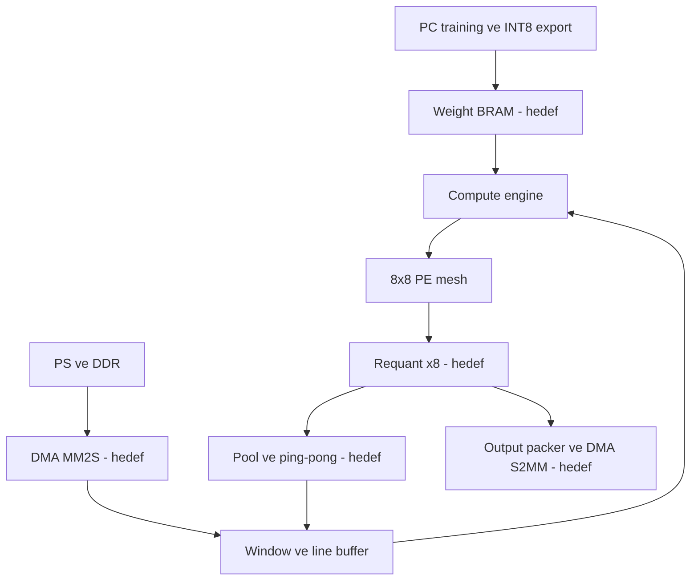
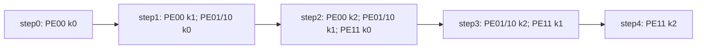
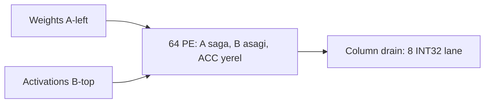
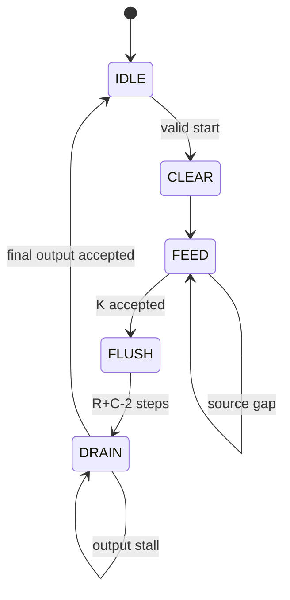
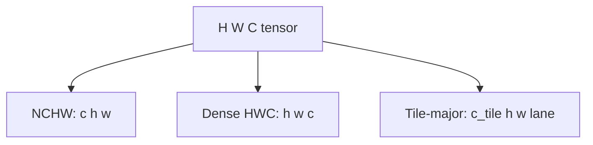
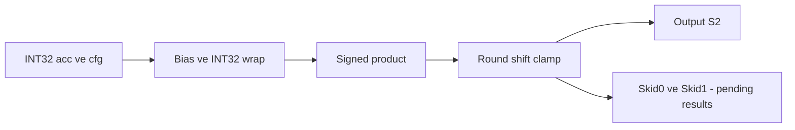

# 8×8 Systolic Array - Uçtan Uca Çalışma Kitabı

Emin için · Agâh · 02 Ekim 2026 · Kaynak kod üzerinden hazırlanmış v1.0

Bu kitap mimariyi, matematiği, SystemVerilog implementasyonunu, Python reference modellerini, testbench'leri ve hedef PS/PL sistemini birlikte açıklar. Her bölümün yanında ve altında not alanı vardır. Bölüm numarası + soru numarasıyla geri dönebilirsin: örneğin “B13-S2: stall sırasında skew neden donmalı?”

## B01 · Bu kitap nasıl okunmalı ve neyi gerçekten biliyoruz?

İlk turda B02-B07 ile sistemin ne hesapladığını kavra. İkinci turda B08-B18 ile clock kenarında verinin nasıl hareket ettiğini izle. Üçüncü turda B19-B25 ile ML, quantization ve RTL arasındaki sayısal kontratı çalış. Son turda B26-B35 ile PS, AXI, doğrulama ve performansı birbirine bağla. Ek A'da bütün güncel RTL / Python / testbench / Vivado kaynakları satır numaralarıyla bulunur; bir kavramı okuduktan sonra ilgili dosyaya geç.

Üç kanıt etiketi kullanıyoruz. **KOD:** diskteki implementasyonda doğrudan mevcut. **KONTRAT:** ADR'de tarif edilmiş, henüz tamamı uygulanmamış olabilir. **TÜRETİM:** kaynaklardan matematiksel olarak çıkardığımız sonuç; bir kart ölçümü değildir. Öğretici pseudo-code açıkça örnek olarak işaretlenir.

İncelenen kanonik içerik vault'un `🏰 300-Projects/systolic-array-8x8/` klasörüdür. Vivado için ASCII çalışma kopyası `C:/grad-rtl/systolic-array-8x8/` bulunur. Bu kitap hazırlanırken 24 kaynak dosyasının iki kopyası LF-normalize içerikte birebir aynı bulundu. Snapshot hash'leri Ek B'dedir. Mevcut proje dosyaları bu çalışma sırasında değiştirilmedi.

**KOD:** synthesis top yalnız `systolic_array_8x8 → compute_engine → systolic_array_os → 64 × pe_os` zinciridir. `window_gen → line_buffer` ayrı bir hiyerarşidir. `requant_unit` ve `axi_lite_regs` de bağımsızdır. Window testbench'i ilk Conv1 tile'ında generator ile engine'i bağlar; bu dar integration testi tam CNN entegrasyonu değildir.

**KAYITLI SONUÇ:** 27 Eylül notlarında XSim 6/6 PASS vardır. Bu oturumda uzun HDL regression ve synthesis yeniden koşulmadı. Python self-check'leri yeniden çalıştırıldı: engine, window, requant ve dört cycle-model case geçti. Vektör üreticisinin güncel çıktısı bellekte **60.750** örnek olarak doğrulandı; eski nottaki 60.748 sayısına sonradan eklenen iki bypass/saturation örneği dahildir.

**BULUNAMAYAN KAYNAKLAR:** vault'ta gerçek training script'i, `cnn_pipeline/model.py`, checkpoint, calibration dataset, trained weight `.coe` dosyaları ve çalışan PYNQ driver'ı yok. Model mimarisi ADR-002 ve arayüz notlarından açıklanır. Eğitim accuracy'si, optimizer, epoch, learning rate, gerçek scale'ler ve trained logits uydurulmaz. Ortak repo için erişilebilir bir kaynak gövdesi de bu incelemede alınamadı.

? B01-S1: Birim testlerin yeşil olması ile tüm LeNet inference'ının çalışması arasında hangi bloklar eksik?

## B02 · Bir görüntüden sınıf sonucuna: büyük resim

Hedef ürün, PYNQ-Z2 üzerinde INT8 LeNet-5 inference'ı yapan bir accelerator'dır. PS, Cortex-A9 işlemci ve yazılım ortamıdır. PL, FPGA fabric içindeki custom RTL ve Xilinx IP'leridir. Eğitim PC'de yapılır. FPGA eğitim yapmaz; sabit ağırlıklarla forward inference yürütür. Array de kendi başına görüntüyü veya sınıfı tanımaz; ona verilen iki integer stream'in dot product'larını hesaplar.



**KONTRAT, hedef akış:** PC training → calibration → INT8 weight/bias/scale export → BRAM initialization + integer golden → PS görüntüyü hazırlar → DDR input buffer → AXI DMA MM2S → input adapter / line buffer → window generator → weight feeder ile paired engine input → 8×8 MAC array → sekiz requantizer → ReLU / MaxPool → activation ping-pong memory → sonraki layer. Son FC katmanından 10 logit ve status çıkar; output packer → DMA S2MM → DDR → PS sonucu okur.

İki ayrı yol vardır. **Data plane** görüntü ve sonuç byte'larını AXI4-Stream ile taşır. **Control plane** layer parametrelerini, START / RESET komutlarını ve status okumalarını AXI4-Lite ile taşır. Ağırlıkların başlangıç planı DMA ile her frame yeniden taşınması değil, bitstream/BRAM initialization ile yüklenmesidir. Çalışma sırasında weight loading daha sonraki bir özelliktir.

Bir katmanın sonuçları sonraki katmanın girdisidir. Tek bir array zaman içinde Conv1, Conv2, FC1, FC2, FC3 için yeniden kullanılır; beş bağımsız array yoktur. Layer sequencer hangi buffer'ın okunacağını, hangi weight bankasının adresleneceğini, aktif row / column sayısını ve quantization parametrelerini belirlemelidir. Bu sequencer henüz kaynaklarda bulunmaz.

Compute engine'in input beat'i 64-bit weight + 64-bit activation'dır. Output beat'i ise sekiz INT32 accumulator, yani **256 bit** taşır. Bu internal interface bir 64-bit AXI output değildir. Requantizer'lar sekiz değeri INT8'e çevirirse bir output pixel/channel-group 64 bit'e iner. Final bypass'ta INT32 logit packing için ayrı width adaptation gerekir.

PS/DDR tarafındaki host double buffering ile PL içindeki iki activation buffer farklı amaçlara hizmet eder. İlkinde DMA ve CPU işleri overlap edilir. İkincisinde bir layer'ın girdisi okunurken çıktısı eski girdiyi ezmeden başka belleğe yazılır. ADR-007'de host buffering'in ertelenmesi ile ADR-018'de internal ping-pong planı bu nedenle aynı karar değildir.

? B02-S1: Weight stream ve input DMA stream neden aynı veri değildir?

## B03 · LeNet-5 geometry: her layer'ın shape'i ve işi

**KONTRAT:** batch=1, girdi 32×32×3 RGB INT8; 5×5 stride=1 valid convolution; 2×2 stride=2 MaxPool; Conv1 6, Conv2 16 output channel; FC 400→120→84→10. Model notu `LeNet5ReLUMaxPool` adını verir. Bu, klasik LeNet'in bütün tarihsel ayrıntılarının aynısı olmak zorunda olmayan proje varyantıdır.

| Layer | Input | Output | K | Weight / bias sayısı |
|---|---|---|---:|---|
| Conv1 | 32×32×3 | 28×28×6 | 75 | 450 / 6 |
| Pool1 | 28×28×6 | 14×14×6 | - | 0 / 0 |
| Conv2 | 14×14×6 | 10×10×16 | 150 | 2400 / 16 |
| Pool2 | 10×10×16 | 5×5×16 | - | 0 / 0 |
| FC1 | 400 | 120 | 400 | 48000 / 120 |
| FC2 | 120 | 84 | 120 | 10080 / 84 |
| FC3 | 84 | 10 | 84 | 840 / 10 |

Convolution boyutu `out = floor((in + 2·pad - kernel)/stride) + 1` olur; burada dilation=1. İlk katmanda `(32-5)+1=28`. Pooling 28'i 14'e indirir. İkinci convolution `(14-5)+1=10`, pooling 10'u 5'e indirir. Flatten 16·5·5=400 eleman verir. “K=400” array boyutu değil, her FC1 output'unun 400 product toplaması demektir.

Toplam weight sayısı **61.770**, toplam bias sayısı **236** olur. INT8 weights 61.770 byte, INT32 biases 944 byte tutar; bank alignment, padding, M0/n table ve BRAM granularity bunlara eklenir. FC1 weights toplam weight'lerin yaklaşık %77,7'sidir. “Küçük CNN” demek tüm katmanların bellek maliyetinin birbirine yakın olması demek değildir.

Pooling'ler dışında toplam faydalı MAC sayısı **651.720**: Conv1 352.800; Conv2 240.000; FC1 48.000; FC2 10.080; FC3 840. Bias addition bu MAC hesabına katılmamıştır. Pooling compare'ları, ReLU, quantization ve DMA da MAC sayısı değildir.

MNIST reference aşaması ve hedef böcek sınıflandırma dataset'i proje planında yer alır. RGB modelde grayscale MNIST kullanılıyorsa resize / pad / channel replication politikası gerekir; bu politikanın gerçek script'i burada yok. Modelin 10 sınıf olması gerçek dataset class mapping'inin hangi türlerden oluştuğunu kanıtlamaz.

? B03-S1: Kernel 3×3 seçilse FC1 input niçin 400 kalmaz? B03-S2: Conv2 K hesabında fiziksel 8 channel padding'i mi mantıksal 6 channel'ı mı kullanmalıyız?

## B04 · Convolution gerçekten ne hesaplıyor?

Tek output değerinin index'lerini yazalım: `Y[co,oh,ow]`. Bu değer için `ci`, `kh`, `kw` üzerinden tüm product'lar toplanır. PyTorch Conv2d, kernel'i ters çevirmeyen cross-correlation kullanır. Dolayısıyla export edilen kernel'i RTL'de ikinci kez çevirmek yanlış olur. [Kaynak S1: PyTorch Conv2d]

```text
acc[co,oh,ow] = sum over ci,kh,kw:
  W[co,ci,kh,kw] * X[oh*stride-pad+kh,
                         ow*stride-pad+kw, ci]
a = wrap32(acc + bias_q[co])
y = requant(a, M0[co], n[co], relu)
```

Conv1'in bir output'u 3 channel × 5 row × 5 column = 75 product kullanır. Altı output channel için aynı pencere altı farklı kernel'le çarpılır. Komşu output pixel pencereleri büyük ölçüde aynı input byte'larını kullanır. Line buffer'ın varlık nedeni bu reuse'dur: her pencere için input frame'i DDR'den yeniden okumak yerine yakın satırlar PL'de tutulur.

**Öğretici küçük örnek:** tek channel, 3×4 input ve 2×2 kernel düşün. Input row'ları `[1,2,3,4]`, `[5,6,7,8]`, `[9,10,11,12]`; kernel `[1,0; -1,2]`. İlk pencere `[1,2;5,6]` → `1+0-5+12=8`. Bir sağdaki pencere `[2,3;6,7]` → `2+0-6+14=10`. Aynı kernel kullanılmış, farklı pencere seçilmiştir. Array columns bu farklı output pozisyonlarını temsil eder.

**Direct convolution** pencerelerin mantıksal `B[k,c]` matrisi gibi davranmasını sağlar ama bütün im2col matrisi DDR'de materialize edilmez. Conv1 için açık im2col matrisi `75×784=58.800` INT8 eleman olur; input 3072 byte olduğundan gerçek expansion yaklaşık **19,14×**'dir. “Kernel 5×5, expansion 25×” kaba bir söylemdir; output geometry ve channel hesabıyla bu örnekte 19,14× çıkar.

Current generator bu reuse'u düşük port sayısıyla, serialized gather ile gerçekleştirir. Direct convolution seçilmiş olması kendiliğinden her cycle sekiz activation üretileceği anlamına gelmez. Throughput ayrıca bellek portu ve FSM tasarımına bağlıdır; B17 ve B34 bu farkı hesaplar.

? B04-S1: `ci` değiştiğinde spatial koordinat niçin tekrar aynı kernel konumlarına döner?

## B05 · CNN'yi GEMM olarak düşünmek: M, N ve K

Array `C = A × B` hesaplar. `A[M,K]` ağırlık, `B[K,N]` activation pencere matrisi, `C[M,N]` output accumulator matrisi olsun. Proje eşlemesi **row=M=output channel**, **column=N=output position**, **K=reduction**'dır. Conv2 M=16 olduğu için output channels iki row tile'a bölünür; array'in fiziksel row sayısı hâlâ 8'dir.

| Eksen | CNN karşılığı | Array'de ne olur? |
|---|---|---|
| r / M | Output channel | Bir PE row'u, bir weight stream |
| c / N | Output pixel veya FC batch item | Bir PE column'u, bir activation stream |
| k / K | ci·kH·kW veya FC input index | Zaman içinde ardışık paired beat |

`PE[r,c]` yalnız o channel ve o position'ın partial sum'ını tutar. Ağırlık soldan girip row boyunca sağa ilerler; aynı weight sekiz position'a uygulanır. Activation üstten girip column boyunca aşağı ilerler; aynı activation sekiz output channel'a uygulanır. Bu paylaşım her accepted input beat'in en fazla 64 MAC üretmesini sağlar.

**Output-stationary:** sabit duran şey partial sum'dır. Weight'ler sabit durmaz; K boyunca yenileri gelir. `weight-stationary` mimaride weight'lerin PE içinde tutulması farklı bir dataflow'dur. Bu projedeki `pe_os` adındaki `os`, output-stationary anlamına gelir.

Tile, fiziksel array'e sığan output altmatrisidir. `active_rows` ve `active_cols` 1..8 olur. Tile K dimension'ının 8 olması gerekmez: bugün synthesis top `K_MAX=1024` sınırına kadar tek reduction çalıştırır. FC1 K=400, tek output tile boyunca 400 paired beat'tir. README'nin “K tavanı yok” ifadesi, eski K=8 chunk sınırının kalktığını anlatır; gerçek yeni sınır **1024**'tür.

FC'de batch=1 olduğundan N=1; array'in yalnız bir column'u faydalı iş yapar. FC1'in 120 output'u 15 row tile gerektirir, her tile 8×1 ve K=400'dür. K'yi sekiz column'a dağıtıp partial sums'ı toplama fikri `K-split + adder tree`'dir; current RTL bunu implement etmez.

? B05-S1: Conv'da N neden input pixel sayısı değil output pixel sayısıdır? B05-S2: 8×8 array FC1'i 8 input'la mı sınırlıyor?

## B06 · Elle çözülmüş 2×2 × K=3 örneği

Bu örnek gerçek INT8 portlarına sığar. `A=[[2,-1,3],[1,4,-2]]`, `B=[[5,2],[-3,1],[4,-2]]` seçelim. A'nın row'ları iki output channel'ın weight dizileridir. B'nin column'ları iki output pozisyonunun activation dizileridir. Bias henüz eklenmez.

```text
C[0,0] = 2*5 + (-1)*(-3) + 3*4   = 25
C[0,1] = 2*2 + (-1)*1    + 3*(-2) = -3
C[1,0] = 1*5 + 4*(-3)   + (-2)*4 = -15
C[1,1] = 1*2 + 4*1      + (-2)*(-2) = 10
```

Engine configuration `active_rows=2`, `active_cols=2`, `k_len=3` olur. k=0 source beat'inde weight lane0=2, lane1=1; activation lane0=5, lane1=2. k=1'de weight `[-1,4]`, activation `[-3,1]`; k=2'de `[3,-2]` ve `[4,-2]`. Inactive lanes sıfır tutulur. Bu beat'ler source tarafında henüz skew edilmemiştir; engine triangular delay banks ile hizalar.

Drain **column-major beat** düzenindedir. İlk beat `out_col=0` ile `[25,-15]`; ikinci beat `out_col=1` ile `[-3,10]`. Lane0 her beat'te channel0, lane1 channel1'dir. Array'in internal flatten sırası ise row-major'dur: `[C00,C01,C10,C11]`. Engine bu internal matrix'ten o anki column'u seçer.

Bytes two's complement taşınır: `-1=0xFF`, `-2=0xFE`, `-3=0xFD`. Source'ın ilk weight beat'i alt 16 bitte `0x0102` olur; lane0 low byte'tır. İkinci beat alt 16 bitte `0x04FF` olur. Bu little-endian lane konvansiyonu sayıların işaretini değiştirmez; signed yorum port / cast tarafından yapılır.

Current engine'in stallsız cycle_count'u `1 CLEAR + 3 FEED + 2 FLUSH + 2 DRAIN = 8` olur. START kabul edge'i bu sayaca dahil değildir. Faydalı MAC sayısı `2·2·3=12`'dir. Fiziksel 8×8 donanımda bu küçük örneğin düşük utilization'ı tasarım hatası değil, küçük iş yükünün sonucudur.

? B06-S1: Drain'de `[-3,10]` neden aynı row'un iki sonucu değildir? B06-S2: İlk beat'i hex yazarken byte sırası nasıl oluştu?

## B07 · Wavefront ve skew: operandlar nasıl aynı anda buluşuyor?

Skew olmadan row1'in ağırlığı PE10'a hemen gelir, fakat ona eşlik etmesi gereken activation PE00'dan bir edge sonra iner. Yanlış k'ler çarpılabilir. Çözüm: row r weight stream'ini r step, column c activation stream'ini c step geciktirmek. Array forwarding register'ları da yol üzerinde operandları birer step geciktirir.

`A[r,k]` array sol kenarına `t=k+r`, `B[k,c]` üst kenarına `t=k+c` step'inde gelir. A c hücre sağa, B r hücre aşağı ilerleyince ikisi `PE[r,c]`'de **t=k+r+c** anında buluşur. Buradaki t, duvar clock'u değil başarılı array ilerlemelerinin index'idir; source stall varsa tüm yapı donar.



2×2, K=3 örneğinde step0 PE00 k0'ı işler. Step1 PE00 k1, PE01 ve PE10 k0'ı işler. Step2 PE00 k2, PE01 ve PE10 k1, PE11 k0'ı işler. Step3 PE01 / PE10 k2 ve PE11 k1; step4 PE11 k2. Artık dört accumulator da tamamlanmıştır.

Son MAC index'i `(K-1)+(R-1)+(C-1)=K+R+C-3` olur. Sıfırdan başlayan index sayısı `K+R+C-2` step'tir. K FEED step'inden sonra **R+C-2 FLUSH step'i** gerekir. Tam 8×8'de bu 14'tür. Partial 6×4 tile'da 8'tir; current engine physical boyut yerine active boyutları kullanır.

FLUSH state zero/invalid yeni edge verisi sürerek daha önce accepted olmuş operandları PE'lerin sonuna taşır. Bu, `pipe_flush` sinyalinden farklıdır. `pipe_flush` forwarding register'larını temizleyip pending işi yok eder; current engine bunu CLEAR sırasında kullanır. İsim benzerliği nedeniyle ikisini karıştırmak kolaydır.

Stall bir veya birkaç clock sürebilir. O sırada PE forwarding, PE accumulator, skew registers ve k_count birlikte hold etmelidir. Yalnız accumulator'ı durdurup operandları ilerletmek veri düşürür. Yalnız k_count'u durdurmak repeated MAC'e neden olabilir. Current paired-handshake tasarımı bu state'leri aynı `array_step` altında bağlar.

? B07-S1: PE11'in ilk MAC'inin neden step2'de olduğunu çizerek göster. B07-S2: FLUSH state'inde `pipe_flush=1` yapsak ne kaybolur?

## B08 · SystemVerilog okuma rehberi: syntax'ın donanım karşılığı

`logic` bir sinyal tipidir; tek başına “register” demek değildir. `always_ff @(posedge clk)` içindeki assignment'lar state tutan flip-flop / DSP register mantığını ifade eder. `always_comb` veya `assign` kombinasyonel hesap / bağlantıyı ifade eder. Bu ayrımı her dosyada önce işaretle: hangi değerler clock edge'inden sonra değişir, hangileri input değişince yeniden hesaplanır?

```systemverilog
logic signed [7:0] x;          // 8-bit two's complement
logic [63:0] beat;             // packed bus, 8 byte
logic signed [7:0] pipe[0:7];  // unpacked array, 8 signed entry
beat[r*8 +: 8]                // r*8'den başlayan 8 bit
acc <= acc + product;         // edge'de eski acc'den yeni acc
```

Nonblocking `<=` sağ tarafta eski state'i kullanır; yeni değerler NBA update phase'inde birlikte görünür. Bir PE'nin `a_out <= a_in` işlemi komşu PE'ye aynı edge'de yeni A'yı kullandırmaz. Komşu o edge'de eski forwarding output'u kullanır; bu yüzden her hücre bir cycle gecikmedir. Python cycle modelindeki `next_a / next_b` dizileri aynı prensibi uygular.

`parameter` elaboration zamanında donanımı belirler. ROWS/COLS/bit width değiştirmek yeni hardware oluşturur; runtime register yazmak değildir. `active_rows`, `active_cols`, `k_len` ise her start'ta örneklenen runtime configuration'dır. `window_gen` geometry'si bugün parameter'dır; LAYER_CFG yazmak mevcut module instance'ını 32×32'den 14×14'e dönüştürmez. Dynamic geometry için yeni decode/datapath tasarımı gerekir.

`genvar` ve `generate for` loop'ları clock'ta dönen yazılım loop'u değil, parallel instance üreticisidir. Mesh'teki 8×8 generate 64 gerçek PE oluşturur. `always_comb for` loop'unda accumulator işlemleri olsaydı sentez uzun combinational chain üretebilirdi; loop görmek otomatik cycle reuse demek değildir.

`$signed(...)` bit örüntüsünü signed yorumlar; çoğu kullanımda bit width'ü artırmaz. Sign extension ayrıca gerekir: `{{16{product[15]}},product}`. `>>>` signed sol operand üzerinde arithmetic shift'tir; `>>` logical shift'tir. Bir concatenation çoğunlukla unsigned olduğundan cast önemlidir. Unsized integer literal ve expression width'e dikkat et; Python `int` sınırsız, RTL fixed width'dür.

`rst_n` active-low anlamını isimde belirtir. Buradaki modüller `always_ff @(posedge clk)` kullandığı için reset **synchronous**'dur. Port adında `_n` olması async reset yapmaz. `always_ff @(posedge clk or negedge rst_n)` olsaydı async assertion hardware'ı tarif ederdi.

`.*` aynı isimli portları otomatik bağlar. Top wrapper'da sadeleştirir, ama yeni port eklerken aynı isim / width / direction kontrolü gerekir. `initial $error` parameter guard'ları ağırlık veya görüntü datasının hardware'da runtime kontrolü değildir.

? B08-S1: `generate` loop ile `always_ff` içindeki loop'un hardware farkı nedir? B08-S2: NBA yüzünden komşu PE hangi A'yı görür?

## B09 · pe_os.sv: en küçük compute birimi

**Kaynak:** `rtl/pe_os.sv`, 81 satır. Önce parameter ve ports (DATA_WIDTH=8, ACC_WIDTH=32), sonra combinational product / fire, sonra sequential forwarding ve accumulator bloklarını oku. Tam kaynak Ek A'dadır.

| Sinyal | Görev | Hold / öncelik |
|---|---|---|
| step | PE'nin compute/forward ilerlemesi | 0 ise normal forwarding ve MAC durur |
| clear_acc | Yeni dot product için acc'yi sıfırlama | MAC'ten öncelikli; step şartı yok |
| pipe_flush | A/B ve valid state'ini temizleme | Forwarding'de step'ten öncelikli |
| a_in / b_in | Signed operandlar | Product combinational hesaplanır |
| a_valid / b_valid | Operandın anlamlı olduğunu gösterir | İkisi de 1 olmadan MAC yok |
| acc_out | Yerel INT32 partial sum | Forwarding'den ayrı state |
| mac_fire | Bu edge'de MAC enable koşulu | Registered pulse değildir |

`product=a_in*b_in` 16-bit signed'dır. `product_ext` işareti 32 bit'e genişletir. `mac_fire = step && a_valid_in && b_valid_in && !clear_acc && !pipe_flush`. Product combinational hesaplanabilir ama `mac_fire=0` ise acc'ye yazılmaz. Zero data ile invalid data aynı şey değildir: valid zero product matematiksel olarak 0 katkıdır; invalid bubble hiçbir product sayılmaz.

Reset sırasında forwarding data/valid ve acc sıfırlanır. Normal durumda `pipe_flush` forwarding'i temizler, yoksa `step` forwarding'i günceller. Ayrı accumulator kararında `clear_acc` varsa zero, yoksa `mac_fire` varsa `acc+product_ext`; kalan durumda hold. `clear_acc` yalnız acc'yi temizleyebilir; `pipe_flush` yalnız operand zincirini temizleyebilir. Engine yeni tile için ikisini birlikte kullanır.

Signed sınır örneği: `-128×127=-16256`; sonraki `-128×-128=16384`, sum=128. `tb_pe_os` bunu kontrol eder. Product'ı 8 bit'te tutsaydık exact 16-bit sonuç kaybolurdu. Accumulator'a INT8 saturation koymak da reduction'ı bozardı; saturation yalnız requant output'unda yapılır.

Accumulator overflow modulo 2^32 wrap'tir. `2147483647+1` → `-2147483648`. Bu PE overflow flag çıkarmıyor; `mac_fire` sayısı var, overflow detector yok. Sistem status'taki `acc_ovf_seen`'in bütün MAC overflow'larını gördüğü iddia edilemez. Current requant `out_ovf` yalnız bias addition overflow'unu bildirir. Gerçek ağda MAC bound'u düşük olduğu için export proof bu ayrımı kapatmalıdır.

`(* use_dsp="yes" *)` senteze niyet bildirir. Tek PE'nin DSP48E1'e map edilmesi source syntax'tan kesin olarak ispatlanmaz. OOC netlist primitive count bunu ölçer. DSP48E1'in native multiplier'ı signed 25×18'dir; INT8×INT8 içine sığar. [Kaynak S2: AMD UG479 / UG953]

? B09-S1: `clear_acc=1,step=0` iken accumulator ne olur? B09-S2: `pipe_flush=1` acc'yi de sıfırlar mı?

## B10 · systolic_array_os.sv ve sabit 8×8 wrapper

**Kaynak:** `rtl/systolic_array_os.sv`, 79 satır. Mesh aritmetiği yeniden yazmaz; PE'leri birbirine bağlar. A links `[ROWS][COLS+1]`, B links `[ROWS+1][COLS]` biçimindedir. Fazladan edge elemanı ilk input ve son forwarded output bağlantılarını mümkün kılar. A valid ve B valid için paralel link dizileri vardır.



Sol edge'de `a_left_flat[r*DATA_WIDTH +: DATA_WIDTH]` signed cast ile row r'ye girer. Üst edge'de B lane c column c'ye girer. PE[r, c]'nin A output'u `a_link[r][c+1]`, B output'u `b_link[r+1][c]` olur. Yatay / düşey hareket ayrı register zincirleridir; accumulator hiçbir komşuya aktarılmaz.

`PE_INDEX=r*COLS+c` row-major flatten index'tir. Varsayılan 8×8 ve INT32 için `C[r,c]` bit slice'ı `[(r*8+c)*32 +: 32]` olur. PE00 bits31:0, PE01 bits63:32, PE10 bits287:256. `mac_fire_flat` de aynı PE index'ini kullanır. Packed bus unsigned olsa bile INT32 slice'ı `$signed` ile yorumlandığında negatif sayı korunur.

Mesh **hazır skew edilmiş** edge stream bekler. K counter, IDLE/FEED FSM veya source handshake yoktur; yalnız `step`, `clear_acc`, `pipe_flush` kontrolü vardır. Dolayısıyla mesh'i raw source lane'leriyle doğrudan besleyip correct matrix multiply beklemek yanlış olur. Skew compute_engine'in görevidir.

`rtl/systolic_array_8x8.sv` 36 satırlık sabit isimli top'tur. `compute_engine #(ROWS=8,COLS=8,K_MAX=1024,DATA_WIDTH=8,ACC_WIDTH=32)` instance'ını `.*` ile sarar. Yeni bir mathematical layer eklemez. Runtime k_len 11-bit'tir; 1024'ü temsil etmek için 10 değil 11 bit gerekir. ROW / COL count 4-bit'tir; 8'i temsil etmek için 3-bit yetersizdir.

Wrapper'ın `out_acc_flat=256 bit` olması mesh'in bütün accumulator'larının 2048 bit olarak dışarı çıktığı anlamına gelmez. Engine bir column seçip sekiz row accumulator'ını dışarı verir. Eski inceleme dokümanındaki 512/2048-bit demo ports current top'a ait değildir. Full mesh internal 2048-bit bus hâlâ vardır, fakat external interface streaming'dir.

? B10-S1: PE[3,5]'in accumulator bit başlangıcı nedir? B10-S2: Mesh neden `start` portuna ihtiyaç duymaz?

## B11 · compute_engine.sv: port kontratı ve state

**Kaynak:** `rtl/compute_engine.sv`, 294 satır. K-streaming controller hem wavefront timing'i hem output lifecycle'ını yönetir. DATA_WIDTH/ACC_WIDTH/ROWS/COLS parameter'dır, normal top 8×8'dir. K_MAX yeni finite sınırdır. ROW_W, COL_W, K_W `$clog2(max+1)` ile count değerlerini temsil eder.

| Port grubu | Kabul / üretim şartı | Anlamı |
|---|---|---|
| start, start_ready | IDLE ve start=1 edge'i | Boyutları sample et, tile başlat |
| active_rows / active_cols / k_len | Start'ta latch | 1..ROWS, 1..COLS, 1..K_MAX |
| weight_valid/data/ready | FEED ve iki valid birlikte | K'deki bir weight vector |
| activation_valid/data/ready | Aynı paired edge | Aynı K'nin activation vector'u |
| out_valid/data/ready | DRAIN handshake | Bir column, ROWS lane accumulator |
| out_lane_valid | DRAIN'de low rows_reg bitleri 1 | Inactive output channel'ları filtrele |
| out_col / out_k_last / out_last | Output ile birlikte stable | Column index / full K / tile sonu |
| done / config_error | Bir cycle pulse | Son drain kabulü / illegal config |
| cycle_count / drain_stall / mac_fire | Gözlem | Busy cycles / output blocked / PE work |

Runtime config register'ları `rows_reg`, `cols_reg`, `k_reg`; FEED sayaç `k_count`; FLUSH sayaç `flush_count`; DRAIN sayaç `drain_col` olur. Start kabulünden sonra dışarıdaki dimension input'larını değiştirmek current tile'ın hesabını değiştirmez. Weight/activation data ise ancak handshake anında sample edilir.

`weight_skew[r][d]`, `act_skew[c][d]` ve valid mirror'ları triangular delay banks'tir. Row0 / col0 paired source'un current beat'ini görür; row r>0 / col c>0 index r-1 / c-1 history entry'sini görür. Arrays rectangular declare edilmiştir ama kullanılmayan entries synthesis'te optimize edilebilir; mantıksal triangular gecikme toplamı her kenarda 0+1+...+7=28 byte'dır.

`out_acc_flat` current `drain_col` için mesh'in row-major internal bus'ından gather edilir. Inactive row value'ları CLEAR sonrası 0'dır, ama downstream yine `out_lane_valid`'i kullanmalıdır. Inactive lanes'i requant'a bias ile sokarsan 0 MAC bile nonzero output üretebilir; mask / output padding logic şarttır.

`busy` state≠IDLE'dır. `done` output'un sadece valid olmasına değil **son output beat'inin kabul edilmesine** bağlıdır. Consumer ready olmasa engine output'larını tutar ve busy kalır. Bu, tile acc'leri ezilmeden yeni start'a geçilmesini engeller.

? B11-S1: `out_last` bir CNN frame sınırı mı, engine tile sınırı mı? B11-S2: Inactive lane acc=0 iken bias'lı requant ne üretir?

## B12 · Engine FSM: IDLE → CLEAR → FEED → FLUSH → DRAIN



**IDLE:** `start_ready=1`, `busy=0`. start gelirse dimension guard uygulanır. Zero / büyük active row, zero / büyük column veya illegal K config_error pulse üretir; busy olmaz. Valid request config latch'ler ve CLEAR'a geçer. Busy state'lerde start dikkate alınmaz; start'ı level olarak sürekli tutan upstream IDLE'a dönüldüğünde istemeden tekrar başlatabilir. Güvenli kullanım tek kabul pulse'ıdır.

**CLEAR:** bir cycle `array_clear=1`, `array_flush=1`, `array_step=1`. PE acc'leri ve forwarding valid'leri sıfırlanır. Skew bankalarının CLEAR'da ayrı zero assignment'ı yoktur; reset onları temizler, normal tile sonunda FLUSH active history'yi boşaltır. Valid masking ile unused rows / columns dışlanır. Skew'i okurken `array_step && state!=CLEAR` koşulunu izle. Sonraki state FEED olur.

**FEED:** yalnız paired input acceptance'ta array_step=1. Her kabul k_count'u ilerletir. `k_count==k_reg-1` kabul edildiğinde K FEED tamamlanır. 1×1 tile ise hiç propagation gecikmesi yoktur ve doğrudan DRAIN'e geçilir. Diğerlerinde FLUSH'a geçilir. Son FEED edge'i bütün PE'lerin son MAC'inin aynı anda tamamlandığı edge değildir.

**FLUSH:** array her clock ilerler; source ready=0, source data kabul edilmez. Giriş skew bankalarına invalid zeros itilerek pending operandlar taşınır. `flush_target=rows_reg+cols_reg-2` step sonunda DRAIN'e geçilir. Partial tile daha kısa flush kullanır; daha uzak inactive PE'lerde hesap gerekmiyor.

**DRAIN:** array_step=0, accumulator'lar korunur. out_valid=1. Ready gelirse drain_col ilerler; son column kabulünde done=1 ve state=IDLE. Ready=0 ise out_data, mask, col, k_last, last sabittir. Tiles overlap etmez: output'un bitmesini bekler, sonra yeni CLEAR başlar.

Bu tasarım ikinci accumulator bankasını kullanmaz. 64×32=2048 bit C state'i zaten PE'lerde vardır; ikinci snapshot storage'dan kaçınmak için drain boyunca aynı state saklanır. Bedeli her tile için serial drain interval'idir. Gelecekte output snapshot + FIFO ile next tile overlap edilebilir, fakat current lifecycle bu değildir.

`cycle_count` reset'ten sonra state≠IDLE olan her edge'de artar; **start'ta sıfırlanmaz**. Dolayısıyla iki tile çalıştırdıktan sonra yalnız ikinci tile duration'ını vermez. Ölçümde önce/sonra farkını al veya reset sınırı tanımla. Counter 32-bit wrap olabilir. `done` ve `config_error` sticky değildir; AXI register block'taki DONE ise sticky W1C'dir.

? B12-S1: FEED'in bitmesi neden DRAIN için yeterli değil? B12-S2: cycle_count start'ta zero olmuyorsa bir tile'ı nasıl ölçersin?

## B13 · Handshake, stall ve bubble: verinin korunumu

Her transfer clock edge'inde `VALID && READY` ile kabul edilir. VALID=1 verinin mevcut olduğu, READY=1 consumer'ın kabul edebildiği anlamına gelir. VALID tek başına transfer değildir. Producer VALID'i READY'den bağımsız raise etmeli, blocked iken data ve metadata'yı stable tutmalıdır; aksi halde iki endpoint birbirini bekleyip deadlock olabilir.

```text
pair_ready = (state == FEED) && weight_valid && activation_valid
weight_ready = pair_ready
activation_ready = pair_ready
array_step = CLEAR || FLUSH || pair_ready
```

Weight valid=1, activation valid=0 ise iki ready de 0 olur. Weight producer pending K beat'ini tutar. Activation geldiğinde iki beat birlikte accepted olur. Weight data'sını valid olsa bile her clock değiştirirsen bekleyen weight kaybolur. Activation counter'ını consumer ready görmeden ilerletirsen k index'leri ayrışır.

| Clock slot | W valid | X valid | Paired transfer | Skew / array |
|---|---:|---:|---|---|
| 0 | 1 | 1 | K0 accepted | İlerler |
| 1 | 1 | 0 | Yok | Hold |
| 2 | 1 | 0 | Yok | Hold |
| 3 | 1 | 1 | K1 accepted | İlerler |
| 4 | 0 | 0 | Yok | Hold |
| 5 | 1 | 1 | K2 accepted | İlerler |

Current engine source starvation'ı temiz biçimde kaldırır. README'deki “çalışma başladıktan sonra kesintisiz feeder gerekir” cümlesi eski mimari varsayımıdır; KOD'da FEED tüm array/skew state'ini durdurabilir. Kesintisiz feeder ideal throughput için gerekir, numerical correctness için zorunlu değildir. Downstream out_ready, upstream pair_ready denkleminde bulunmaz; kombinasyonel backpressure yolu yoktur.

Bubble, geçerli token olmayan boş slottur. Array içinde valid bits hangi operandların gerçek olduğunu bildirir; FLUSH'ın zeros/invalid token'ları MAC sayılmaz. Stall bütün token'ların bulunduğu yerde beklemesidir. Bubble eklemek ile global hold aynı davranış değildir; current source gap hold kullanır, end-of-K propagation invalid bubble kullanır.

Data conservation mantığı: engine her input k'yi tam bir kez kabul etmeli; her active PE tam K MAC yapmalı; her tile tam active_cols output beat üretmeli. Requant'ta intentional dropped k_last=0 token'ları ayrıca sayılır. Bu invariants final sınıf doğru çıksa bile kayıp / duplicate bug'larını yakalar.

? B13-S1: İki source da VALID'i READY'den türetirse niçin transfer hiç başlamayabilir?

## B14 · Cycle hesabını edge üzerinden yapmak

Stallsız, active R×C tile için engine busy edge sayısı `Tcore = 1 + K + (R+C-2) + C` olur. Bir CLEAR, K accepted FEED, wavefront FLUSH, C accepted DRAIN. START'ın IDLE edge'i dahil değildir. Start-to-next-start süre hesabında request schedule ve IDLE acceptance slot'u ayrıca tarif edilmelidir; bu sayı tek başına tam frame latency değildir.

Örnek tam 8×8 K=400: `1+400+14+8=423` cycle. 100 MHz'de 4,23 µs. Faydalı MAC=64·400=25.600, fiziksel MAC capacity=64·423=27.072, slot utilization=%94,56. **400/414=%96,62** ise yalnız FEED+FLUSH array-run penceresinin utilization'ıdır; CLEAR ve DRAIN'i dışarıda bırakır. ADR-018'de 423 ile %96,6'nın birlikte yazılması denominator karışıklığıdır.

2×2 K=3 örneği için START edge'ine E0 diyelim. E1 CLEAR; E2/E3/E4 FEED k0/k1/k2; E5/E6 FLUSH; E6'dan sonra out_valid görünür. E7 first DRAIN kabulü, E8 last DRAIN kabulü ve done pulse. E6 sonrası çıkışı “görmek” ile E7 edge'inde “kabul etmek” farklı olaylardır.

Stall eklenince `T = Tcore + Sfeed + Sdrain`. Sfeed FEED'de pair_ready=0 clock sayısı, Sdrain DRAIN'de out_ready=0 sayısıdır. FLUSH her clock ilerlediği için source stall'a tabi değildir. Engine cycle_count'u bu busy clock'ları sayar; current top ayrı stall_in counter üretmez, AXI register file stall_in'i dışarıdan input olarak bekler.

Mesh only `verify_architecture.py` run_cycles'i `K+R+C-2` hesaplar. CLEAR/DRAIN/FSM/start yaşam döngüsü bu modelde yoktur. Dolayısıyla cycle modelin 22 run cycle sonucu, engine'in K=8 tam tile busy duration'ının 22 olduğunu göstermez: engine için 1+8+14+8=31 cycle çıkar.

Throughput ve latency ayrı kavramlardır. Uzun K'de FEED bir pair/cycle sürdürülebilir; tek tile'ın total latency'si yine setup/flush/drain içerir. Current tiles serial olduğundan tile throughput'u bu bütün lifecycle'a bağlıdır. Pipelined requant'ın bir result/cycle olması engine'in her cycle bir output üretmesi anlamına gelmez; output yalnız DRAIN burst'ünde vardır.

? B14-S1: 6×4, K=75 tile'ın Tcore değeri kaçtır? B14-S2: WNS veya 64 MAC/cycle'dan frame fps'ini doğrudan bulabilir miyiz?

## B15 · Partial tile ve K-streaming ayrıntıları

Physical array 8×8 olsa da active_rows/cols daha küçük olabilir. Row mask `((1<<rows_reg)-1)` biçiminde low R bits'i açar. Source valid masking yalnız active rows / cols için token üretir. CLEAR tüm acc'leri sıfırlar; inactive PE'ler invalid operands nedeniyle MAC yapmaz. Inactive data'nın random olması, valid=0 doğruysa hesapta etkisizdir; output padding yine zero garanti etmelidir.

Conv1 row sayısı 6'dır. Her output satırının genişliği 28 olduğu için current window tile_x sırası 0,8,16,24 ve active_cols 8,8,8,4'tür. Son tile'ı 8 kabul etmek input sınırının dışındaki data'yı kullanır. Conv2 width10 için tile_x 0,8 ve cols8,2'dir. FC2 son row tile'da 84 mod8=4 active row; FC3 son tile'da 10 mod8=2 row vardır.

K-streaming'de tek tile için tüm K accepted pairs aynı accumulator'da birikir. Eski K_MAX=8 harness'ında K=400 için 50 chunk + dış partial sum accumulation gerekirdi. Current engine'de k_len=400 bir start'tır; output yalnız tamamlanmış reduction'dan sonra çıkar. `out_k_last` bu nedenle her DRAIN beat'inde 1'dir.

`out_last` yalnız drain_col==active_cols-1 tile bitişidir. Network frame TLAST üretmek için layer sequencer ayrıca son spatial tile, son channel tile, son layer ve packer'ın son payload beat'ini bilmelidir. Tile end flag'ini doğrudan DMA TLAST yaparsan her tile ayrı packet gibi görünür. Generator'ın `m_tile_last`'ı ise o tile'ın son **input K beat'i**dir; output drain end'iyle aynı an değildir.

Big-K test current normal top'ın sınırını değiştirmez. `tb_compute_engine` KMAX=131200 instance kurar ve -128×-128 product'larıyla K=131073 wrap testini gerçekleştirir. Signed pozitif sınır ilk kez K=131072'de aşılır; 131073 de geçerli directed test'tir. Default top K≤1024, gerçek ağ K≤400 olduğundan bu overflow model dışı verification boyutudur.

Bir K term'i düşerse veya iki kez kabul edilirse output matrix boyutu yine doğrudur; hata yalnız değerlerde görünür. Bu yüzden yalnız out_count ve last kontrolü yetmez. K-sensitive pattern, numerical scoreboard ve mümkünse MAC count birlikte gerekir. Current engine TB numerical pattern'lar içerir; waveform'da mac_fire toplamak ayrı bir doğrulama olabilir.

? B15-S1: Conv1 son spatial tile'ında kaç useful PE aktiftir? B15-S2: `m_tile_last`, `out_last` ve DMA TLAST üç farklı sınırı nasıl temsil eder?

## B16 · window_gen.sv: görüntüyü activation beat'lerine dönüştürmek

**Kaynak:** `rtl/window_gen.sv`, 233 satır. Input `s_data[63:0]` flat HWC image byte stream'i; output `m_data[63:0]` aynı k'deki sekiz farklı output position'ın activation byte'larıdır. Bu iki 64-bit bus aynı packing anlamına gelmez. Input'ta sekiz ardışık storage byte; output'ta sekiz spatial window örneği vardır.

Önemli output metadata: `m_active_cols` right-edge lane sayısı; `m_k` reduction index; `m_tile_row` output y; `m_tile_x` ilk output x; `m_tile_start` k=0; `m_tile_last` k=K_LEN-1. Bunlar m_valid=1 ve m_ready=0 iken current counters/gather register değişmediği için stable kalır.

```text
K_LEN = C_IN*K_H*K_W
ci = k_count // (K_H*K_W)
kh = (k_count // K_W) % K_H
kw = k_count % K_W
source_row = out_y*STRIDE - PAD + kh
source_col = (tile_x+gather_lane)*STRIDE - PAD + kw
```

Loop sırası output row → row içindeki tile_x → ci → kh → kw'dir. k'de kw en hızlı, ardından kh, ardından ci değişir. Bu **channel-major K** sırasıdır ve PyTorch weight `[co,ci,kh,kw]` layout'una uyar. Input image HWC olduğu halde K sırasının HWC spatial-major olması zorunlu değildir; iki farklı order, adres hesaplayıcıyla bağlanır.

**ST_INPUT:** gerekli bottom row yazılana kadar line buffer input alır. Gerekli row'lar hazır ve write_busy=0 olduğunda input durdurulur ve ST_READ'e geçilir. **ST_READ:** gather_lane 0..7, her cycle bir byte okur; inactive/out-of-bounds lane'e zero yazar. Sekiz lane tamamlanınca ST_OUTPUT. **ST_OUTPUT:** valid beat'i consumer kabul edene kadar tutar. Kabulde bir sonraki k'ye, tile'a veya output row'a geçer. **ST_DONE:** done level'ı 1 kalır, reset gelmeden yeni frame başlatılmaz.

Current output rate stallsız durumda **8 READ + 1 OUTPUT = bir beat / 9 cycle**'dır. Partial tile'da iki active lane olsa bile gather_lane yediye kadar döner; sekiz READ slot yine kullanılır. Üretici bir beat/cycle engine'i saturation'a getiremez; paired-handshake engine beklerken state'i dondurur.

Module parametreli olsa da external widths 64-bit ve lane sayısı 8 hard-coded'dır. DATA_WIDTH=8 dışına genellenmiş olduğuna güvenme: beat slices `lane*DATA_WIDTH` ile değişir, 64-bit bus sabit kalır. `PAD≠0` sınır davranışı code'da zero üretebilir, fakat production frame kontratı ve corner-case tests tamamlanmış değildir. STRIDE / PAD her kombinasyonu için parametre kabul testleri de yoktur.

? B16-S1: Input bus'ın lane0..7'si ile output bus'ın lane0..7'si neden aynı koordinatlar değildir? B16-S2: Done olduktan sonra ikinci frame nasıl başlayabilir?

## B17 · line_buffer.sv: banking, ring ve satır sınırları

**Kaynak:** `rtl/line_buffer.sv`, 144 satır. K_H retained row için sekiz byte bankası tanımlar. `ROW_BYTES=IN_W*C_IN`, `BYTE_GROUPS=ceil(ROW_BYTES/8)`, `MEM_DEPTH=K_H*BYTE_GROUPS`; her bankada MEM_DEPTH byte entry vardır. Conv1 current storage 8·5·12=480 byte'tır. Bu implementasyon K_H row saklar; literatürdeki yalnız K_H-1 previous row + current window hesabı 384 byte'dır ve birebir aynı memory architecture değildir.

```text
logical_row_byte = column*C_IN + channel
bank = logical_row_byte % 8
address = (row % K_H)*BYTE_GROUPS + logical_row_byte//8
```

Ring slot row%K_H'dır; örneğin Conv1 row0 ve row5 aynı physical row slot'unu kullanır. Output row0 hâlâ row0..4'e ihtiyaç duyarken row5 yazılırsa row0 kaybolur. `window_gen` allow_input/resume_write ile ring overwrite'ı engeller. `rows_written` absolute completed row count'tur, physical slot index'i değildir.

Input beat accepted olunca 64-bit beat_reg'e alınır. `beat_pending` boyunca beat_lane 0..7 birer byte yazar. `s_ready` pending beat bitene kadar düşüktür. Stallsız baseline'da bir acceptance cycle + sekiz serialized write cycle gerekir; bu input yolu da line-rate sekiz byte/cycle write değildir.

Conv2 test fixture'ında dense input row `14*6=84 byte`'tır. 84 mod8=4; bir beat'in ilk dört byte'ı row sonunda, sonraki dört byte'ı yeni row'da olabilir. Input beat'i bölmeden hemen hepsini yazmak ring'in korunması gereken row'unu erken ezebilir. `row_pause` row boundary'de kalan beat lanes'i bekletir; resume_write onları güvenli zamanda sürdürür. `write_busy=beat_pending&&!row_pause`, pause sırasında read phase'e geçişe izin verir.

Read yolu **always_comb** içinde `byte_mem[bank][addr]` okur, registered synchronous BRAM read yoktur. `ram_style="block"` attribute'u gerçek block RAM inference kanıtı değildir. FPGA block RAM'in synchronous port davranışıyla bu read style'ın uyumu synthesis ve STA ile incelenmelidir. Current OOC top line_buffer'ı içermediğinden bankaların gerçekten BRAM'e map edildiği henüz doğrulanmış değil.

`rd_valid`, row<rows_written ve geometry limits kontrolü yapar; çok eski row'un ring'de overwrite edilmiş olup olmadığını kontrol etmez. Doğru request sırasını generator sağlamak zorundadır. RAM payload reset'te temizlenmez; valid/write counters reset olur. Stale RAM data'nın yanlışlıkla valid sayılmaması bu protokole bağlıdır.

`s_last` şu anda unused_s_last'a bağlanır; early/late TLAST denetlenmez. Frame bitişi TOTAL_BYTES counter'ından gelir. Dolayısıyla line buffer'da frame_done görmek DMA packet sınırının doğru olduğunu ispatlamaz. Input adapter layer'ı byte count ve TLAST sözleşmesini ayrıca doğrulamalıdır.

? B17-S1: Row4 sonrası pending beat'teki row5 byte'larını neden bekletiyoruz? B17-S2: `ram_style` neden BRAM ölçümünün yerini tutmaz?

## B18 · Generator ile engine entegrasyonu ve eksik sequencer

Current `tb_window_gen` ilk Conv1 tile'ında `window_gen` output'unu real `compute_engine` activation input'una bağlar. R=6, C=8, K=75; weights testbench function'dan gelir. Sonuç 6 channel × 8 position için integer sum ile kontrol edilir. Trained weights, bias, requant, pooling, DMA veya ikinci layer bu dar testte yoktur.

Testbench start mantığı ilk valid k=0 metadata'sını görünce engine'i start eder. `integration_started` yükselene kadar generator ready=0 tutularak ilk activation beat kaybolmaz. Engine CLEAR'ı bitirip FEED'e geldiğinde paired source accept başlar. Weight valid activation valid'e bağlanmıştır; weight function current m_k'yi kullanır. Bu, metadata timing'in öğretici bir örneğidir; genel layer controller implementasyonu değildir.

Full Conv2 için bir output-position tile'ının activation K stream'i iki channel tile'da kullanılmalıdır. Current generator her spatial tile'ı yalnız bir kez üretir; engine ilk 8 channels'ı bitirince aynı pencere akışının ikinci 8 channels için yeniden verilmesi gerekir. Current generator'da rewind / replay port yoktur. Gelecek entegrasyon: activation tile buffer + replay, generator traversal extension veya frame reread seçimi yapmalıdır. “Wire'ları bağlamak” bu problemi çözmez.

Pool1 sonrası storage 8-lane padded plan ise logical C_IN=6 ile packed dense HWC'yi aynı kabul edemezsin. Current conv2 fixture 1176 dense byte kullanır. Planned pool1 buffer 1568 padded byte'dır. Current `window_gen(C_IN=6)` line buffer adresi `w*6+ci` bekler. Araya storage adapter koymak veya physical stride/channel parameters eklemek gerekir; B19 layout tabloları bu gereksinimi açıklar.

Layer sequencer'ın görevleri: geometry seçmek; row / channel tiles'i dolaşmak; active_rows/cols ayarlamak; K sayaç / weight address yönetmek; requant config'i doğru channel group'a bağlamak; pooling output adreslerini üretmek; ping-pong swap; replay; next-layer start; final frame TLAST / frame_id / status; timeout/error recovery. Bu görevler current engine FSM'nin üstündedir.

Tek frame daha tamamlanmadan aynı module'leri ikinci frame için reset etmek, pending output'u silebilir. Global reset / soft-reset / frame-start ayrımı tasarlanmalı. `window_gen` sticky done ile reset bekler; engine start-ready tile reusable'dır; requant pipe output'u drain edilmelidir. Tam sistem controller bu farklı lifecycle'ları uzlaştıracak.

? B18-S1: Conv2'de aynı B[k, c] stream'i iki row tile'a nasıl tekrar sunulabilir? B18-S2: Full integration için “start” ile “frame-start” aynı sinyal olabilir mi?

## B19 · Tensor layout: NCHW, dense HWC ve tile-major HWC

Tensor geometry (H/W/C değerleri) ile physical memory layout farklıdır. Aynı 5×5×16 tensor üç farklı sırayla saklanabilir. Yanlış sıra çoğu zaman bus width / packet length hatası vermez; yalnız numerical outputs bozulur.



| Layout | Flat index / byte address | Kullanım |
|---|---|---|
| NCHW, batch1 | `(c*H+h)*W+w` | PyTorch channel-first tensor |
| Dense HWC | `(h*W+w)*C+c` | Current input / window reference |
| `[c_tile][H][W][8]` | `(((c//8)*H+h)*W+w)*8+c%8` | Planned intermediate buffer |

Input 32×32×3 HWC dolgusuzdur: 3072 byte, 384×64-bit beat. İlk beat ilk pixel'in RGB'sini, ikinci pixel'in RGB'sini ve üçüncü pixel'in ilk iki channel'ını taşır; bir beat bir pixel değildir. Little-endian lane mapping `byte_i → TDATA[8*(i%8)+:8]` olur. 0x80 signed -128, 0xFF -1 olarak yorumlanır.

Ara tensor'lerde channel count 8'e padded edilir. Conv1 28×28×6 → 6272 physical byte; Pool1 14×14×6 →1568 byte. Conv2 10×10×16 →1600; Pool2 5×5×16 →400. FC1 120; FC2 84→88. Her physical slotun padding byte'ı zero olmalı, padding mathematical K'ye gerçek channel gibi karışmamalıdır. Conv2 K=6·25=150 kalır; physical Cstride=8 ise addressing bunu ayrıca bilmelidir.

**FC1 kritik ayrıntı:** ADR-016 tek satır plain HWC weight permute gösterir. Ancak ADR-018'in tile-major 16-channel buffer'ı `[ct][h][w][lane]`'dir; plain `[h][w][c]` ile aynı değildir. H=5, W=5, C=16'da channel8, h=0, w=0 tile-major index200, dense HWC index8, NCHW index200 olur. Başka koordinatlar ayrışır: c=1, h=0, w=0 NCHW25, dense HWC1, tile-major1; c=8, h=1, w=0 NCHW205, dense HWC88, tile-major240.

FC1'e physical tile-major sırayı doğrudan feed ediyorsan weight columns da o sıraya permute edilmelidir. Öğretici PyTorch dönüşümü: `W.reshape(120,2,8,5,5).permute(0,1,3,4,2).contiguous().reshape(120,400)`. Alternatif: buffer reader'ı plain HWC order'ında gather edip ADR-016'nın plain HWC permute'unu korumak. Current full-model export olmadığı için hangisinin implement edildiği bilinmiyor; biri seçilip index-sensitive vector'la doğrulanmalı.

Hex memory file'da lane0 low byte olmalıdır: byte sequence `[01,02,03,04,05,06,07,08]` word `0807060504030201` yazılır. MSB-first hex text ile little-endian storage byte'larını karıştırma. `int.from_bytes(chunk,'little')` bu packing'i yapar.

? B19-S1: Physical pool1 byte1568 olması Conv2 K'yi 200 yapmalı mı? B19-S2: Tile-major ile dense HWC hangi channel sayısında doğal olarak aynı olabilir?

## B20 · Weight banking, addresses ve export formatı

**KONTRAT ADR-011:** sekiz BRAM weight bankası; `bank=co%8`, output channel tile=`co//8`, bank-local address=`tile*K+k`. K order `ci*(kH*kW)+kh*kW+kw`. Sekiz row her k'de aynı address'i farklı bankalardan okur. Bu, bir single dual-port memory'den sekiz bağımsız read istemekten kaçınır.

Conv2 co=11 için bank3, tile1. ci=2, kh=1, kw=4 ise k=2·25+1·5+4=59; K=150 olduğu için address=1·150+59=209. Source k59 beat'inde bank0 channel8, bank1 channel9, ... bank7 channel15 weights verir. Engine row skew bu eşzamanlı bank outputs'u row index kadar geciktirir.

Conv1 co=6 ve7 yoktur. Son row tile'daki inactive bank entries deterministic zero ile initialize edilmeli veya row valid mask ile dışlanmalıdır. Requant config commit bugün sekiz bankanın tamamını ister; inactive bank M0'sı da normalized legal değer olmalı, bias zero seçilebilir. Sadece active bankları yazarak written_mask tamamlanmaz.

```text
memory_initialization_radix=16;
memory_initialization_vector=
02, FF, 03, ...;
```

Bu `.coe` syntax'ı öğretici örnektir; gerçek training weight export değildir. `.coe` Vivado memory initialization formatı, `.mem` ise SV `$readmemh` test verisidir. Birini diğerinin yerine aynı dosya gövdesiyle kullanamazsın. `req_acc.mem` 32-bit acc örnekleri taşır; array weight bankası veya trained CNN parameters değildir.

Katman başına ayrı sekiz bank dosyası planı layer-select/address base tasarımı gerektirir. Current RTL'de weight BRAM module'ü, read-latency alignment veya feeder FSM yoktur. Engine weight_valid/data'yı dışarıdan alır. “Weights bitstream'e gömülü” mevcut engine'in içinde trained ROM bulunduğu anlamına gelmez; bu hedef yükleme politikasıdır.

Export'ta yapılacak doğrulamalar: dtype signed INT8; finite float; per-channel weight scale; bias INT32 range; M0/n normalization; exact bank/tile/k order; padded weight zero; header/checkpoint hash; class mapping; preprocessing metadata; FC1 layout transform; error bound. Bu işlemlerin gerçek script'i vault'ta bulunmuyor. B21-B23 matematiksel yöntemini açıklıyor.

? B20-S1: co=15, k=149 Conv2 hangi bank/address'ten okunur? B20-S2: BRAM'in registered read latency'si valid ve k sayaçlarını nasıl etkiler?

## B21 · Model tarafı: training'den export'a hangi bilgiler taşınır?

Training akışı input preprocessing → floating-point forward → loss → backpropagation → optimizer step şeklindedir. Inference yalnız forward'dur. Accelerator'a taşınacak bilgi weights / biases yanında preprocessing, class mapping, scale'ler ve tensor layout'tur. Bunlardan biri farklıysa doğru RTL yanlış uygulama cevabı üretebilir.

**Öğretici model iskeleti; vault'taki gerçek model.py değildir:**

```python
# PyTorch shape fikri; trained checkpoint veya çalıştırılan kod değil.
x = relu(conv1(x))        # NCHW: [1, 6, 28, 28]
x = maxpool2x2(x)         # [1, 6, 14, 14]
x = relu(conv2(x))        # [1,16,10,10]
x = maxpool2x2(x)         # [1,16, 5, 5]
x = flatten(x)           # [1,400], layout dönüşümü ayrıca gerekir
x = relu(fc1(x))         # [1,120]
x = relu(fc2(x))         # [1,84]
logits = fc3(x)          # [1,10], final ReLU kullanılmaz
```

FC activation ayrıntıları için gerçek model source doğrulanmalıdır; yukarıdaki iskelet proje topology'sinin öğretici normal uygulamasıdır. Doküman notu conv bloklarında Conv→ReLU→MaxPool olduğunu doğruluyor. Final logits'te softmax probability üretilebilir ama **argmax için softmax gerekmez**; pozitif ortak scale dönüşümü ve softmax class order'ı korur.

Preprocessing kontratı: input boyutu / RGB channel order / resize method / crop / per-channel mean-std / scale / quantization rounding / clipping / byte order. Örneğin training'de `(x/255-mean)/std` uygulanmışsa FPGA'ya çıplak 0..255 RGB'yi signed byte olarak göndermek yanlış olur; önce aynı normalization ve integer quantization yapılmalı. 255'i direkt INT8 cast etmek -1 bit örüntüsü verir, learned input semantics'ini üretmez.

Calibration, representative input'larla layer activation range'lerini ölçerek scale seçmektir; optimizer güncellemesi değildir. Training set, calibration set, validation/test set rolleri ayrıdır. Dataset / checkpoint olmadan “INT8 doğruluğu %X” hesaplayamayız. Hangi observer / clipping policy'nin kullanıldığı da gerçek export script'i olmadan bilinmez.

Export manifest ideal olarak şunları sabitler: checkpoint SHA-256; network geometry; class index→label; preprocessing; per-layer activation scale; per-channel weight scale; bias_q/M0/n; bank file hashes; tensor layout/padding; rounding rule; RTL/regmap version; sample input/output hashes. Bu manifest'in eksikliği hardware ile golden modelin aynı eğitim snapshot'ını kullandığını belirsiz bırakır.

? B21-S1: Input'u `uint8` görüntüden `int8` buffer'a cast etmek niçin quantization değildir?

## B22 · Quantization: scale, zero-point, bias ve multiplier

**ADR-003:** weight signed INT8 symmetric z=0 ve per-output-channel scale; activation signed INT8 symmetric z=0 ve per-tensor scale. Float approximation `x≈s_x*x_q`, `w_co≈s_w[co]*w_q` olur. INT8 bit örüntüsü fiziksel büyüklüğü scale olmadan tanımlamaz. Aynı integer10 farklı layer scale'lerinde farklı float değerlerdir.

Accumulator real-unit karşılığı `s_acc[co]=s_x*s_w[co]` olur. Bias aynı domain'de `bias_q=round(b_float/(s_x*s_w[co]))` seçilir. Bias'ı INT8'e quantize etmek veya output scale ile bölmek doğru değildir. Current requant unit bias'ı INT32 wrap addition ile accumulator'a ekler.

Bir sonraki layer'ın activation scale'i s_y ise integer output multiplier `M[co]=(s_x*s_w[co])/s_y` olur. Donanım float M almaz; `M≈M0*2^-n`, normalized M0 aralığı [65536,131072) ve n aralığı [0,63] alır. M0 anlamlı pozitif 17-bit değer olsa da signed operand uyumu için 18-bit signed register'da tutulur; bit17=0 kalmalıdır.

**Öğretici exact örnek:** s_x=0,02; s_w=0,05; s_y=0,08 → M=0,0125. M0=104857 ve n=23 seçilirse M≈0,01249993. acc=1000, bias=20 → a=1020; real≈1,02; output integer≈12,75→13; represent edilen output≈13·0,08=1,04. Bu bir trained channel'ın parametreleri değil, formula örneğidir.

Normalized multiplier seçiminin yöntemi: uygun n için `M0≈M·2^n` hesapla; rounding sonrasında M0 bounds'u kontrol et; representable M0/n pair'i seç; scale error'ı kaydet. Exact bir power-of-two örneği M0=65536, n=17 → M=0,5; n=16→M=1. `n=0` legal'dır ama M çok büyük olur; legal aralık ile trained modelde sık görülen aralık farklıdır.

Input/weight quantization'daki `round(...)` politikasını requant stage'in round-half-up kuralıyla otomatik özdeş kabul etme. Python built-in `round` ties-to-even kullanır. Checkpoint export bir kere belirlenen q weights / bias_q üretir; RTL aynı exported integers'ı tüketir. Integer golden→RTL bit-exact zinciri bunlar ve requant formula ile tanımlanır. Framework quantized backend'inin rounding'i ayrıca farklı olabilir.

Simetrik aktivasyonla ReLU sonrası signed negative range kullanılmaz; useful positive seviyeler 0..127'dir. Per-channel weight scale her output channel'ın dynamic range'ini ayrı kullanır. PyTorch observer'ları calibration için kullanılabilir; current signed INT8 kontratını otomatik her backend'in quantized kernel'i ile bit-exact sanmamak gerekir.

? B22-S1: bias_q niçin `s_y` yerine `s_x*s_w` ile ölçeklenir? B22-S2: M0'nun signed register'da bir extra sign bit'i neden var?

## B23 · Requant aritmetiği: wrap, rounding, shift, clamp

```text
a = wrap32(acc + bias_q)
p = signed64(a * M0)
half = 0 if n==0 else 2**(n-1)
y_raw = (p + half) arithmetic_shift_right n
lo = 0 if relu else -128
y = max(lo, min(127, y_raw))
```

Round-half-up tam eşitlikte +∞ yönüne gider. M0=65536, n=17 için a=5 → p/2^n=2,5 →3; a=-5→-2,5→-2. “Negatif sayıyı sıfırdan uzağa yuvarla” olsaydı -3 olurdu. Arithmetic right shift negatiflerde floor yapar: -5>>1=-3. Önce half offset eklemek floor-shift'i half-up'a dönüştürür; `n=0` için offset eklenmez.

Saturation örnekleri aynı M=0,5 ile a=300 →raw150→127, sat1; a=-300→raw-150→-128, sat1. ReLU açılırsa a=-20→raw-10→0, sat1. Current flag tanımı clamp tetiklenmesidir; ReLU alt clamp'i de sat_seen'e katkıda bulunabilir. `sat_seen=1` tek başına modelin başarısız olduğunu göstermez; flag'in bu geniş anlamını bilmek gerekir.

Bias overflow örneği acc=2147483647, bias1 → wrapped a=-2147483648, ovf1. Sonraki requant wrapped değeri kullanır. Float saturating addition yapılmaz. Python reference'da `wrap32` açık yazılır; sınırsız Python int addition'ı doğrudan RTL ile aynı değildir. Wrap addition associative olduğundan farklı MAC reduction order'ları aynı modulo sonucu verir; saturation addition böyle değildir.

Product'ın absolute bound'u normalized M0 ile <2^48. n63'te half=2^62; product+half <2^62+2^48 olduğundan signed64'e sığar. Sadece product için 50-bit yeterli olabilir, fakat rounding offset için 64-bit path gerekir. Shift count unsigned6'dır; arithmetic value signed kalmalıdır.

Bias hariç network maximum K400 için product bound=400·16384=6.553.600. Güvenli sufficient proof: `abs(bias_q)+K*16384 <= 2147483647`. Her exported bias için kontrol edilmelidir. Bound'un sağlanmaması overflow'un kesin olduğu anlamına gelmez, yalnız bu basit proof'un yetmediğini gösterir; actual range analizi gerekir.

**Final-logit ölçeği - açık entegrasyon koşulu:** per-channel s_w ile bypass ham acc'leri sınıflar arasında farklı scale taşır. Raw INT32'lere doğrudan argmax ancak final `s_x*s_w[co]` ortaksa veya önceden common-domain conversion yapılmışsa doğrudur. Örnek: q0=100, scale 0=0,01→1; q1=90, scale 1=0,02→1,8. Raw argmax class0 seçer, gerçek class1'dir. ADR-016 raw-logit packet'i bu koşulu tek başına çözmez. Final layer ortak weight scale, ortak INT32 rescale veya PS'te dequantized argmax seçimi netleştirilmelidir; current sources bunu kanıtlamaz.

? B23-S1: -2,5 half-up kaç olur? B23-S2: Neden final ham acc'lere argmax her zaman güvenli değildir?

## B24 · requant_unit.sv: S0, S1, S2 ve debug bypass

**Kaynak:** `rtl/requant_unit.sv`, 396 satır. Tek instance **bir lane**'i işler; engine'in sekiz output channel lane'i için sekiz instance veya serialization gerekecektir. Current source file'da sekiz-unit wrapper yoktur. Default ACC_W32, M0_W18, PROD_W64, LAT3'tür.



**S0:** signed33 addition ile full acc+bias, low32 wrapped a ve signed overflow condition hesaplanır. Aynı accepted sample ile cfg_m0, shift, relu, bypass, last, ovf register edilir. **S1:** widened signed multiplication; a'nın bypass kopyası ve config metadata ileri taşınır. **S2:** product+half, arithmetic shift, clamp; y/raw/last/sat/ovf result queue'ya eklenir.

Config sample ile pipeline'da taşınır; S1'in aynı cycle'da dışarıdaki yeni cfg'yi okuması yoktur. Bu, channel tile boundary'de parametre güncellenirken pending sample'ın eski parametresini korur. `cfg_*` yine input handshake'te correct lane / channel için doğru olmalıdır; capture yanlış bank seçimini düzeltmez.

`in_valid && in_ready` accept'tir. `in_k_last=0` örnek normal handshake ile tüketilir fakat `s0_valid=0` olduğundan output üretmez. Bu blok partial sums biriktirmez, drop eder. upstream completed reduction sunmalıdır. `in_valid && in_last → in_k_last` SVA assertion'ı illegal frame/tile marker'ı yakalar; antecedent'in ready şartı yoktur, valid pending token'da da legal olmalıdır.

**Bypass:** raw output wrapped bias-added a'nın sign-extended64 halidir; multiplier/round/shift sonucu seçilmez. y INT8 debug clamp olarak tanımlı kalır, fakat downstream final logits için **out_y_raw[31:0]** kullanmalıdır. `out_sat=0` bypass'ta zorunludur; `out_ovf` bias overflow flag'i yine geçerlidir. Bypass combinational shortcut değildir; aynı S0/S1/S2 latency'sini kullanır.

LAT parameter'ını 4 yapmak current RTL'ye dördüncü register eklemez; code `LAT!=3` için warning üretir. Current implementation fixed3-stage'dir. LAT3 protocol simulation'da doğrulanmıştır; 100 MHz setup timing'i ayrı synthesis/STA gerektirir. Requant current OOC top dışında olduğu için S2'nin gerçek 100 MHz timing margin'i bilinmez.

DSP48E1 25×18 multiplier'ın 32×18 product'ı tek native DSP'ye sığmaz; yaklaşık iki DSP/lane tahmini vardır. Synthesis tool decomposition, attributes ve optimizations sonucu gerçek count ölçülmelidir. 64 array +8·2=80 DSP hesabı **tahmindir**, measured full-system utilization değildir. 64-bit shift / clamp LUT/routing maliyeti de ölçülmemiştir.

? B24-S1: k_last=0 token neden stall edilmek yerine tüketilip düşürülür? B24-S2: cfg_bypass=1 iken y ve raw portlarından hangisini final packet'e koyarız?

## B25 · Skid buffer: registered ready ve output sırası

Requant output'ta direct S2 + skid0 + skid1 olmak üzere üç result slot vardır; bunlara henüz result olmayan S0/S1 pending samples eklenebilir. Arithmetic pipe global `pipe_ce` ile ilerler. `pipe_ce = !(skid0_valid && skid1_valid && s2_valid && !out_ready)` full result queue + consumer stall'da tüm arithmetic / queue state'i dondurur.

Current combinational output **S2**'dir. Queue mantığındaki gerçek FIFO order `S2 → skid0 → skid1` olur. Source file'ın başındaki “skid in front of S2” yorumunu bu output mux ve update code ile birlikte yorumla; çıktı doğrudan skid0'dan alınmaz. En eski result S2'de korunur, blocked iken yeni result'lar boş skid slots'a append edilir.

Consumer ready olduğunda S2 pop edilir. Skid0 varsa yeni S2'ye taşınır; skid1 varsa skid0'a; S1'den gelen yeni calculated result son boş slot'a eklenir. Bir blocked sample y/raw/last/sat/ovf bundle'ı olarak saklanır; metadata'yı farklı sırada ilerletmek data doğru olsa bile last/status'u yanlış sample'a bağlar.

`in_ready` yalnız sequential block'ta atanır. out_ready'nin combinational input-ready yolu yoktur; kapasite sonraki edge'de ready'ye yansır. Bu registered ready yaklaşımı aniden düşen out_ready karşısında buffer margin ister. Geç gelen consumer stall'ının pipeline'da zaten accepted olmuş samples'ı düşürmemesi skid tasarımının temel amacıdır.

**Öğretici lifecycle:** A output S2'de beklerken B skid0'a, C skid1'e girebilir. Queue full ve out_ready0 olunca CE=0; S0/S1 dahil pending data tutulur. out_ready1 olunca A kabul edilir; B yeni output olur, C arkasına geçer. Throughput tekrar açılırken input ready'nin registered olması bir recovery bubble yaratabilir; protocol bunu tolere eder.

No-stall LAT3, input kabul edge'i ile output **kabul edge'i** farkıdır. Output data S2 register'ına daha önceki edge sonrası görünür; monitor active-edge handshake'i ölçer. Stall sırasında elapsed wall-clock latency artık 3 olmak zorunda değildir. Sample sırası ve conservation korunmalıdır.

Timing TB `accepted = produced + live + dropped` invariant'ını kontrol eder; k_last0 intentionally dropped örneklerdir. Reset pending samples'ı temizler; reset sonrası scoreboard yeni epoch başlatır. Reset öncesi accepted'ların mutlaka output olması reset semantiğinin parçası değildir. Current random timing test ordering ve conservation'a odaklanır; numerical values randomized stall altında bağımsız full-scoreboard ile kontrol edilmiş sayılmaz.

? B25-S1: Output durunca config bundle neden data ile birlikte donmalı? B25-S2: LAT3 neden stall'da 3 clock garantisi değildir?

## B26 · AXI4-Lite, AXI4-Stream ve AXI memory-mapped ayrımı

AXI4-Lite küçük register read/write transaction'ları içindir. AXI4 memory-mapped, DDR burst transfers gibi adresli yüksek throughput işlemleri taşır. AXI4-Stream adres taşımaz; data beat'leri ve sideband metadata taşır. “AXI kullanıyor” bu üç arayüzün birbirinin yerine geçtiği anlamına gelmez.

AXI4-Lite write üç bağımsız channel kullanır: AW(address), W(data+WSTRB), B(response). AW ve W aynı cycle'da gelmek zorunda değildir. Read AR(address) ve R(data+response) kullanır. Current axi_lite_regs aw_hold/w_hold register'larıyla AW-first veya W-first gelmesini kaldırır; ikisi tamamlanmadan write side effect uygulanmaz. BREADY gecikirse BVALID response korunur.

AXI4-Stream transfer TVALID&&TREADY edge'idir. TDATA64, TKEEP8, TLAST packet-end kontratı vardır. ADR-006 TUSER kullanmaz; TKEEP all-1 planı packet byte count'unun 8'e tam bölünmesine bağlıdır. Video-IP convention olan TLAST=end-of-line bu projede geçerli değildir; input TLAST bütün RGB frame sonunda, beat383'te olmalıdır.

Internal compute ports AXI4-Stream'in tam arayüzü değildir: iki ayrı paired valid/ready source, 256-bit accumulator output, lane_valid/col/k_last/tile-last vardır. `window_gen` s_valid/data/last isimleri de tek başına hardened DMA-compliant wrapper oluşturmaz: TKEEP ve TLAST validation yoktur. Interface metadata, packet error detection ve packer eklenmelidir.

Simple DMA'da MM2S DDR'den okur ve stream'e verir; S2MM stream'den alıp DDR'ye yazar. PS custom register'lara AXI-Lite master yolundan ulaşır; DMA kendi control registers'ını da AXI-Lite üzerinden alır. DMA burst master port'ları PS HP üzerinden DDR'ye bağlanır. Control ve bulk image data ayrı channel/topology kullanır.

PYNQ DMA class'ın belgelenmiş yolu Simple Mode'dur. Buffer physically contiguous allocate edilmelidir. S2MM transaction bitişi için stream source TLAST üretmelidir; eksik TLAST wait'in tamamlanmamasına neden olur. [Kaynak S3: PYNQ DMA; S4: PYNQ Buffer]

Backpressure paket sınırında da stable olmalıdır: TLAST=1, TVALID=1, TREADY=0 ise son beat kabul edilmemiştir; data/TLAST değişmez. Packet byte counter yalnız accepted beat'te ilerlemelidir. TREADY'yi görmek için TVALID'i bekleyen yanlış source ile paired-valid engine'in davranışı deadlock yaratabilir; protocol source valid bağımsızlığını korumalıdır.

? B26-S1: AXI-Lite AW geldikten iki cycle sonra W gelmesi legal mi? B26-S2: TLAST neden her row sonunda değil?

## B27 · Register map: yazılımın gördüğü kontrat

**Kaynak:** `rtl/axi_lite_regs.sv`, 439 satır. Register map version1, RTL version1; VERSION=0x00010001. Address width12 default, 32-bit data, WSTRB4. Current block register kontrolünü sağlar; sequencer/compute'ye wiring henüz yoktur.

| Offset | Register | Current anlam |
|---|---|---|
| 0x000 | VERSION | RO, rtl_ver / regmap_ver |
| 0x004 | CONTROL | bit0 START pulse,1 SOFT_RESET pulse,2 IRQ_EN |
| 0x008 | STATUS | bit0 !busy,1 busy,2 latched DONE,3 any ERROR,4 TABLE_VALID |
| 0x00C | ERROR | Low8 W1C sticky error bits |
| 0x010 | LAYER_CFG | Raw32 RW storage; decode yok |
| 0x014 | TILE_CFG | tile0:7, count8:15, bypass16, param_src17 |
| 0x040+16i | BIAS_Q[i] | Yazma shadow, okuma active |
| 0x044+16i | M0[i] | Low18; yazma shadow, okuma active |
| 0x048+16i | SHIFT[i] | n0:5, relu8; shadow / active |
| 0x04C+16i | Reserved | RO zero / write side effect yok |
| 0x0C0 | PARAM_COMMIT | bit0 commit event |
| 0x0C4 | PARAM_STATUS | written_mask0:23, committed24 |
| 0x100 /104 /108 /10C | Counters | cycle / stall_in / stall_out / frame |

ERROR bits: 0 CFG_M0;1 CFG_SHIFT;2 ACC_OVF;3 CFG_WR_BUSY;4 TLAST_EARLY;5 TLAST_LATE;6 TIMEOUT;7 PARAM_INCOMPLETE. Current block local olarak 0/3/7 üretir; diğerleri hw_error_set'ten gelebilir. TLAST detector, timeout timer veya PE overflow detector bu register block içinde yoktur. Register bit'in bulunması corresponding detector'ın implement edildiğini göstermez.

KONTRAT LAYER_CFG alanları: c_in bits8:0; kH11:9; kW14:12; stride16:15; pad18:17; out_H24:19; out_W30:25; bit31 reserved. **KOD** ham32 read/write'dır; bit31 RAZ/WI mask henüz uygulanmamıştır. Bu block geometry port'u çıkarmadığı için software register yazmak current window parameter'ını değiştirmez.

WSTRB byte-enable'dır. Örneğin strb0001 yalnız bits7:0 günceller, strb0010 bits15:8; ReLU bit8 ikinci byte'tadır. `merge_wstrb` önce eski shadow değerini korur, enable byte'ları değiştirir. Software bring-up'ta parametreleri full WSTRB=0xF ile yazmak en açık yöntemdir. Written_mask byte düzeyinde değil word düzeyindedir; zero / partial strobed writes için full-image integrity ayrıca incelenmelidir.

Unmapped read zero ve OKAY response verir; yanlış offset slave error üretmez. CONTROL START/SOFT_RESET okununca bit0/1 zero'dur; pulse register seviyesinde tutulmaz. IRQ_EN saklanır fakat current module IRQ output port'u yoktur. Counters dış datapath input'larıdır; register file onları artırmaz. SOFT_RESET register'ları kendi içinde temizlemez, `soft_reset` ve `counter_clear` pulse üretir; downstream davranışı henüz wiring gerektirir.

? B27-S1: Parametreyi yazıp okumak neden shadow değil active değeri verir? B27-S2: ERROR[4] bitinin varlığı early TLAST detector'ın varlığını gösterir mi?

## B28 · Shadow + commit: atomik parametre yükleme

Sekiz lane × bias/M0/shift =24 word write, ardından bir commit gerekir. PS bu words'ü sırayla yazarken current tile old active parameters ile devam edebilmelidir. Shadow bankası draft image, active bankası validated image'dir. Commit tek edge'de bütün bankaları kopyalar; “atomik” burada tüm image'in bir clock'ta görünmesi demektir.

```text
write BIAS[0..7], M0[0..7], SHIFT[0..7] -> shadow
written_mask == 0xFFFFFF ?
each M0 in [65536,131072) ?
busy == 0 ?
yes: shadow -> active; committed=1; written_mask=0
no: ERROR bit; active stays unchanged
```

`written_mask[bank*3+word]` word yazıldığında 1 olur. SHIFT word bias/M0'dan ayrı bir bit'tir. Eksik bir word ile commit PARAM_INCOMPLETE7 üretir. Illegal M0 ile CFG_M0 bit0. Busy commit CFG_WR_BUSY3; busy shadow write serbesttir. Commit erteleme kuyruğu yoktur; software idle'da yeniden commit etmelidir.

START register mode'da committed=1 ister. İlk commit öncesi start reddedilir. Başarılı commit sonrası shadow'da yeni draft yarım yazılmış olsa bile old committed image geçerlidir; START eski active ile çalışabilir. COMMITTED her shadow write'ta sıfırlanmaz. DONE de start'ta otomatik temizlenmez; software yeni işten önce W1C ile önceki DONE'u temizlemelidir.

W1C “bit'i temizlemek için 1 yaz” demektir; zero yazmak korur. Hardware event aynı edge'de software clear ile gelirse hardware kazanır: `error_next=(error_old & ~clear_mask) | hw_event`. Done için aynı mantık uygulanır. Bu, kısa error pulse'un clear race'de kaybolmasını engeller.

PARAM_SRC bit17 TABLE seçerse start guard table_valid'i sorgular. Fakat current cfg_* outputs **her zaman active register values**'dur; TABLE parameter bundle ve mux TODO'dur. `table_valid=1` sürmek tablo yükleme özelliğini tamamlamaz; guard'ı geçmiş ama cfg register yolunda kalan bir yapı olur. TABLE yolunu çalışan runtime feature gibi kullanmamak gerekir.

M0 guard bypass final layer'da da commit sırasında tüm sekiz bankaya uygulanır. Bypass multiplier'ı kullanmasa bile legal dummy M0 konmalıdır. n0..63 tüm değerler aritmetik olarak legal; current ERR_CFG_SHIFT local set edilmez. Bias range word'de signed32 olarak saklanır, exported bias overflow bound'u burada hesaplanmaz.

24 shadow write+commit output-channel group başınadır; her spatial tile başına zorunlu değildir. Conv1 bir set, Conv2 iki set, FC1 15, FC2 11, FC3 2 →31 sets, 775 control writes. Bunun runtime maliyeti PYNQ MMIO / bare-metal'de farklıdır; gerçek ölçüm yok. Param table planının gerekçesi bu yazılım overhead'ini azaltmaktır.

? B28-S1: Failed commit current active image'i değiştirir mi? B28-S2: TABLE_VALID=1 olması table mux'ın çalıştığını kanıtlar mı?

## B29 · Hedef PS/PL bring-up ve output packet

**KONTRAT:** ilk kart yazılımı PYNQ Python overlay, sonra aynı map üzerine Vitis bare-metal C. PYNQ / Vitis embedded emülasyon ortamı değildir; karta erişen yazılım yoludur. XSim PL simülasyonudur. `processing_system7_vip` C program çalıştırmaz; SV tasks register/DMA transaction dizilerini üretir.

Vivado block design hedefi: ZYNQ7 PS → FCLK0 100 MHz; AXI GP master → control interconnect → accelerator AXI-Lite + DMA AXI-Lite; DMA memory masters → PS HP → DDR; MM2S stream → accelerator input; accelerator output → S2MM. proc_sys_reset peripheral_aresetn PL reset kaynağıdır. PS FCLK_RESET0_N ile reset IP'si ext_reset polarity config'i uyumlu seçilmelidir; yalnız port isimlerinden polarite varsayılmaz.

Custom RTL synchronous active-low reset kullanır. Reset release fabric clock'a synchronized olmalı; raw PS reset'i doğrudan bağlamak doğru bağlantı kanıtı değildir. IP Integrator clock/reset associations ve interface metadata gerektirir. FCLK0 kullanılırsa ayrıca clock wizard zorunlu değildir; additional clock domains sırf interface var diye eklenmez.

**Öğretici PS transaction sırası; çalışan driver değildir:** allocate contiguous3072-byte input ve48-byte output; normalized/quantized HWC input'u kopyala; overlay/regmap version kontrolü; stale DONE/ERROR temizle; idle kontrolü; REG param image yaz + commit + validation; S2MM output buffer'ını hazırla; accelerator frame-start ver; MM2S input transfer başlat; iki DMA completion + accelerator/error status bekle; output packet parse et; frame_id/logit/golden karşılaştır. Gerçek sequencer / driver olmadığı için isimler ve tam start ordering product implementation'da netleşmelidir.

Cache coherence önemlidir: CPU buffer'a yazınca DMA'nın gördüğü DDR içeriği güncel olmalı; DMA yazınca CPU eski cache line okumamalı. PYNQ allocated buffer/driver cache maintenance API'leri vardır; actual driver version davranışına göre flush/invalidate veya sync_to/from_device kullanılır. Normal NumPy array'in physically contiguous DMA buffer olduğu varsayılmaz. [Kaynak S3-S4]

**Planned output packet 48 byte /6 beat:** beat0..4=10×INT32 little-endian logit; beat5 low32 STATUS, high32 reserved zero. STATUS argmax bits7:0, sat_seen8, acc_ovf_seen9, reserved15:10, frame_id31:16. TLAST son beat5'te; TKEEP=0xFF. Float-domain correctness için B23 final-scale koşulu packet'teki argmax'a da uygulanmalıdır. Current output packer / argmax block yoktur.

Frame_id 16-bit wrap olur; host göndermeyi / kabulü buna göre match etmelidir. DMA send completion hesap completion değildir; input DDR read bittiği anda layer'lar hâlâ çalışıyor olabilir. S2MM completion da accelerator sticky DONE'unun hangi boundary'yi temsil ettiğine bağlı olarak ayrıca kontrol edilir. PS polling timeout'u, DMA error registers ve hardware ERROR birlikte debug edilir.

? B29-S1: DMA send wait bittiğinde inference niçin bitmemiş olabilir? B29-S2: 256-bit engine output'undan 48-byte final packet'e hangi işlemler gerekiyor?

## B30 · Python kaynakları: hangisi hangi gerçeğin modeli?

Vault'taki `model/` beş dosya içerir; hiçbiri PyTorch training network'ü değildir. `sim/run_tests.py` Python orchestration'dır. Stdlib-only reference'lar NumPy/PyTorch kurulu olmadan arithmetic / ordering doğrulayabilir. Ancak bu sade modeller bütün SoC'yi veya trained-network accuracy'sini simüle etmez.

| Dosya | Temel fonksiyon | Ne doğrular, neyi modellemez? |
|---|---|---|
| engine_ref.py | wrap32, engine_ref | Matrix values + column drain order; FSM/stall cycle yok |
| verify_architecture.py | systolic_tile, golden | PE propagation/skew/valid cycle modeli; engine drain yok |
| window_ref.py | _signed_byte, window_stream | HWC coordinates, K order, partial columns; ring/latency yok |
| requant_ref.py | requant_raw_ref, requant_ref | Numeric multiply/round/shift/clamp; bias/pipeline wrapper yok |
| gen_requant_vectors.py | make_vector, build_vectors, write_vectors | Bias/bypass/flags + serialization; simulation driver yok |
| sim/run_tests.py | sources, discover_tests, main | XSim compile/elaborate/run; numerical golden değildir |

**engine_ref:** A[r][k] weight, B[k][c] activation. Active matrix entries için her product sonrası wrap32; result matrix ve `(lane,column,value)` drain list'i döndürür. Inactive entries zero. Function dimensions'i A/B input array shapes'inden alır; hardware max limits'i aynen guard eden bir wrapper değildir. Self-check'deki 127×127, K131073 case signed overflow'a ulaşmaz; wrap helper uygulanır ama true engine-wrap coverage SV'deki -128×-128 case'inden gelir.

**verify_architecture:** row / col / K boyunca pipeline token'larını explicit modelleyip independent sum golden ile karşılaştırır. `a_pipe,b_pipe,av_pipe,bv_pipe` old state; next_* ayrı diziler. Clock step'te herkes eski komşu output'unu görür. Dört case 8×8 K8;3×5 K7;1×1 K1;8×2 K5. Bubble propagation var; arbitrary source/output stall schedule yoktur.

**window_ref:** HWC flat list'i accepted bytes gibi düşünür. _signed_byte 0..255 bit örüntülerini signed INT8'e dönüştürür; negatif -128..-1 girdiyi de kabul eder. Output tuple `(k, eight_values, active_cols)`; row/x explicit tuple'da yok, traversal order'dan türetilir. k channel-major; pad için out-of-frame zero. Current RTL latency/ring overwrite davranışını modellemez, yalnız ideal output sequence'i verir.

**requant_ref:** normalized odd multiplier'larla tie construction, boundaries, seeded random vectors. Native Python arithmetic right shift RTL signed>>> ile aynı numeric semantics'e sahiptir. Golden formula'nın correct olması FIFO/ready implementasyonunun correct olduğunu kanıtlamaz; timing TB bunun için ayrıdır.

Current engine/window SV TB'leri Python functions'ı canlı çağırmaz; equivalent mathematical scoreboard'u SV içinde yazar. Yalnız requant numeric test Python-generated `.mem` dosyalarını doğrudan okur. README'deki “Python reference'a karşı” ifadelerini bu iki köprü biçimiyle oku.

? B30-S1: Python engine_ref sonucu doğruysa RTL drain ordering'i yine hangi test yakalar? B30-S2: `_signed_byte(255)` neden -1 verir?

## B31 · Requant test vectors ve $readmemh dosya köprüsü

`gen_requant_vectors.py` reference arithmetic'i tekrar tanımlamak yerine requant_ref'ten import eder; wrapper semantic olarak acc+bias wrap, overflow flag, bypass ve sat flag'i ekler. `signed_hex` range guard'ı yapar, bit mask ile two's complement fixed-width word yazar. Negative -1 8-bit FF,32-bit FFFFFFFF,64-bit FFFFFFFFFFFFFFFF olur.

Main channels `(98765,20)`, `(131071,31)`, `(65537,1)`; her biri relu off/on ve yaklaşık10k seeded random + ties + boundary + extremes kapsar. Buna n0/49/50/63 offset corner'ları, bias signed overflow, bypass ve sat-status directed pair eklenir. Güncel **60.750** vector row,13 mem file (count dahil) vardır; bir index bütün input/expected fields'de aynı sample'ı gösterir.

Files acc32, bias32, m0 signed18, shift unsigned6, relu1, bypass1, k_last1, last1, y8, raw64, sat1, ovf1; req_count32 toplamı içerir. Numeric TB MAX_VECTORS70000 ile arrays kurar. `$readmemh("../vectors/req_raw.mem",raw_mem)` current sim/build çalışma dizininden relative path kullanır; Python source path'inden relative değildir.

Tie çözümü `(acc*M0) mod2^n = 2^(n-1)`. Odd M0'nın modular inverse'i ile base bulunur; unique acc'ler **base+j*2^n**'dir. j'yi modular product'ın içine koyarsan modulo işlemi onu siler; aynı tie tekrar üretilir. Reference self-check101 distinct ties ve51 half-up/nearest-even raw difference bulur.

Final INT8 compare tek başına rounding'i ayırt etmeyebilir. Normalized multiplier ile bu directed odd-M0 ties'in raw değerleri saturation bölgesinde kaldığında iki farklı rounding aynı127/-128 output'a clamp edilir. Bu yüzden raw64 port'u da karşılaştırılır. Bu observed masking sonucunu tüm possible even multipliers veya her future quantization formatı için genel teorem gibi kullanma.

n≥33 odd-M0 directed construction'ında signed32 window'a tie düşmez; empty tie list actual rounding coverage değildir. n0 için fractional division/tie yoktur. Boundary vectors clamp edges'i özellikle vurur; uniform random test küçük corner regions'i kaçırabilir. Random seed0 tekrarlanabilirliği sağlar, bütün olası input combinations'ı exhaustive doğrulamaz.

`ensure_vectors()` directory'de herhangi `.mem` görürse regeneration'ı atlar. Eksik / stale vector set'i version/hash ile kontrol etmez. Yeni generator commit'i sonrası eski dosyalarla test koşmak coverage mismatch üretebilir. Güvenli çalışma: regeneration'ı açık komutla yap veya complete file/hash manifest kontrolü ekle. Bu kitap mevcut code'u açıklar; runner bu oturumda düzeltilmedi.

? B31-S1: raw compare neden final y compare'dan daha güçlü? B31-S2: Önceden üretilmiş vectors yeni generator'a otomatik uyuyor mu?

## B32 · Testbench'ler: PASS tam olarak neyi kanıtlıyor?

| Testbench | Gerçek kapsam | Önemli sınır |
|---|---|---|
| tb_pe_os | Signed extremes, forward, stall, bubble, clear, flush | Basic PE; full network yok |
| tb_compute_engine | K75/150/400, skew, partial, source gaps, big-K wrap, config guards | out_ready sürekli1; drain BP yönlendirilmiş test yok |
| tb_window_gen | Conv1/2/FC fixtures, partial lanes, random in/out gaps, first Conv1 tile integration | Dense input; trained/padded full network değil |
| tb_requant_unit_num | 60.750 vectors, y/raw/last/sat/ovf | out_ready1; pipelined full random stall numeric test değil |
| tb_requant_unit_timing | LAT3, stable assertions, order/conservation, drop, random BP, reset | Value scoreboard full numerical checker değil |
| tb_axi_lite_regs | AW/W independence, failed/valid commit, guard, W1C, race, reset, counters | TABLE mux/IRQ/datapath integration yok |

SV driver genellikle negedge'de input sürer, posedge'de handshake sample eder; NBA update sonrası state'i görmek için #1 delay kullanılabilir. Handshake'in **pre-edge value** ile alınması gerekir. Post-NBA ready değişmişse onu aynı edge'in acceptance şartı sanmak race yaratır. Current timing TB pre-edge input_handshake kaydeder; numeric TB'deki #1 monitor no-stall profile'a göre değerlendirilmelidir.

Scoreboard expected sample list'i ile observed accepted outputs'u eşleştirir. Requant numerical test accepted indices kuyruğu tutar, five-field expected tuple compare eder. Engine test mathematical sum'ı SV'de hesaplar, out_col ve lane-valid'i kontrol eder. Window fixture coordinate-sensitive pattern byte'ları kullanır; byte reversal veya CHW/HWC swap testten kaçmasın diye input'ta distinct values vardır.

SVA `|=>` next sampled edge implication, `|->` same sampled edge implication'dır. `disable iff(!rst_n)` reset'te assertion'ı devre dışı bırakır. `$stable` sinyalin bir önceki sample'a göre değişmemesini ister. Output BP assertion data yanında raw, last, sat, ovf'yi de kapsar; sideband token'ın ayrılmaz parçasıdır.

Illegal `in_last&&!in_k_last` timing testcase'inde DUT assertion geçici `$assertoff` yapılır; ardından token'ın drop edildiği ve hiçbir output/last üretmediği kontrol edilir. Bu test **assertion'ın ihlali gerçekten raporladığını ispatlamaz**; drop behavior'ı ölçer. Assertion enforcement ayrı expected-failure run ile doğrulanabilir. Current green regression'da intentional error output yoktur.

Window TB randomized backpressure Conv1 sequence'ini baseline'a karşı da compare eder. Conv2 fixture'ın84-byte rows'u row-crossing bug'ına odaklanır. Full tensor padding / channel replay / pooling / final packet tests mevcut değildir. PE testbench'te watchdog yok, bazı diğer TB'lerde timeout counter bulunur; XSim runner'da subprocess timeout yoktur. Hanging test'i “PASS çıkmadı” filtresi tek başına zamanında sonlandıramaz.

? B32-S1: Engine test out_ready'yi değiştirmiyorsa drain backpressure hangi kanıtla doğrulanıyor? B32-S2: Assertion disable edilen testcase hangi behavior'ı doğrulamış olur?

## B33 · sim/run_tests.py ve Vivado kaynak akışı

`run_tests.py` project root'u `__file__`'dan bulur. İlk `ascii_guard` non-ASCII path'i reddeder. Bu yüzden vault'un emoji path'inde `--list` bile çalışmaz; ASCII `C:/grad-rtl/systolic-array-8x8` çalışma kopyasına geçilir. Tool discovery önceliği VIVADO_BIN, XILINX_VIVADO/bin, default paths, PATH'teki xvlog'dur; PATH command'i mevcut değilse uygun error verir.

```powershell
Set-Location 'C:/grad-rtl/systolic-array-8x8'
python model/engine_ref.py
python model/window_ref.py
python model/requant_ref.py
python model/verify_architecture.py
python model/gen_requant_vectors.py
python sim/run_tests.py --list
python sim/run_tests.py tb_pe_os
python sim/run_tests.py --keep --verbose
```

Komutlardaki `python` gerçek Python interpreter olmalıdır; bundled runtime path de kullanılabilir. Generator `.mem` files yazar; yalnız first four self-check'ler reference kontrolleridir. run_tests compile bütün rtl/*.sv+tb/*.sv sources'u alır; seçili tb için `xvlog -sv --incr → xelab -top -snapshot → xsim -runall` uygular. Unknown test / no test fail olur.

PASS criterion: process return0 + PASS word + no FAIL/FAILED/MISMATCH/ERROR/$error/$fatal/assertion failed/UNRESOLVED marker. XSim erken bitip exit0 verebildiği için yalnız return code yeterli değildir. Başarılı full run sonrası sim/build silinir; --keep korur. Vectors ayrı directory'de kalır. Runner Python numerics'i kendisi tekrar koşturmaz; yalnız missing vectors için generator çalıştırır.

`create_project.tcl`: ASCII guard; `.project/systolic_array_8x8.xpr` varsa reopen edip return, yoksa create; all RTL ve TB eklenir, synth top8×8, sim top compute_engine, XDC eklenir. GUI source list'inde requant'ın bulunması top synthesis'inde kullanıldığı anlamına gelmez. Ayrıca existing project reopen path'i sources'u yeniden enumerate etmez; sonradan added source'u GUI'ye eklemek / regeneration gerekebilir.

`check_synth.tcl`: yalnız pe/mesh/engine/top dördünü read_verilog, XDC read, OOC synth xc7z020clg400-1; utilization/timing/methodology reports; DSP count tam64 guard; max-delay path present ve slack≥0 guard. `filelist.f` de aynı dört source'u listeler, runner onu kullanmaz. `constraints.xdc` clock period10 ns'dir; DDR/AXI I/O external timing full-system constraints'i değildir.

GUI ve batch yolları farklı çalışma dizinlerine sahip olduğundan vector junction planlanmıştır. create script link'i vectors directory mevcutsa oluşturur; generator sonradan ilk kez koşmuşsa reopen return link kurmayabilir. Relative mem path hatası numerical mismatch'ten farklı bir environment problemidir. Bu ayrımı önce log'da tespit et.

? B33-S1: sim compile list'i ile synthesis filelist'i neden farklı? B33-S2: GUI Sources'ta bir RTL dosyasının bulunması neden timing coverage kanıtı değil?

## B34 · Performans ve synthesis sayılarını doğru okumak

**KAYITLI RAPOR:** 26 Eylül 2026, Vivado 2025.1, Design State=Synthesized, top=systolic_array_8x8, 64 DSP48E1,1160 total LUT (1104 logic+56 SRL),960 FF,0 BRAM; WNS+3.074 ns, TNS0 @100 MHz. Reports C:/grad-rtl altında okunmuştur. Bunlar **OOC post-synthesis compute core** sonuçlarıdır; routed full-SoC timing, full-memory resource veya measured board fps değildir. I/O delay olmayan 152 inputs/374 outputs raporda görünür.

Array teorik peak=64 MAC/cycle·100 MHz=6,4 GMAC/s. Multiply ve add ayrı operation sayılırsa 12,8 GOPS. İç edges bandwidth 8 weight+8 activation=16 byte/active step, peak 1,6 GB/s; bu DDR measured throughput değildir. Source reuse/banking internal bandwidth'i sağlar; current serialized window path bunu sürekli sürdüremez.

ADR-018'in eski ideal tablo hesabı flattened spatial tiling Conv1=98, Conv2=26 invocation sayar. Current generator row içinde kalır: Conv1 `28*ceil(28/8)=112`; Conv2 `2 channel tiles*10*ceil(10/8)=40`. Partial active rows/cols overhead'i de hesaba katınca current row-bounded schedule için stallsız **core-only türetim**:

| Layer | Invocation | Busy cycles | Faydalı MAC | MAC-slot utilization |
|---|---:|---:|---:|---:|
| Conv1 | 112 | 10528 | 352800 | %52,36 |
| Conv2 | 40 | 6680 | 240000 | %56,14 |
| FC1 | 15 | 6135 | 48000 | %12,22 |
| FC2 | 11 | 1415 | 10080 | %11,13 |
| FC3 | 2 | 180 | 840 | %7,29 |
| Toplam | 180 | 24938 | 651720 | %40,83 |

Hesap her actual tile için `1+K+R+C-2+C` toplar. Bu 249,38 µs @100 MHz değeri yalnız stallsız engine busy cycles'idir; IDLE acceptance gaps, window production, replay, requant/pooling, BRAM latencies, controller, DMA ve software overhead'i içermez. **Tam network ölçümü veya çalışır full-network simulation sonucu değildir.** Flattened ideal schedule'a uygun yeni generator yazılırsa tablo değişir.

Current Conv1 generator 112·75=8400 activation beat üretir; output generation salt READ/OUTPUT slot'ları 8400·9=**75600 cycle=756 µs**'dir, input row writes ve other gaps hariç. Tek 6×8 K75 full tile'da ilk activation'dan son accepted input'a 74·9=666 clock period geçer; CLEAR/first gather/FLUSH/DRAIN ayrıca vardır. Dolayısıyla 213-249 µs core tahminini current generator ile end-to-end frame süresi sanmak mümkün değildir.

Conv2 generator dense frame başına20 spatial tile·150=3000 activation beat üretir; iki channel group için reuse/replay gereklidir. Full-network performance bu seçime bağlıdır. FC N1 column inefficiency ile time'ın önemli kısmını yer; daha büyük array tek başına bunu düzeltmez. K-split, gather parallelization, activation replay ve output overlap ayrı optimizasyonlardır.

WNS period constraint'e göre setup margin'dir; +3.074 ns ile “her full system 144 MHz çalışır” sonucu çıkarma. Place/route parasitics, fanout, next modules ve clock assumptions değişir. DSP count source attribute niyetinden measured primitive count'a geçiştir; requant/BRAM/AXI resources current report'a dahil değildir. 0BRAM sonucu tüm CNN'nin memory-free olduğunun kanıtı değildir.

? B34-S1: %96,6 ile %94,56 aynı tile'ın hangi iki denominator'ıdır? B34-S2: 8400 beat'lik Conv1 generator engine'i niçin idle bırakır?

## B35 · Tam inference için kalan işler ve kaynak tutarsızlıkları

Bu bölüm scope değerlendirmesidir; proje code'u veya ADR'leri bu kitap için değiştirilmedi. Mevcut code parçalarının nerede tamamlandığını ve hangi bağlantıların henüz implement edilmediğini bilerek okumak gerekir.

| İş | Current durum | Uçtan uca kabul kanıtı |
|---|---|---|
| Trained model / integer network golden | Vault'ta yok | Aynı checkpoint, all layers outputs |
| Weight BRAM / feeder / requant table | Port / ADR planı | Bank address + latency + export hashes |
| Full layer sequencer | Yok | Conv1→pool→Conv2→pool→FC×3 |
| Physical layout adapters / replay | Yok | Padded Cstride, K order, channel tiles |
| Pooling RTL | Yok | Window borders, scale/order bit-exact |
| Requant×8 wrapper | Yok | Lane mask/config/lockstep stalls |
| AXI input/output wrapper | Yok | TLAST/TKEEP/frame byte count/BP |
| Output logits/argmax packer | Yok | Common-domain class compare,48B packet |
| Full BD / PS VIP / DMA regression | Yok | DDR→IP→DDR whole inference |
| PYNQ driver / image compatibility | Açık | Real board overlay + golden comparison |
| Full synthesis / route / STA | Yok | Bütün blocks, constraints, routed WNS |

İlk takip soruları için önemli üç numerical/layout risk: final per-channel raw logits common scale olmadan argmax edilemez; ADR-016 plain HWC FC1 permute'u ADR-018 tile-major storage'a otomatik uymaz; dense conv2 fixture physical padded pool1 buffer'ını test etmez. Bunlar “RTL birim testinde bug var” iddiası değil, tam sistemin birleştirilmesinde çözülmesi gereken açık kontrat noktalarıdır.

Doküman eskimesi: eski Systolic Array RTL İncelemesi / tasarim-ve-repo-incelemesi systolic_tile_engine/demo ports ve K_MAX8 anlatır; current wrapper compute_engine'dir. ADR-002 micro-run K chunks current engine için geçersizdir. ADR-018 tile counts/performance flattened schedule varsayar, current generator row tiles üretir. README'nin “K tavanı yok” ifadesi actual1024 guard'ını atlar; “continuous feeder correctness için gerekli” yorumu current paired stalls ile uyuşmaz.

Code seviyesinde takip edilecek sınırlamalar: line_buffer combinational memory read henüz BRAM/STA görmedi; generator geometry static parameters ve one-frame/reset lifecycle; PAD/STRIDE corner verification incomplete; table-valid guard gerçek TABLE cfg mux olmadan var; LAYER_CFG reserved bit31 mask yok; IRQ_EN var IRQ port yok; soft-reset event'i downstream'e bağlanmamış; counters çoğu dış input, current engine cycle_count cumulative.

Verification kapsamı: engine output backpressure test'i yok; random requant timing numeric values fully scored değil; illegal-input assertion enforcement disabled testcase'le ölçülmüyor; vector regeneration any-file predicate incomplete sets'i kaçırır; subprocess watchdog yok. Kayıtlı6/6 green sonucu bu kapsamın dışındaki senaryoları garanti etmez. Hiçbiri bu oturumda silently fixed veya kapandı olarak işaretlenmedi.

ADR-014/015/016/018 frontmatter'da önerildi olarak kalır; Kişi B onayı project memory'de açık görünür. Kodun bazı önerileri implement etmesi ADR status'unu otomatik accepted yapmaz. Bundan sonraki net adım, metadata + physical layout + final-logit scale sözleşmesini kapatıp full-network golden ve integration top'unu birlikte doğrulamaktır.

? B35-S1: “Tam ağı çalıştırmak” için kaynaklarda bulunmayan ilk üç module / artifact hangisi? B35-S2: Hangi belirsizlik model tarafında, hangisi RTL tarafında?

## B36 · Bir output'u input byte'ına kadar izleme ve MaxPool

Şimdi tek Conv1 output'u için bütün zinciri indekslerle takip edelim. Output channel2, oh=1, ow=3 istiyoruz. Current generator out_y1, tile_x0, output lane3 kullanır. Engine output row2, column3 aynı değeri temsil eder. Bu değer75 term'lik reduction'ın sonucudur; her term bir başka input byte/weight'ten gelir.

Term ci1, kh2, kw4 olsun. k=1·25+2·5+4=39. Source image koordinatı h=1+2=3, w=3+4=7, c=1; dense HWC byte index=(3·32+7)·3+1=310. Input beat38, lane6'dır: 310//8=38,310%8=6. Byte -5 ise wire0xFB taşır. Weight channel2, k39=7 örneği seçersek o term product=-35 olur. Bu, bir trained term değil öğretici koordinat izidir.

Line buffer byte310'u row3 local byte22'ye yazar; bank22%8=6, address=(3%5)·12+22//8=38. Generator k39 ST_READ'in lane3'ünde bu byte'ı okur ve m_data[31:24]'e koyar. Weight bank2, address39 değeri7'yi weight_data[23:16]'e koymalıdır. Engine paired acceptance'ta bu K token'ını alır.

Weight row2 için2 step skew, activation column3 için3 step skew vardır. A c3 boyunca3 step, B r2 boyunca2 step propagation yapınca t=k+2+3=44 step'te PE[2,3] product -35'i acc'ye ekler. Bütün75 term tamamlanıp FLUSH bitince drain_col3 beat'inin row2 INT32 slice'ı bu output'un acc'sidir.

Varsayalım completed acc1000, bias20 ve B22 örnek multiplier104857, n23, relu1: S0 a1020, S1 product106.954.140, S2 half4.194.304 eklendikten sonra shift23→13. out_y=13, raw=13, sat0, ovf0. Conv1 physical padded output address `((oh*28+ow)*8)+co = (1*28+3)*8+2 =250` olur. Dense six-channel layout olsaydı188 olurdu; storage kontratı hangi adresi kullandığını belirler.

2×2 MaxPool output'h=0, w=1, channel2 için Conv1 coordinates (0,2),(0,3),(1,2),(1,3) kullanılır. Örnek quantized değerler9,4,7,13 ise pool result13. Same positive per-tensor output scale korunursa monotonic requant+ReLU function için `max(f(a_i)) = f(max(a_i))`; bu yüzden requant-önce-MaxPool order uygun koşullarda equivalent'tir. Bias/channel config aynı olmalı; average pooling aynı commute ilişkisine sahip değildir.

Pool1 planned padded output address `((0*14+1)*8)+2=10`; next Conv2 logical channel2'dir, fiziksel stride8 olduğu unutulmamalıdır. Bir output pixel'in manual trace'i, data ordering / bank / skew / requant / pooling / buffer address'ın hepsini aynı örnekte bağlar. Final class'ı kontrol etmeden önce bu intermediate coordinate'leri golden'la compare etmek bug'ı doğru layer'a daraltır.

? B36-S1: k39, output(oh1, ow3) için input byte310'a nasıl ulaştık? B36-S2: Aynı pooling channel'ında different scale kullanılsa max'ın integer order'ı güvenli kalır mı?

## B37 · Not alarak çalışma: mini alıştırmalar ve cevap anahtarı

Her bölüm için üç not türü kullanabilirsin: “terim” (kelimeyi bilmiyorum), “neden” (tasarım kararını anlayamadım), “hesap” (index/cycle adımını takip edemedim). Sonraki soruda Bxx-Sy, PDF sayfası veya kaynak dosyası+satır numarası ver. Aynı dosya snapshot'ından konuşacağımız için farklı versiyonları karıştırmayız.

| Alıştırma | Hesap / açıklama görevi |
|---|---|
| A1 | 6×4 tile, K75 için Tcore ve useful MAC hesapla |
| A2 | PE[3,5] accumulator internal bit başlangıcını bul |
| A3 | Conv2 co15, k149 için bank/tile/address bul |
| A4 | Pool2 c8, h1, w0 NCHW/denseHWC/tile-major indexes |
| A5 | a=-5, M0=65536, n17, ReLU0 için raw/y bul |
| A6 | Raw logits100@0,01 ve 90@0,02 argmax farkını açıkla |
| A7 | Conv1 generator beat sayısı ve 9 cycle/beat süresini bul |
| A8 | 8×8, K400 run-only ve whole-core utilization'ı ayır |
| A9 | Bias overflow ve clamp saturation arasındaki farkı yaz |
| A10 | first generator beat'i START/CLEAR sırasında kaybetmeden tut |

**Cevaplar:** A1:1+75+(6+4-2)+4=88 cycle;6·4·75=1800 MAC. A2:(3·8+5)·32=928;bits959:928. A3:bank7, tile1, address1·150+149=299. A4:205 /88 /240. A5:-2 /-2. A6:raw class0, scaled class1;common scale gerekir. A7:28·4·75=8400 beat;75600 cycle=756 µs, input/control gaps hariç. A8:400/414=%96,62;400/423=%94,56. A9:ovf INT32 addition'daki range crossing, sat INT8/ReLU clamp; independent flags. A10:producer valid/data/meta stable kalır, ready FEED'e kadar0;start config metadata'sını first beat'ten sample eder, beat yalnız pair_ready'de consumed olur.

**Okuma rotası - kaynak file içinde:** PE'de product/fire sonra sequential priorities; mesh'te edge assigns sonra PE generate; engine'de pair_ready/array_step sonra skew ve FSM; window'da coordinate decode sonra ST_READ/ST_OUTPUT; line_buffer'da bank/address sonra row_pause; requant'ta formula sonra queue/pop/append ve register update; regs'te read_mux sonra AW/W holds, commit_accept ve W1C. Ek A source listing numaraları original physical source lines'dır.

En verimli deney bir koordinat için beklenen value'yu elle çıkarmak, aynı value'nun input beat / bank address / PE index / output beat'ini bulmaktır. Sonra stall eklenince **değer ve sıra aynı, clock sayısı daha fazla** mı diye bak. Son aşamada trained image için all-layer tensors karşılaştırılır. Bir classifier'ın class output'u doğru diye ara arithmetic contract'ın doğru olduğu varsayılmaz.

Bu çalışma kitabının örnekleri v1.0 kaynak snapshot'ına bağlıdır. Kod ilerledikçe yeni integration top / model export geldiğinde özellikle B18, B19, B23, B29, B34, B35 güncellenmelidir. Code appendix frozen kopyadır; future source line numbers değişirse appendix snapshot'ı hâlâ bu kitaba referans vermek için kullanılabilir.

? B37-S1: İlk tekrar turunda B06'nın dört accumulator değerini çizerek yeniden üretebilir misin?

## B38 · Kavram sözlüğü ve kaynaklara dönüş

| Terim | Bu projedeki anlamı |
|---|---|
| PE | Processing element; product+yerel acc+forward |
| MAC | Multiply-accumulate; bir product ve bir addition |
| GEMM | General matrix multiplication; C=A×B |
| Output-stationary | Partial sum PE içinde tutulur |
| Skew / wavefront | Row/col delays ile aynı k'nin buluşması |
| K-streaming | Reduction'ın bütün K'si aynı acc'de akar |
| Tile | Array'e sığan output submatrix |
| Partial tile | Active row/col sayısı physical boyuttan az |
| Bubble / stall | Invalid boş token / global state hold |
| FEED / FLUSH / DRAIN | Input consume / pending MAC finish / results output |
| Requantization | INT32 sum'ı next-layer INT8 domain'e çevirme |
| M0 / n | Integer multiplier / unsigned right-shift amount |
| Scale / zero-point | Integer→real factor / integer zero offset |
| Wrap / saturation | Modulo overflow / clamp-to-range |
| Golden model | Expected arithmetic / data-order reference |
| Bit-exact | Her compared bit aynı; tolerance karşılaştırması değil |
| PS / PL | ARM software system / FPGA programmable logic |
| DMA MM2S / S2MM | Memory-to-stream / stream-to-memory |
| AXI-Lite / AXIS | Register transactions / addressed olmayan stream |
| TLAST / TKEEP | Packet sonu / byte-lane validity mask |
| BRAM / DSP / LUT / FF / SRL | FPGA memory / arithmetic / logic / register / shift resource |
| OOC synthesis / STA | Isolated core netlist / static timing analysis |
| WNS / TNS | Worst setup slack / total negative slack |
| Shadow / commit / W1C | Draft params / atomic publish /1 yazarak clear |
| Latency / throughput | Bir işin duration'ı / birim zamanda sonuç rate'i |

**Yerel birincil kaynaklar:** Ek A'daki24 source; ADR-001 board/tools,002 model geometry,003 numeric contract,004 array size,005 direct convolution,006 packet semantics,007 DMA mode,008 clock strategy,011 weight layout,014 requant timing,015 registers,016 activation layout,017 simulation flow,018 K-streaming/intermediate buffer. README current integration scope için; eski RTL incelemeleri tarihsel evolution için okunur. Journal/Threads proje hafızasıdır, numerical source code'un yerini tutmaz.

**Dış teknik kaynaklar - 02 Ekim 2026 tarihinde kontrol edildi:** S1 [PyTorch Conv2d](https://docs.pytorch.org/docs/stable/generated/torch.nn.modules.conv.Conv2d.html): kernel-flip olmayan cross-correlation ve geometry. S2 [AMD DSP48E1 UG953](https://docs.amd.com/r/2024.1-English/ug953-vivado-7series-libraries/DSP48E1) ve [UG479](https://docs.amd.com/v/u/en-US/ug479_7Series_DSP48E1):25×18 signed multiplier. S3 [PYNQ DMA](https://pynq.readthedocs.io/en/latest/pynq_libraries/dma.html): Simple Mode, DDR/stream kanalları, TLAST completion. S4 [PYNQ Buffer v2.7](https://pynq.readthedocs.io/en/v2.7.0/pynq_package/pynq.buffer.html):contiguous allocation/cache maintenance. Bunlar genel protocol/tool açıklamalarını destekler; projenin çalıştığını gösteren test sonuçları değildir.

Bu kitabın primary evidence'ı diskteki source snapshot'tır. Harici API dokümanının “latest” sayfası ileride değişebilir; kart image/library version'ı ayrıca kilitlenmelidir. PYNQ image2025.1 uyumu hâlâ açık project decision olarak bırakıldı. Bu incelemede firmware/bitstream/card bağlantısı çalıştırılmadı.


## Ek A · Tam kaynak kodu

Bu listing’ler 02 Ekim 2026 snapshot’ıdır. PDF satır numaraları original dosya satırlarıdır. Uzun satırlar görsel olarak sarılır; continuation yeni source line sayılmaz.

### A01 · rtl/pe_os.sv

```sv
`timescale 1ns/1ps

// Signed, output-stationary processing element.
// A moves right, B moves down, and the partial sum remains local.
module pe_os #(
    parameter int DATA_WIDTH = 8,
    parameter int ACC_WIDTH  = 32
) (
    input  logic                         clk,
    input  logic                         rst_n,
    input  logic                         step,
    input  logic                         clear_acc,
    input  logic                         pipe_flush,
    input  logic signed [DATA_WIDTH-1:0] a_in,
    input  logic signed [DATA_WIDTH-1:0] b_in,
    input  logic                         a_valid_in,
    input  logic                         b_valid_in,
    output logic signed [DATA_WIDTH-1:0] a_out,
    output logic signed [DATA_WIDTH-1:0] b_out,
    output logic                         a_valid_out,
    output logic                         b_valid_out,
    output logic signed [ACC_WIDTH-1:0]  acc_out,
    output logic                         mac_fire
);
    localparam int PROD_WIDTH = 2 * DATA_WIDTH;

    logic signed [PROD_WIDTH-1:0] product;
    logic signed [ACC_WIDTH-1:0]  product_ext;

    // Vivado should map each PE MAC to one DSP48E1. Post-synthesis checking is
    // still mandatory; the attribute is an implementation request, not proof.
    (* use_dsp = "yes" *) logic signed [ACC_WIDTH-1:0] acc_reg;

    initial begin
        if (DATA_WIDTH < 1)
            $error("DATA_WIDTH must be positive");
        if (ACC_WIDTH < PROD_WIDTH)
            $error("ACC_WIDTH must be at least 2*DATA_WIDTH");
    end

    always_comb begin
        product     = a_in * b_in;
        product_ext = $signed({{(ACC_WIDTH-PROD_WIDTH){product[PROD_WIDTH-1]}}, product});
        mac_fire    = step && a_valid_in && b_valid_in &&
                      !clear_acc && !pipe_flush;
    end

    // Synchronous active-low reset is deliberate: it is friendly to DSP48
    // inference and is driven by a reset synchronizer in the SoC wrapper.
    always_ff @(posedge clk) begin
        if (!rst_n) begin
            a_out       <= '0;
            b_out       <= '0;
            a_valid_out <= 1'b0;
            b_valid_out <= 1'b0;
            acc_reg     <= '0;
        end else begin
            if (pipe_flush) begin
                a_out       <= '0;
                b_out       <= '0;
                a_valid_out <= 1'b0;
                b_valid_out <= 1'b0;
            end else if (step) begin
                a_out       <= a_in;
                b_out       <= b_in;
                a_valid_out <= a_valid_in;
                b_valid_out <= b_valid_in;
            end

            if (clear_acc)
                acc_reg <= '0;
            // Fixed-width addition wraps modulo 2**ACC_WIDTH. Saturation is
            // applied only after requantization, never in the MAC reduction.
            else if (mac_fire)
                acc_reg <= acc_reg + product_ext;
        end
    end

    assign acc_out = acc_reg;

endmodule
```

### A02 · rtl/systolic_array_os.sv

```sv
`timescale 1ns/1ps

// Parameterized output-stationary PE mesh.
// The edge streams must already be time-skewed by row/column index.
module systolic_array_os #(
    parameter int ROWS       = 8,
    parameter int COLS       = 8,
    parameter int DATA_WIDTH = 8,
    parameter int ACC_WIDTH  = 32
) (
    input  logic                              clk,
    input  logic                              rst_n,
    input  logic                              step,
    input  logic                              clear_acc,
    input  logic                              pipe_flush,
    input  logic [ROWS*DATA_WIDTH-1:0]        a_left_flat,
    input  logic [ROWS-1:0]                   a_left_valid,
    input  logic [COLS*DATA_WIDTH-1:0]        b_top_flat,
    input  logic [COLS-1:0]                   b_top_valid,
    output logic [ROWS*COLS*ACC_WIDTH-1:0]    c_acc_flat,
    output logic [ROWS*COLS-1:0]              mac_fire_flat
);
    logic signed [DATA_WIDTH-1:0] a_link [0:ROWS-1][0:COLS];
    logic signed [DATA_WIDTH-1:0] b_link [0:ROWS][0:COLS-1];
    logic                         av_link[0:ROWS-1][0:COLS];
    logic                         bv_link[0:ROWS][0:COLS-1];
    logic signed [ACC_WIDTH-1:0]  acc_link[0:ROWS-1][0:COLS-1];
    logic                         fire_link[0:ROWS-1][0:COLS-1];

    initial begin
        if (ROWS < 1 || COLS < 1)
            $error("ROWS and COLS must be positive");
    end

    genvar r;
    genvar c;
    generate
        for (r = 0; r < ROWS; r++) begin : g_a_edge
            assign a_link[r][0]  = $signed(a_left_flat[r*DATA_WIDTH +: DATA_WIDTH]);
            assign av_link[r][0] = a_left_valid[r];
        end

        for (c = 0; c < COLS; c++) begin : g_b_edge
            assign b_link[0][c]  = $signed(b_top_flat[c*DATA_WIDTH +: DATA_WIDTH]);
            assign bv_link[0][c] = b_top_valid[c];
        end

        for (r = 0; r < ROWS; r++) begin : g_row
            for (c = 0; c < COLS; c++) begin : g_col
                localparam int PE_INDEX = r*COLS + c;

                pe_os #(
                    .DATA_WIDTH(DATA_WIDTH),
                    .ACC_WIDTH (ACC_WIDTH)
                ) u_pe (
                    .clk        (clk),
                    .rst_n      (rst_n),
                    .step       (step),
                    .clear_acc  (clear_acc),
                    .pipe_flush (pipe_flush),
                    .a_in       (a_link[r][c]),
                    .b_in       (b_link[r][c]),
                    .a_valid_in (av_link[r][c]),
                    .b_valid_in (bv_link[r][c]),
                    .a_out      (a_link[r][c+1]),
                    .b_out      (b_link[r+1][c]),
                    .a_valid_out(av_link[r][c+1]),
                    .b_valid_out(bv_link[r+1][c]),
                    .acc_out    (acc_link[r][c]),
                    .mac_fire   (fire_link[r][c])
                );

                assign c_acc_flat[PE_INDEX*ACC_WIDTH +: ACC_WIDTH] = $unsigned(acc_link[r][c]);
                assign mac_fire_flat[PE_INDEX] = fire_link[r][c];
            end
        end
    endgenerate

endmodule
```

### A03 · rtl/compute_engine.sv

```sv
`timescale 1ns/1ps

// K-streaming output-stationary compute engine.
//
// A-left is the weight edge (one stream per output-channel row); B-top is the
// activation edge (one stream per output-position column).  A source beat is
// accepted only as a pair: this makes a missing source a clean, lossless stall.
// The ready signals depend only on the local state and the two source valids;
// they never depend on out_ready or any downstream ready, so there is no
// combinational downstream-ready -> upstream-ready path.
//
// The PE accumulators are deliberately retained through DRAIN.  Consequently
// tiles are sequential: the next CLEAR cannot happen until the last drain beat
// has been accepted.  This costs one accumulator-set drain interval per tile,
// but avoids a second 64*ACC_WIDTH accumulator bank.
module compute_engine #(
    parameter int ROWS       = 8,
    parameter int COLS       = 8,
    parameter int K_MAX      = 1024,
    parameter int DATA_WIDTH = 8,
    parameter int ACC_WIDTH  = 32,
    parameter int ROW_W      = $clog2(ROWS+1),
    parameter int COL_W      = $clog2(COLS+1),
    parameter int K_W        = $clog2(K_MAX+1),
    parameter int FLUSH_W    = $clog2(ROWS+COLS+1)
) (
    input  logic                                clk,
    input  logic                                rst_n,

    input  logic                                start,
    output logic                                start_ready,
    input  logic [ROW_W-1:0]                    active_rows,
    input  logic [COL_W-1:0]                    active_cols,
    input  logic [K_W-1:0]                      k_len,

    input  logic                                weight_valid,
    output logic                                weight_ready,
    input  logic [ROWS*DATA_WIDTH-1:0]          weight_data,
    input  logic                                activation_valid,
    output logic                                activation_ready,
    input  logic [COLS*DATA_WIDTH-1:0]          activation_data,

    output logic                                busy,
    output logic                                done,
    output logic                                config_error,

    output logic                                out_valid,
    input  logic                                out_ready,
    output logic [ROWS*ACC_WIDTH-1:0]           out_acc_flat,
    output logic [ROWS-1:0]                     out_lane_valid,
    output logic [COL_W-1:0]                    out_col,
    output logic                                out_k_last,
    output logic                                out_last,

    output logic                                drain_stall,
    output logic [31:0]                         cycle_count,
    output logic [ROWS*COLS-1:0]                mac_fire_flat
);
    typedef enum logic [2:0] {IDLE, CLEAR, FEED, FLUSH, DRAIN} state_t;
    state_t state;

    logic [ROW_W-1:0] rows_reg;
    logic [COL_W-1:0] cols_reg;
    logic [K_W-1:0]   k_reg;
    logic [K_W-1:0]   k_count;
    logic [FLUSH_W-1:0] flush_count;
    logic [COL_W-1:0] drain_col;

    // Triangular delay banks.  Entry [r][d] is the d-cycle history for row r;
    // only d=r-1 is observed at the array boundary (and likewise for columns).
    // The extra unused entries keep the parameterized declaration legal for the
    // 1-row/1-column case as well.
    logic signed [DATA_WIDTH-1:0] weight_skew [0:ROWS-1][0:ROWS-1];
    logic signed [DATA_WIDTH-1:0] act_skew    [0:COLS-1][0:COLS-1];
    logic                         weight_skew_v [0:ROWS-1][0:ROWS-1];
    logic                         act_skew_v    [0:COLS-1][0:COLS-1];

    logic [ROWS*DATA_WIDTH-1:0] a_left_flat;
    logic [COLS*DATA_WIDTH-1:0] b_top_flat;
    logic [ROWS-1:0]            a_left_valid;
    logic [COLS-1:0]            b_top_valid;
    logic [ROWS*COLS*ACC_WIDTH-1:0] array_c_flat;

    logic array_step;
    logic array_clear;
    logic array_flush;
    logic pair_ready;
    integer flush_target;
    integer comb_ri;
    integer comb_ci;
    integer out_ri;
    integer seq_ri;
    integer seq_ci;
    integer seq_di;

    assign start_ready = (state == IDLE);
    assign busy        = (state != IDLE);

    // Both edge handshakes are deliberately coupled.  A source that is ready
    // cannot be consumed alone, so no beat can be duplicated when its partner
    // starves.  No downstream signal appears in this equation.
    assign pair_ready       = (state == FEED) && weight_valid && activation_valid;
    assign weight_ready     = pair_ready;
    assign activation_ready = pair_ready;

    assign array_clear = (state == CLEAR);
    assign array_flush = (state == CLEAR);
    assign array_step  = (state == CLEAR) || (state == FLUSH) || pair_ready;

    assign out_valid      = (state == DRAIN);
    assign out_col        = drain_col;
    assign out_lane_valid = (state == DRAIN) ? ((1 << rows_reg) - 1'b1) : '0;
    assign out_k_last     = (state == DRAIN);
    assign out_last       = (state == DRAIN) && (drain_col == cols_reg - 1'b1);
    assign drain_stall    = (state == DRAIN) && !out_ready;

    // The skew is applied at the array boundary.  Row/column zero sees the
    // current paired source beat; rows/columns above zero see their shift-bank
    // entry.  During a source stall array_step is low and all these registers
    // remain frozen.
    always_comb begin
        a_left_flat  = '0;
        b_top_flat   = '0;
        a_left_valid = '0;
        b_top_valid  = '0;

        for (comb_ri = 0; comb_ri < ROWS; comb_ri = comb_ri + 1) begin
            if (comb_ri == 0) begin
                a_left_flat[comb_ri*DATA_WIDTH +: DATA_WIDTH] = weight_data[comb_ri*DATA_WIDTH +: DATA_WIDTH];
                a_left_valid[comb_ri] = pair_ready && (comb_ri < int'(rows_reg));
            end else begin
                a_left_flat[comb_ri*DATA_WIDTH +: DATA_WIDTH] = weight_skew[comb_ri][comb_ri-1];
                a_left_valid[comb_ri] = weight_skew_v[comb_ri][comb_ri-1];
            end
        end

        for (comb_ci = 0; comb_ci < COLS; comb_ci = comb_ci + 1) begin
            if (comb_ci == 0) begin
                b_top_flat[comb_ci*DATA_WIDTH +: DATA_WIDTH] = activation_data[comb_ci*DATA_WIDTH +: DATA_WIDTH];
                b_top_valid[comb_ci] = pair_ready && (comb_ci < int'(cols_reg));
            end else begin
                b_top_flat[comb_ci*DATA_WIDTH +: DATA_WIDTH] = act_skew[comb_ci][comb_ci-1];
                b_top_valid[comb_ci] = act_skew_v[comb_ci][comb_ci-1];
            end
        end
    end

    systolic_array_os #(
        .ROWS       (ROWS),
        .COLS       (COLS),
        .DATA_WIDTH (DATA_WIDTH),
        .ACC_WIDTH  (ACC_WIDTH)
    ) u_array (
        .clk           (clk),
        .rst_n         (rst_n),
        .step          (array_step),
        .clear_acc     (array_clear),
        .pipe_flush    (array_flush),
        .a_left_flat   (a_left_flat),
        .a_left_valid  (a_left_valid),
        .b_top_flat    (b_top_flat),
        .b_top_valid   (b_top_valid),
        .c_acc_flat    (array_c_flat),
        .mac_fire_flat (mac_fire_flat)
    );

    always_comb begin
        flush_target = int'(rows_reg) + int'(cols_reg) - 2;
    end

    // The array is row-major (row*COLS+column); the external contract is a
    // column beat with one fixed output-channel lane per row.
    always_comb begin
        out_acc_flat = '0;
        for (out_ri = 0; out_ri < ROWS; out_ri = out_ri + 1)
            out_acc_flat[out_ri*ACC_WIDTH +: ACC_WIDTH] =
                array_c_flat[(out_ri*COLS + drain_col)*ACC_WIDTH +: ACC_WIDTH];
    end

    always_ff @(posedge clk) begin
        if (!rst_n) begin
            state        <= IDLE;
            rows_reg     <= '0;
            cols_reg     <= '0;
            k_reg        <= '0;
            k_count      <= '0;
            flush_count  <= '0;
            drain_col    <= '0;
            done         <= 1'b0;
            config_error <= 1'b0;
            cycle_count  <= '0;
            for (seq_ri = 0; seq_ri < ROWS; seq_ri = seq_ri + 1) begin
                for (seq_di = 0; seq_di < ROWS; seq_di = seq_di + 1) begin
                    weight_skew[seq_ri][seq_di]   <= '0;
                    weight_skew_v[seq_ri][seq_di] <= 1'b0;
                end
            end
            for (seq_ci = 0; seq_ci < COLS; seq_ci = seq_ci + 1) begin
                for (seq_di = 0; seq_di < COLS; seq_di = seq_di + 1) begin
                    act_skew[seq_ci][seq_di]   <= '0;
                    act_skew_v[seq_ci][seq_di] <= 1'b0;
                end
            end
        end else begin
            done         <= 1'b0;
            config_error <= 1'b0;
            if (state != IDLE)
                cycle_count <= cycle_count + 1'b1;

            // A paired source beat advances both triangular banks.  In FLUSH,
            // zero/invalid beats are shifted to drain the already accepted K.
            if (array_step && (state != CLEAR)) begin
                for (seq_ri = 0; seq_ri < ROWS; seq_ri = seq_ri + 1) begin
                    weight_skew[seq_ri][0]   <= (state == FEED) ? weight_data[seq_ri*DATA_WIDTH +: DATA_WIDTH] : '0;
                    weight_skew_v[seq_ri][0] <= (state == FEED) && pair_ready && (seq_ri < int'(rows_reg));
                    for (seq_di = 1; seq_di < ROWS; seq_di = seq_di + 1) begin
                        weight_skew[seq_ri][seq_di]   <= weight_skew[seq_ri][seq_di-1];
                        weight_skew_v[seq_ri][seq_di] <= weight_skew_v[seq_ri][seq_di-1];
                    end
                end
                for (seq_ci = 0; seq_ci < COLS; seq_ci = seq_ci + 1) begin
                    act_skew[seq_ci][0]   <= (state == FEED) ? activation_data[seq_ci*DATA_WIDTH +: DATA_WIDTH] : '0;
                    act_skew_v[seq_ci][0] <= (state == FEED) && pair_ready && (seq_ci < int'(cols_reg));
                    for (seq_di = 1; seq_di < COLS; seq_di = seq_di + 1) begin
                        act_skew[seq_ci][seq_di]   <= act_skew[seq_ci][seq_di-1];
                        act_skew_v[seq_ci][seq_di] <= act_skew_v[seq_ci][seq_di-1];
                    end
                end
            end

            case (state)
                IDLE: begin
                    if (start) begin
                        if ((active_rows == 0) || (int'(active_rows) > ROWS) ||
                            (active_cols == 0) || (int'(active_cols) > COLS) ||
                            (k_len == 0) || (int'(k_len) > K_MAX)) begin
                            config_error <= 1'b1;
                        end else begin
                            rows_reg    <= active_rows;
                            cols_reg    <= active_cols;
                            k_reg       <= k_len;
                            k_count     <= '0;
                            flush_count <= '0;
                            drain_col   <= '0;
                            state       <= CLEAR;
                        end
                    end
                end

                CLEAR: begin
                    // clear_acc/pipe_flush are asserted for this whole cycle;
                    // the array clears on this edge and feed begins next cycle.
                    state <= FEED;
                end

                FEED: begin
                    if (pair_ready) begin
                        if (k_count == k_reg - 1'b1) begin
                            if ((int'(rows_reg) + int'(cols_reg)) <= 2) begin
                                state <= DRAIN;
                            end else begin
                                flush_count <= '0;
                                state       <= FLUSH;
                            end
                        end else begin
                            k_count <= k_count + 1'b1;
                        end
                    end
                end

                FLUSH: begin
                    if ((int'(flush_count) + 1) >= flush_target) begin
                        state <= DRAIN;
                    end else begin
                        flush_count <= flush_count + 1'b1;
                    end
                end

                DRAIN: begin
                    if (out_ready) begin
                        if (drain_col == cols_reg - 1'b1) begin
                            done  <= 1'b1;
                            state <= IDLE;
                        end else begin
                            drain_col <= drain_col + 1'b1;
                        end
                    end
                end

                default: state <= IDLE;
            endcase
        end
    end
endmodule
```

### A04 · rtl/systolic_array_8x8.sv

```sv
`timescale 1ns/1ps

// Fixed-name 64-PE streaming configuration used as the Vivado synthesis top.
module systolic_array_8x8 (
    input  logic             clk,
    input  logic             rst_n,
    input  logic             start,
    output logic             start_ready,
    input  logic [3:0]       active_rows,
    input  logic [3:0]       active_cols,
    input  logic [10:0]      k_len,
    input  logic             weight_valid,
    output logic             weight_ready,
    input  logic [63:0]      weight_data,
    input  logic             activation_valid,
    output logic             activation_ready,
    input  logic [63:0]      activation_data,
    output logic             busy,
    output logic             done,
    output logic             config_error,
    output logic             out_valid,
    input  logic             out_ready,
    output logic [255:0]     out_acc_flat,
    output logic [7:0]       out_lane_valid,
    output logic [3:0]       out_col,
    output logic             out_k_last,
    output logic             out_last,
    output logic             drain_stall,
    output logic [31:0]      cycle_count,
    output logic [63:0]      mac_fire_flat
);
    compute_engine #(
        .ROWS(8), .COLS(8), .K_MAX(1024), .DATA_WIDTH(8), .ACC_WIDTH(32)
    ) u_engine (.*);

endmodule
```

### A05 · rtl/line_buffer.sv

```sv
`timescale 1ns/1ps

// HWC line buffer: a ring of K_H rows in eight byte banks.  The bank is
// logical-row-byte modulo eight, so each bank is a plain byte memory with one
// read port and one serialized write port.  The gather stage therefore needs
// one read per cycle and never more than two ports per memory, while the
// external beat still contains eight spatial positions.
//
// AXIS beats are serialized because one beat can touch a bank several times
// and can cross a row boundary (conv2 has 84-byte rows).  The ring is not
// overwritten until the current output row has drained, so K_H rows suffice.
module line_buffer #(
    parameter int K_H        = 5,
    parameter int C_IN       = 3,
    parameter int IN_W       = 32,
    parameter int IN_H       = 32,
    parameter int DATA_WIDTH = 8
) (
    input  logic                         clk,
    input  logic                         rst_n,
    input  logic                         allow_input,
    input  logic                         resume_write,
    input  logic                         s_valid,
    output logic                         s_ready,
    input  logic [63:0]                  s_data,
    input  logic                         s_last,
    output logic                         write_busy,
    output logic [$clog2(IN_H+1)-1:0]    rows_written,
    output logic                         frame_done,
    input  logic                         rd_en,
    input  logic [$clog2(IN_H+1)-1:0]    rd_row,
    input  logic [$clog2(IN_W+1)-1:0]    rd_col,
    input  logic [$clog2(C_IN+1)-1:0]    rd_ch,
    output logic                         rd_valid,
    output logic [DATA_WIDTH-1:0]        rd_byte
);
    localparam int ROW_BYTES   = IN_W * C_IN;
    localparam int BYTE_GROUPS = (ROW_BYTES + 7) / 8;
    localparam int MEM_DEPTH   = K_H * BYTE_GROUPS;
    localparam int TOTAL_BYTES = IN_H * ROW_BYTES;
    localparam int ROW_W       = (IN_H < 1) ? 1 : $clog2(IN_H+1);

    (* ram_style = "block" *) logic [DATA_WIDTH-1:0] byte_mem [0:7][0:MEM_DEPTH-1];
    logic [63:0] beat_reg;
    logic        beat_pending;
    logic        row_pause;
    integer     beat_lane;
    integer     frame_byte_count;
    integer     next_count;
    integer     byte_row;
    integer     byte_col_in_row;
    integer     byte_bank;
    integer     byte_addr;
    integer     completed_rows;
    integer     rd_byte_index;
    integer     rd_bank;
    integer     rd_addr;

    assign write_busy = beat_pending && !row_pause;
    assign s_ready = allow_input && !beat_pending && !frame_done &&
                     (frame_byte_count < TOTAL_BYTES);

    always_comb begin
        rd_valid      = 1'b0;
        rd_byte       = '0;
        rd_byte_index = 0;
        rd_bank       = 0;
        rd_addr       = 0;
        if (rd_en && (int'(rd_row) < int'(rows_written)) &&
            (int'(rd_row) < IN_H) && (int'(rd_col) < IN_W) &&
            (int'(rd_ch) < C_IN)) begin
            rd_byte_index = int'(rd_col)*C_IN + int'(rd_ch);
            rd_bank = rd_byte_index % 8;
            rd_addr = (int'(rd_row) % K_H) * BYTE_GROUPS +
                      (rd_byte_index / 8);
            rd_byte = byte_mem[rd_bank][rd_addr];
            rd_valid = 1'b1;
        end
    end

    always_ff @(posedge clk) begin
        if (!rst_n) begin
            beat_reg         <= '0;
            beat_pending     <= 1'b0;
            row_pause        <= 1'b0;
            beat_lane        <= 0;
            frame_byte_count <= 0;
            rows_written     <= '0;
            frame_done       <= 1'b0;
        end else begin
            if (row_pause) begin
                // A beat crossed the last byte of the retained ring.  Hold
                // its remaining lanes until the generator has drained the
                // output row that still uses the overwritten slot.
                if (resume_write)
                    row_pause <= 1'b0;
            end

            if (s_valid && s_ready) begin
                beat_reg     <= s_data;
                beat_pending <= 1'b1;
                beat_lane    <= 0;
            end

            if (beat_pending && !row_pause) begin
                if (frame_byte_count < TOTAL_BYTES) begin
                    byte_row        = frame_byte_count / ROW_BYTES;
                    byte_col_in_row = frame_byte_count % ROW_BYTES;
                    byte_bank       = byte_col_in_row % 8;
                    byte_addr       = (byte_row % K_H) * BYTE_GROUPS +
                                      (byte_col_in_row / 8);
                    byte_mem[byte_bank][byte_addr]
                        <= beat_reg[beat_lane*DATA_WIDTH +: DATA_WIDTH];

                    next_count = frame_byte_count + 1;
                    frame_byte_count <= next_count;
                    completed_rows = next_count / ROW_BYTES;
                    if (completed_rows > int'(rows_written))
                        rows_written <= completed_rows[ROW_W-1:0];

                    if (next_count >= TOTAL_BYTES) begin
                        frame_done   <= 1'b1;
                        beat_pending <= 1'b0;
                    end else if (beat_lane == 7) begin
                        beat_pending <= 1'b0;
                    end else if ((next_count % ROW_BYTES) == 0) begin
                        row_pause <= 1'b1;
                        beat_lane <= beat_lane + 1;
                    end else begin
                        beat_lane <= beat_lane + 1;
                    end
                end else begin
                    beat_pending <= 1'b0;
                    frame_done   <= 1'b1;
                end
            end
        end
    end

    // Fixed eight-byte beats have no TKEEP; geometry is the byte-count
    // contract.  Keep s_last in the interface for the DMA wrapper.
    logic unused_s_last;
    always_comb unused_s_last = s_last;
endmodule
```

### A06 · rtl/window_gen.sv

```sv
`timescale 1ns/1ps

// Parametric valid-convolution window generator.
//
// The output order is output-row, eight-column tile, then
//   k = ci*(K_H*K_W) + kh*K_W + kw.
// Each output beat contains eight positions at the same k, exactly matching
// compute_engine's B-top activation edge.  The final tile of a row reports
// only its real columns in m_active_cols and zeroes all inactive lanes.
//
// A gather takes eight line-buffer reads (one pixel per cycle), then presents
// one 64-bit activation beat.  The line buffer has eight banks with one read
// port each; the gather therefore needs one read port per cycle, never more
// than two per memory.  It also means overlapping adjacent windows share the
// same K_H-row ring and do not require eight independent windows.
//
// PAD is retained as a parameter and zero padding is generated for coordinates
// outside the input frame.  The Stage-1 contract is PAD=0; a production
// non-zero-padding design would additionally need an explicit border policy
// in the DMA/frame contract and verification vectors.
module window_gen #(
    parameter int K_H        = 5,
    parameter int K_W        = 5,
    parameter int C_IN       = 3,
    parameter int IN_W       = 32,
    parameter int IN_H       = 32,
    parameter int STRIDE     = 1,
    parameter int PAD        = 0,
    parameter int DATA_WIDTH = 8
) (
    input  logic        clk,
    input  logic        rst_n,

    input  logic        s_valid,
    output logic        s_ready,
    input  logic [63:0] s_data,
    input  logic        s_last,

    output logic        m_valid,
    input  logic        m_ready,
    output logic [63:0] m_data,
    output logic [3:0]  m_active_cols,
    output logic [31:0] m_k,
    output logic [31:0] m_tile_row,
    output logic [31:0] m_tile_x,
    output logic        m_tile_start,
    output logic        m_tile_last,
    output logic        done
);
    localparam int OUT_W = ((IN_W + 2*PAD - K_W) / STRIDE) + 1;
    localparam int OUT_H = ((IN_H + 2*PAD - K_H) / STRIDE) + 1;
    localparam int K_LEN = C_IN * K_H * K_W;
    localparam int ROW_W = (IN_H < 1) ? 1 : $clog2(IN_H+1);
    localparam int COL_W = (IN_W < 1) ? 1 : $clog2(IN_W+1);

    typedef enum logic [2:0] {ST_INPUT, ST_READ, ST_OUTPUT, ST_DONE} state_t;
    state_t state;

    logic allow_input;
    logic resume_write;
    logic lb_write_busy;
    logic [ROW_W-1:0] rows_written;
    logic lb_frame_done;
    logic lb_rd_en;
    logic [ROW_W-1:0] lb_rd_row;
    logic [COL_W-1:0] lb_rd_col;
    logic [$clog2(C_IN+1)-1:0] lb_rd_ch;
    logic lb_rd_valid;
    logic [DATA_WIDTH-1:0] lb_rd_byte;

    line_buffer #(
        .K_H        (K_H),
        .C_IN       (C_IN),
        .IN_W       (IN_W),
        .IN_H       (IN_H),
        .DATA_WIDTH (DATA_WIDTH)
    ) u_line_buffer (
        .clk          (clk),
        .rst_n        (rst_n),
        .allow_input  (allow_input),
        .resume_write (resume_write),
        .s_valid      (s_valid),
        .s_ready      (s_ready),
        .s_data      (s_data),
        .s_last      (s_last),
        .write_busy   (lb_write_busy),
        .rows_written (rows_written),
        .frame_done   (lb_frame_done),
        .rd_en        (lb_rd_en),
        .rd_row       (lb_rd_row),
        .rd_col       (lb_rd_col),
        .rd_ch        (lb_rd_ch),
        .rd_valid     (lb_rd_valid),
        .rd_byte      (lb_rd_byte)
    );

    integer out_y;
    integer tile_x;
    integer k_count;
    integer gather_lane;
    integer ci_index;
    integer kh_index;
    integer kw_index;
    integer source_row;
    integer source_col;
    integer bottom_row;
    integer active_count;
    logic [63:0] gather_reg;

    always_comb begin
        allow_input = (state == ST_INPUT);
        bottom_row = out_y*STRIDE - PAD + K_H - 1;
        resume_write = 1'b0;
        if ((state == ST_INPUT) && !lb_write_busy &&
            (bottom_row >= -1) && (int'(rows_written) > bottom_row) &&
            (out_y < OUT_H))
            allow_input = 1'b0;
        else if (state == ST_INPUT)
            resume_write = 1'b1;
        m_valid = (state == ST_OUTPUT);
        m_data = gather_reg;
        m_k = k_count;
        m_tile_row = out_y;
        m_tile_x = tile_x;
        active_count = OUT_W - tile_x;
        if (active_count > 8)
            active_count = 8;
        if (active_count < 0)
            active_count = 0;
        m_active_cols = active_count[3:0];
        m_tile_start = (state == ST_OUTPUT) && (k_count == 0);
        m_tile_last = (state == ST_OUTPUT) && (k_count == K_LEN-1);
        done = (state == ST_DONE);

        ci_index = k_count / (K_H*K_W);
        kh_index = (k_count / K_W) % K_H;
        kw_index = k_count % K_W;
        source_row = out_y*STRIDE - PAD + kh_index;
        source_col = tile_x*STRIDE - PAD + kw_index + gather_lane*STRIDE;

        lb_rd_en = 1'b0;
        lb_rd_row = '0;
        lb_rd_col = '0;
        lb_rd_ch = '0;
        if (state == ST_READ && (gather_lane < active_count) &&
            (source_row >= 0) && (source_row < IN_H) &&
            (source_col >= 0) && (source_col < IN_W)) begin
            lb_rd_en = 1'b1;
            lb_rd_row = source_row[ROW_W-1:0];
            lb_rd_col = source_col[COL_W-1:0];
            lb_rd_ch = ci_index[$clog2(C_IN+1)-1:0];
        end
    end

    always_ff @(posedge clk) begin
        if (!rst_n) begin
            state       <= ST_INPUT;
            out_y       <= 0;
            tile_x      <= 0;
            k_count     <= 0;
            gather_lane <= 0;
            gather_reg  <= '0;
        end else begin
            case (state)
                ST_INPUT: begin
                    // A row can finish in the middle of an AXIS beat.  The
                    // line buffer keeps write_busy asserted until all eight
                    // bytes have landed, so no partially-written row is read.
                    if (!lb_write_busy && (bottom_row >= -1) &&
                        (int'(rows_written) > bottom_row) &&
                        (out_y < OUT_H)) begin
                        tile_x      <= 0;
                        k_count     <= 0;
                        gather_lane <= 0;
                        gather_reg  <= '0;
                        state       <= ST_READ;
                    end
                end

                ST_READ: begin
                    if ((gather_lane < active_count) && lb_rd_valid)
                        gather_reg[gather_lane*DATA_WIDTH +: DATA_WIDTH]
                            <= lb_rd_byte;
                    else
                        gather_reg[gather_lane*DATA_WIDTH +: DATA_WIDTH] <= '0;

                    if (gather_lane == 7) begin
                        gather_lane <= 0;
                        state <= ST_OUTPUT;
                    end else begin
                        gather_lane <= gather_lane + 1;
                    end
                end

                ST_OUTPUT: begin
                    if (m_ready) begin
                        if (k_count == K_LEN-1) begin
                            if (tile_x + 8 >= OUT_W) begin
                                if (out_y + 1 >= OUT_H) begin
                                    state <= ST_DONE;
                                end else begin
                                    out_y       <= out_y + 1;
                                    tile_x      <= 0;
                                    k_count     <= 0;
                                    gather_lane <= 0;
                                    gather_reg  <= '0;
                                    state       <= ST_INPUT;
                                end
                            end else begin
                                tile_x      <= tile_x + 8;
                                k_count     <= 0;
                                gather_lane <= 0;
                                gather_reg  <= '0;
                                state       <= ST_READ;
                            end
                        end else begin
                            k_count     <= k_count + 1;
                            gather_lane <= 0;
                            gather_reg  <= '0;
                            state       <= ST_READ;
                        end
                    end
                end

                ST_DONE: begin
                    state <= ST_DONE;
                end

                default: state <= ST_INPUT;
            endcase
        end
    end
endmodule
```

### A07 · rtl/requant_unit.sv

```sv
`timescale 1ns/1ps

// INT32 accumulator -> INT8 requantizer with a bias-aware, three-stage path.
//
// S0 registers the wrapped bias addition and the complete configuration
// bundle. S1 registers the signed product. S2 registers the rounded,
// shifted, and clamped result. The output side has two older-result skid
// registers in front of S2. They allow the arithmetic pipe to continue while
// the output is stalled; when all three result slots are occupied, one global
// clock-enable freezes S0, S1, S2, and both skid registers together.
//
// in_ready is written only in the clocked block. It is consequently a
// registered capacity indication: out_ready can affect it only after a clock
// edge, and there is no combinational out_ready -> in_ready path.
module requant_unit #(
    parameter int ACC_W  = 32,
    parameter int M0_W   = 18,
    parameter int PROD_W = 64,
    parameter int LAT    = 3
) (
    input  logic                    clk,
    input  logic                    rst_n,

    input  logic signed [ACC_W-1:0] cfg_bias_q,
    input  logic signed [M0_W-1:0]  cfg_m0,
    input  logic        [5:0]       cfg_shift_n,
    input  logic                    cfg_relu,
    input  logic                    cfg_bypass,

    input  logic                    in_valid,
    output logic                    in_ready,
    input  logic signed [ACC_W-1:0] in_acc,
    input  logic                    in_k_last,
    input  logic                    in_last,

    output logic                    out_valid,
    input  logic                    out_ready,
    output logic signed [7:0]       out_y,
    output logic signed [PROD_W-1:0] out_y_raw,
    output logic                    out_last,
    output logic                    out_sat,
    output logic                    out_ovf
);
    localparam int MUL_W = ACC_W + M0_W;

    logic s0_valid;
    logic signed [ACC_W-1:0] s0_a;
    logic signed [M0_W-1:0]  s0_m0;
    logic [5:0]              s0_shift_n;
    logic                    s0_relu;
    logic                    s0_bypass;
    logic                    s0_last;
    logic                    s0_ovf;

    logic s1_valid;
    logic signed [PROD_W-1:0] s1_product;
    logic [5:0]               s1_shift_n;
    logic                     s1_relu;
    logic                     s1_bypass;
    logic signed [ACC_W-1:0]  s1_a;
    logic                     s1_last;
    logic                     s1_ovf;

    logic s2_valid;
    logic signed [7:0]        s2_y;
    logic signed [PROD_W-1:0] s2_y_raw;
    logic                     s2_last;
    logic                     s2_sat;
    logic                     s2_ovf;

    logic skid0_valid, skid1_valid;
    logic signed [7:0]        skid0_y, skid1_y;
    logic signed [PROD_W-1:0] skid0_y_raw, skid1_y_raw;
    logic                     skid0_last, skid1_last;
    logic                     skid0_sat, skid1_sat;
    logic                     skid0_ovf, skid1_ovf;

    logic signed [ACC_W:0] s0_sum_ext;
    logic signed [ACC_W-1:0] s0_a_comb;
    logic s0_ovf_comb;

    logic signed [MUL_W-1:0] s1_a_mul;
    logic signed [MUL_W-1:0] s1_m0_mul;
    logic signed [MUL_W-1:0] s1_product_mul;
    logic signed [PROD_W-1:0] s1_product_comb;

    logic signed [PROD_W-1:0] half_ulp_comb;
    logic signed [PROD_W-1:0] shifted_comb;
    logic signed [PROD_W-1:0] bypass_raw_comb;
    logic signed [PROD_W-1:0] raw_comb;
    logic signed [PROD_W-1:0] lo_comb;
    logic signed [PROD_W-1:0] clamped_comb;
    logic signed [7:0] y_comb;
    logic sat_comb;

    logic accept;
    logic pipe_ce;


    // The next result queue is represented as skid0, skid1, and S2 in
    // output order. S2 is kept as the direct, no-stall output so the normal
    // latency remains the three arithmetic stages.
    logic next_s2_valid, next_skid0_valid, next_skid1_valid;
    logic signed [7:0] next_s2_y, next_skid0_y, next_skid1_y;
    logic signed [PROD_W-1:0] next_s2_y_raw, next_skid0_y_raw, next_skid1_y_raw;
    logic next_s2_last, next_skid0_last, next_skid1_last;
    logic next_s2_sat, next_skid0_sat, next_skid1_sat;
    logic next_s2_ovf, next_skid0_ovf, next_skid1_ovf;

    always_comb begin
        s0_sum_ext = $signed({in_acc[ACC_W-1], in_acc}) +
                     $signed({cfg_bias_q[ACC_W-1], cfg_bias_q});
        s0_a_comb = s0_sum_ext[ACC_W-1:0];
        s0_ovf_comb = (in_acc[ACC_W-1] == cfg_bias_q[ACC_W-1]) &&
                      (s0_a_comb[ACC_W-1] != in_acc[ACC_W-1]);

        // Widen both factors before multiplying. This makes the signed
        // multiply width explicit instead of relying on expression sizing.
        s1_a_mul = s0_a;
        s1_m0_mul = s0_m0;
        s1_product_mul = s1_a_mul * s1_m0_mul;
        s1_product_comb = s1_product_mul;

        half_ulp_comb = '0;
        if (s1_shift_n != 0) begin
            half_ulp_comb[0] = 1'b1;
            half_ulp_comb = half_ulp_comb <<< (s1_shift_n - 1'b1);
        end

        bypass_raw_comb = s1_a;
        shifted_comb = (s1_product + half_ulp_comb) >>> s1_shift_n;
        raw_comb = s1_bypass ? bypass_raw_comb : shifted_comb;
        lo_comb = s1_relu ? '0 : -128;

        if (raw_comb > $signed(127)) begin
            clamped_comb = $signed(127);
            sat_comb = 1'b1;
        end else if (raw_comb < lo_comb) begin
            clamped_comb = lo_comb;
            sat_comb = 1'b1;
        end else begin
            clamped_comb = raw_comb;
            sat_comb = 1'b0;
        end
        // Bypass exposes the wrapped INT32 value for debug; it is not a
        // quantization operation, so it must never contribute to sat_seen.
        if (s1_bypass)
            sat_comb = 1'b0;
        y_comb = clamped_comb[7:0];
    end

    always_comb begin
        out_valid = s2_valid;
        out_y = s2_y;
        out_y_raw = s2_y_raw;
        out_last = s2_last;
        out_sat = s2_sat;
        out_ovf = s2_ovf;
    end

    assign accept = in_valid && in_ready;
    assign pipe_ce = !(skid0_valid && skid1_valid && s2_valid && !out_ready);

    // Queue update. The compact logical order is S2, skid0, skid1. S2 is the
    // direct output; the two skid registers are appended only when S2 is
    // blocked. Compacting on every pop makes the ordering explicit.
    always_comb begin
        next_skid0_valid = skid0_valid;
        next_skid1_valid = skid1_valid;
        next_s2_valid = s2_valid;
        next_skid0_y = skid0_y;
        next_skid1_y = skid1_y;
        next_s2_y = s2_y;
        next_skid0_y_raw = skid0_y_raw;
        next_skid1_y_raw = skid1_y_raw;
        next_s2_y_raw = s2_y_raw;
        next_skid0_last = skid0_last;
        next_skid1_last = skid1_last;
        next_s2_last = s2_last;
        next_skid0_sat = skid0_sat;
        next_skid1_sat = skid1_sat;
        next_s2_sat = s2_sat;
        next_skid0_ovf = skid0_ovf;
        next_skid1_ovf = skid1_ovf;
        next_s2_ovf = s2_ovf;

        if (pipe_ce) begin
            if (out_valid && out_ready) begin
                // Pop S2, then append old skid0, old skid1, and the new
                // result from S1 into the compact three-entry queue.
                next_s2_valid = 1'b0;
                next_skid0_valid = 1'b0;
                next_skid1_valid = 1'b0;
                if (skid0_valid) begin
                    next_s2_valid = 1'b1;
                    next_s2_y = skid0_y;
                    next_s2_y_raw = skid0_y_raw;
                    next_s2_last = skid0_last;
                    next_s2_sat = skid0_sat;
                    next_s2_ovf = skid0_ovf;
                    if (skid1_valid) begin
                        next_skid0_valid = 1'b1;
                        next_skid0_y = skid1_y;
                        next_skid0_y_raw = skid1_y_raw;
                        next_skid0_last = skid1_last;
                        next_skid0_sat = skid1_sat;
                        next_skid0_ovf = skid1_ovf;
                        if (s1_valid) begin
                            next_skid1_valid = 1'b1;
                            next_skid1_y = y_comb;
                            next_skid1_y_raw = raw_comb;
                            next_skid1_last = s1_last;
                            next_skid1_sat = sat_comb;
                            next_skid1_ovf = s1_ovf;
                        end
                    end else if (s1_valid) begin
                        next_skid0_valid = 1'b1;
                        next_skid0_y = y_comb;
                        next_skid0_y_raw = raw_comb;
                        next_skid0_last = s1_last;
                        next_skid0_sat = sat_comb;
                        next_skid0_ovf = s1_ovf;
                    end
                end else if (skid1_valid) begin
                    next_s2_valid = 1'b1;
                    next_s2_y = skid1_y;
                    next_s2_y_raw = skid1_y_raw;
                    next_s2_last = skid1_last;
                    next_s2_sat = skid1_sat;
                    next_s2_ovf = skid1_ovf;
                    if (s1_valid) begin
                        next_skid0_valid = 1'b1;
                        next_skid0_y = y_comb;
                        next_skid0_y_raw = raw_comb;
                        next_skid0_last = s1_last;
                        next_skid0_sat = sat_comb;
                        next_skid0_ovf = s1_ovf;
                    end
                end else if (s1_valid) begin
                    next_s2_valid = 1'b1;
                    next_s2_y = y_comb;
                    next_s2_y_raw = raw_comb;
                    next_s2_last = s1_last;
                    next_s2_sat = sat_comb;
                    next_s2_ovf = s1_ovf;
                end
            end else if (s1_valid) begin
                // No pop: append to the first free result slot.
                if (!s2_valid) begin
                    next_s2_valid = 1'b1;
                    next_s2_y = y_comb;
                    next_s2_y_raw = raw_comb;
                    next_s2_last = s1_last;
                    next_s2_sat = sat_comb;
                    next_s2_ovf = s1_ovf;
                end else if (!skid0_valid) begin
                    next_skid0_valid = 1'b1;
                    next_skid0_y = y_comb;
                    next_skid0_y_raw = raw_comb;
                    next_skid0_last = s1_last;
                    next_skid0_sat = sat_comb;
                    next_skid0_ovf = s1_ovf;
                end else if (!skid1_valid) begin
                    next_skid1_valid = 1'b1;
                    next_skid1_y = y_comb;
                    next_skid1_y_raw = raw_comb;
                    next_skid1_last = s1_last;
                    next_skid1_sat = sat_comb;
                    next_skid1_ovf = s1_ovf;
                end
            end
        end
    end

    always_ff @(posedge clk) begin
        if (!rst_n) begin
            in_ready <= 1'b1;
            s0_valid <= 1'b0;
            s1_valid <= 1'b0;
            s2_valid <= 1'b0;
            skid0_valid <= 1'b0;
            skid1_valid <= 1'b0;
            s0_a <= '0;
            s0_m0 <= '0;
            s0_shift_n <= '0;
            s0_relu <= 1'b0;
            s0_bypass <= 1'b0;
            s0_last <= 1'b0;
            s0_ovf <= 1'b0;
            s1_product <= '0;
            s1_shift_n <= '0;
            s1_relu <= 1'b0;
            s1_bypass <= 1'b0;
            s1_a <= '0;
            s1_last <= 1'b0;
            s1_ovf <= 1'b0;
            s2_y <= '0;
            s2_y_raw <= '0;
            s2_last <= 1'b0;
            s2_sat <= 1'b0;
            s2_ovf <= 1'b0;
            skid0_y <= '0;
            skid1_y <= '0;
            skid0_y_raw <= '0;
            skid1_y_raw <= '0;
            skid0_last <= 1'b0;
            skid1_last <= 1'b0;
            skid0_sat <= 1'b0;
            skid1_sat <= 1'b0;
            skid0_ovf <= 1'b0;
            skid1_ovf <= 1'b0;
        end else begin
            // A registered ready must also be safe if out_ready goes low in
            // the next cycle. Do not advertise an input handshake while the
            // result queue is already full or the global pipe-enable is
            // frozen; otherwise a sample could be accepted into a stage that
            // is intentionally not advancing.
            in_ready <= pipe_ce &&
                        !(next_s2_valid && next_skid0_valid && next_skid1_valid);

            if (pipe_ce) begin
                s0_valid <= accept && in_k_last;
                if (accept && in_k_last) begin
                    s0_a <= s0_a_comb;
                    s0_m0 <= cfg_m0;
                    s0_shift_n <= cfg_shift_n;
                    s0_relu <= cfg_relu;
                    s0_bypass <= cfg_bypass;
                    s0_last <= in_last;
                    s0_ovf <= s0_ovf_comb;
                end

                s1_valid <= s0_valid;
                if (s0_valid) begin
                    s1_product <= s1_product_comb;
                    s1_shift_n <= s0_shift_n;
                    s1_relu <= s0_relu;
                    s1_bypass <= s0_bypass;
                    s1_a <= s0_a;
                    s1_last <= s0_last;
                    s1_ovf <= s0_ovf;
                end

                s2_valid <= next_s2_valid;
                s2_y <= next_s2_y;
                s2_y_raw <= next_s2_y_raw;
                s2_last <= next_s2_last;
                s2_sat <= next_s2_sat;
                s2_ovf <= next_s2_ovf;
                skid0_valid <= next_skid0_valid;
                skid1_valid <= next_skid1_valid;
                skid0_y <= next_skid0_y;
                skid1_y <= next_skid1_y;
                skid0_y_raw <= next_skid0_y_raw;
                skid1_y_raw <= next_skid1_y_raw;
                skid0_last <= next_skid0_last;
                skid1_last <= next_skid1_last;
                skid0_sat <= next_skid0_sat;
                skid1_sat <= next_skid1_sat;
                skid0_ovf <= next_skid0_ovf;
                skid1_ovf <= next_skid1_ovf;
            end
        end
    end

    property p_last_requires_k_last;
        @(posedge clk) disable iff (!rst_n)
            (in_valid && in_last) |-> in_k_last;
    endproperty

    // A frame boundary is by definition a completed reduction, so this
    // combination cannot arise from a correct upstream engine. The message
    // names it as an illegal input rather than a datapath bug, because that
    // is where the fix belongs.
    //
    // The assertion is labelled so a testbench that deliberately drives the
    // violation can bracket it with $assertoff/$asserton on this label. It
    // deliberately keeps no expected-failure counter and no testbench-visible
    // flag: ADR-014 rejected hierarchical testbench access into this module
    // for exactly this reason -- such hooks break silently when the module is
    // reorganised, and a DUT carrying verification state is a DUT that can
    // behave differently under test than in the field.
    a_last_requires_k_last: assert property (p_last_requires_k_last)
        else $error("Illegal upstream input: in_valid && in_last requires in_k_last");

    initial begin
        if (ACC_W < 2)
            $error("ACC_W must be at least 2");
        if (M0_W < 2)
            $error("M0_W must leave room for the signed guard bit");
        if (PROD_W < ACC_W + M0_W)
            $error("PROD_W must hold the signed product");
        if (LAT != 3)
            $warning("This implementation has S0/S1/S2 latency; LAT is expected to be 3");
    end
endmodule
```

### A08 · rtl/axi_lite_regs.sv

```sv
`timescale 1ns/1ps

// Hand-written AXI4-Lite register file for the Stage 1 control plane.
//
// The parameter registers are deliberately split into shadow and active
// storage.  A software-visible commit is the only operation that copies a
// complete, validated shadow image into the active image.
module axi_lite_regs #(
    parameter int ADDR_W = 12
) (
    input  logic                  clk,
    input  logic                  rst_n,

    input  logic [ADDR_W-1:0]     s_axi_awaddr,
    input  logic                  s_axi_awvalid,
    output logic                  s_axi_awready,
    input  logic [31:0]           s_axi_wdata,
    input  logic [3:0]            s_axi_wstrb,
    input  logic                  s_axi_wvalid,
    output logic                  s_axi_wready,
    output logic [1:0]            s_axi_bresp,
    output logic                  s_axi_bvalid,
    input  logic                  s_axi_bready,

    input  logic [ADDR_W-1:0]     s_axi_araddr,
    input  logic                  s_axi_arvalid,
    output logic                  s_axi_arready,
    output logic [31:0]           s_axi_rdata,
    output logic [1:0]            s_axi_rresp,
    output logic                  s_axi_rvalid,
    input  logic                  s_axi_rready,

    // Datapath status and performance counters.
    input  logic                  busy,
    input  logic                  done,
    input  logic [31:0]           cycle_count,
    input  logic [31:0]           stall_in,
    input  logic [31:0]           stall_out,
    input  logic [31:0]           frame_count,
    input  logic                  table_valid,
    // TODO Stage 2: add the BRAM/table parameter bundle and select it in the
    // cfg_* mux when TILE_CFG.PARAM_SRC=1.  Until then table_valid is the
    // explicit validity contract that prevents an all-zero table start.
    // Bits are the ERROR register bits.  Internal commit/start checks are
    // generated in this block; this input carries datapath-originated error
    // events and is useful for the W1C contract.
    input  logic [7:0]            hw_error_set,

    // One-cycle control events.  START and SOFT_RESET are never readable as
    // level bits; these pulses are the consumer-facing side of those W1S bits.
    output logic                  start,
    output logic                  soft_reset,
    output logic                  counter_clear,

    // Active, committed parameter image.  Unpacked arrays are used so one
    // requant_unit can connect directly to each bank without a packing shim.
    output logic signed [31:0]    cfg_bias_q [0:7],
    output logic signed [17:0]    cfg_m0     [0:7],
    output logic        [5:0]     cfg_shift_n[0:7],
    output logic                  cfg_relu   [0:7],
    output logic                  cfg_bypass
);

    // Version fields are intentionally local to this block so a map change
    // cannot be made without leaving a visible software version trace.
    localparam logic [15:0] RTL_VERSION    = 16'h0001;
    localparam logic [15:0] REGMAP_VERSION = 16'h0001;

    localparam logic [ADDR_W-1:0] A_VERSION      = 12'h000;
    localparam logic [ADDR_W-1:0] A_CONTROL      = 12'h004;
    localparam logic [ADDR_W-1:0] A_STATUS       = 12'h008;
    localparam logic [ADDR_W-1:0] A_ERROR        = 12'h00C;
    localparam logic [ADDR_W-1:0] A_LAYER_CFG    = 12'h010;
    localparam logic [ADDR_W-1:0] A_TILE_CFG     = 12'h014;
    localparam logic [ADDR_W-1:0] A_PARAM_BASE   = 12'h040;
    localparam logic [ADDR_W-1:0] A_PARAM_END    = 12'h0BC;
    localparam logic [ADDR_W-1:0] A_COMMIT       = 12'h0C0;
    localparam logic [ADDR_W-1:0] A_PARAM_STATUS = 12'h0C4;
    localparam logic [ADDR_W-1:0] A_CYCLE_COUNT  = 12'h100;
    localparam logic [ADDR_W-1:0] A_STALL_IN     = 12'h104;
    localparam logic [ADDR_W-1:0] A_STALL_OUT    = 12'h108;
    localparam logic [ADDR_W-1:0] A_FRAME_COUNT  = 12'h10C;

    logic [31:0] layer_cfg_reg;
    logic [17:0] tile_cfg_reg;
    logic        irq_en;

    logic signed [31:0] shadow_bias_q [0:7];
    logic signed [17:0] shadow_m0     [0:7];
    logic        [5:0]  shadow_shift_n [0:7];
    logic               shadow_relu   [0:7];

    logic signed [31:0] active_bias_q [0:7];
    logic signed [17:0] active_m0     [0:7];
    logic        [5:0]  active_shift_n[0:7];
    logic               active_relu   [0:7];

    logic [23:0] written_mask;
    logic        committed;
    logic        done_latched;
    logic [7:0]  error_latched;

    logic        aw_hold;
    logic [ADDR_W-1:0] awaddr_hold;
    logic        w_hold;
    logic [31:0] wdata_hold;
    logic [3:0]  wstrb_hold;

    logic        ar_take;
    logic        aw_take;
    logic        w_take;
    logic        write_complete;
    logic [ADDR_W-1:0] write_addr;
    logic [31:0] write_data;
    logic [3:0]  write_strb;
    logic [3:0]  write_bank;
    logic [1:0]  write_word;

    logic [7:0]  error_set_this_cycle;
    logic [7:0]  error_w1c_mask;
    logic        done_w1c;
    logic        commit_accept;
    logic        write_param;

    integer i;
    integer j;
    integer k;

    function automatic logic [31:0] merge_wstrb(
        input logic [31:0] old_value,
        input logic [31:0] new_value,
        input logic [3:0]  strb
    );
        integer b;
        begin
            merge_wstrb = old_value;
            for (b = 0; b < 4; b = b + 1)
                if (strb[b])
                    merge_wstrb[b*8 +: 8] = new_value[b*8 +: 8];
        end
    endfunction

    function automatic logic [17:0] merge_m0(
        input logic [17:0] old_value,
        input logic [31:0] new_value,
        input logic [3:0]  strb
    );
        logic [31:0] merged;
        begin
            merged = merge_wstrb({14'h0, old_value}, new_value, strb);
            merge_m0 = merged[17:0];
        end
    endfunction

    function automatic logic [5:0] merge_shift(
        input logic [5:0] old_value,
        input logic [31:0] new_value,
        input logic [3:0]  strb
    );
        logic [31:0] merged;
        begin
            merged = merge_wstrb({26'h0, old_value}, new_value, strb);
            merge_shift = merged[5:0];
        end
    endfunction

    function automatic logic [17:0] merge_tile(
        input logic [17:0] old_value,
        input logic [31:0] new_value,
        input logic [3:0]  strb
    );
        logic [31:0] merged;
        begin
            merged = merge_wstrb({14'h0, old_value}, new_value, strb);
            merge_tile = merged[17:0];
        end
    endfunction

    function automatic logic [31:0] read_mux(input logic [ADDR_W-1:0] addr);
        integer bank;
        begin
            read_mux = 32'h0000_0000;
            case (addr)
                A_VERSION: begin
                    read_mux[31:16] = RTL_VERSION;
                    read_mux[15:0]  = REGMAP_VERSION;
                end
                A_CONTROL: begin
                    read_mux[2] = irq_en;
                end
                A_STATUS: begin
                    read_mux[0] = !busy;
                    read_mux[1] = busy;
                    read_mux[2] = done_latched;
                    read_mux[3] = |error_latched;
                    // Extension required by the PARAM_SRC=1 start guard.
                    // It occupies a previously reserved status bit.
                    read_mux[4] = table_valid;
                end
                A_ERROR: begin
                    read_mux[7:0] = error_latched;
                end
                A_LAYER_CFG: begin
                    read_mux = layer_cfg_reg;
                end
                A_TILE_CFG: begin
                    read_mux[17:0] = tile_cfg_reg;
                end
                A_PARAM_STATUS: begin
                    read_mux[23:0] = written_mask;
                    read_mux[24]   = committed;
                end
                A_CYCLE_COUNT: read_mux = cycle_count;
                A_STALL_IN:    read_mux = stall_in;
                A_STALL_OUT:   read_mux = stall_out;
                A_FRAME_COUNT: read_mux = frame_count;
                default: begin
                    if ((addr >= A_PARAM_BASE) && (addr <= A_PARAM_END) &&
                        (addr[1:0] == 2'b00) && (addr[3:2] != 2'b11)) begin
                        bank = (addr - A_PARAM_BASE) >> 4;
                        case (addr[3:2])
                            2'd0: read_mux = active_bias_q[bank];
                            2'd1: read_mux[17:0] = active_m0[bank];
                            2'd2: begin
                                read_mux[5:0] = active_shift_n[bank];
                                read_mux[8]   = active_relu[bank];
                            end
                            default: read_mux = 32'h0;
                        endcase
                    end
                end
            endcase
        end
    endfunction

    always_comb begin
        s_axi_awready = !aw_hold && !s_axi_bvalid;
        s_axi_wready  = !w_hold  && !s_axi_bvalid;
        s_axi_arready = !s_axi_rvalid;

        aw_take = s_axi_awvalid && s_axi_awready;
        w_take  = s_axi_wvalid  && s_axi_wready;
        ar_take = s_axi_arvalid && s_axi_arready;

        write_complete = !s_axi_bvalid &&
                         (aw_hold || aw_take) && (w_hold || w_take);
        write_addr = aw_hold ? awaddr_hold : s_axi_awaddr;
        write_data = w_hold  ? wdata_hold  : s_axi_wdata;
        write_strb = w_hold  ? wstrb_hold  : s_axi_wstrb;
        write_bank = (write_addr - A_PARAM_BASE) >> 4;
        write_word = write_addr[3:2];

        write_param = write_complete &&
                      (write_addr >= A_PARAM_BASE) &&
                      (write_addr <= A_PARAM_END) &&
                      (write_addr[1:0] == 2'b00) &&
                      (write_addr[3:2] != 2'b11);

        error_w1c_mask = 8'h00;
        if (write_complete && (write_addr == A_ERROR) && write_strb[0])
            error_w1c_mask = write_data[7:0];

        done_w1c = write_complete && (write_addr == A_STATUS) &&
                   write_strb[0] && write_data[2];

        error_set_this_cycle = hw_error_set;

        // Hardware wins over software W1C when both happen on one clock.
        // These checks intentionally use the pre-write state, as the AXI
        // write itself is the event being validated.
        if (write_complete && (write_addr == A_COMMIT) &&
            write_strb[0] && write_data[0]) begin
            if (busy) begin
                error_set_this_cycle[3] = 1'b1;
            end else begin
                if (written_mask != 24'hFF_FFFF)
                    error_set_this_cycle[7] = 1'b1;
                for (j = 0; j < 8; j = j + 1)
                    if (($unsigned(shadow_m0[j]) < 18'd65536) ||
                        ($unsigned(shadow_m0[j]) >= 18'd131072))
                        error_set_this_cycle[0] = 1'b1;
            end
        end

        if (write_complete && (write_addr == A_CONTROL) &&
            write_strb[0] && write_data[0] && !busy) begin
            if (tile_cfg_reg[17] ? !table_valid : !committed)
                error_set_this_cycle[7] = 1'b1;
        end

        commit_accept = write_complete && (write_addr == A_COMMIT) &&
                        write_strb[0] && write_data[0] && !busy &&
                        (written_mask == 24'hFF_FFFF);
        for (j = 0; j < 8; j = j + 1)
            if (($unsigned(shadow_m0[j]) < 18'd65536) ||
                ($unsigned(shadow_m0[j]) >= 18'd131072))
                commit_accept = 1'b0;
    end

    always_comb begin
        for (k = 0; k < 8; k = k + 1) begin
            cfg_bias_q[k]  = active_bias_q[k];
            cfg_m0[k]      = active_m0[k];
            cfg_shift_n[k] = active_shift_n[k];
            cfg_relu[k]    = active_relu[k];
        end
        cfg_bypass = tile_cfg_reg[16];
    end

    always_ff @(posedge clk) begin
        if (!rst_n) begin
            layer_cfg_reg <= 32'h0;
            tile_cfg_reg <= 18'h0;
            irq_en <= 1'b0;
            written_mask <= 24'h0;
            committed <= 1'b0;
            done_latched <= 1'b0;
            error_latched <= 8'h0;
            aw_hold <= 1'b0;
            awaddr_hold <= '0;
            w_hold <= 1'b0;
            wdata_hold <= '0;
            wstrb_hold <= '0;
            s_axi_bvalid <= 1'b0;
            s_axi_bresp <= 2'b00;
            s_axi_rvalid <= 1'b0;
            s_axi_rdata <= 32'h0;
            s_axi_rresp <= 2'b00;
            start <= 1'b0;
            soft_reset <= 1'b0;
            counter_clear <= 1'b0;
            for (i = 0; i < 8; i = i + 1) begin
                shadow_bias_q[i] <= '0;
                shadow_m0[i] <= '0;
                shadow_shift_n[i] <= '0;
                shadow_relu[i] <= 1'b0;
                active_bias_q[i] <= '0;
                active_m0[i] <= '0;
                active_shift_n[i] <= '0;
                active_relu[i] <= 1'b0;
            end
        end else begin
            start <= 1'b0;
            soft_reset <= 1'b0;
            counter_clear <= 1'b0;

            // A datapath event is latched.  W1C is applied first, then the
            // event is ORed back in, so an event cannot be lost.
            done_latched <= (done_latched && !done_w1c) || done;
            error_latched <= (error_latched & ~error_w1c_mask) |
                             error_set_this_cycle;

            if (aw_take) begin
                aw_hold <= 1'b1;
                awaddr_hold <= s_axi_awaddr;
            end
            if (w_take) begin
                w_hold <= 1'b1;
                wdata_hold <= s_axi_wdata;
                wstrb_hold <= s_axi_wstrb;
            end

            if (s_axi_bvalid && s_axi_bready)
                s_axi_bvalid <= 1'b0;

            if (write_complete) begin
                aw_hold <= 1'b0;
                w_hold <= 1'b0;
                s_axi_bvalid <= 1'b1;
                s_axi_bresp <= 2'b00;

                if (write_param) begin
                    written_mask[write_bank*3 + write_word] <= 1'b1;
                    case (write_word)
                        2'd0: shadow_bias_q[write_bank] <=
                                  $signed(merge_wstrb(shadow_bias_q[write_bank],
                                                       write_data, write_strb));
                        2'd1: shadow_m0[write_bank] <=
                                  $signed(merge_m0(shadow_m0[write_bank],
                                                    write_data, write_strb));
                        2'd2: begin
                            shadow_shift_n[write_bank] <=
                                merge_shift(shadow_shift_n[write_bank],
                                            write_data, write_strb);
                            if (write_strb[1])
                                shadow_relu[write_bank] <= write_data[8];
                        end
                        default: begin end
                    endcase
                end

                case (write_addr)
                    A_CONTROL: begin
                        if (write_strb[0]) begin
                            irq_en <= write_data[2];
                            if (write_data[0] && !busy &&
                                (tile_cfg_reg[17] ? table_valid : committed))
                                start <= 1'b1;
                            if (write_data[1]) begin
                                soft_reset <= 1'b1;
                                counter_clear <= 1'b1;
                            end
                        end
                    end
                    A_LAYER_CFG: begin
                        layer_cfg_reg <= merge_wstrb(layer_cfg_reg, write_data,
                                                     write_strb);
                    end
                    A_TILE_CFG: begin
                        tile_cfg_reg <= merge_tile(tile_cfg_reg, write_data,
                                                   write_strb);
                    end
                    A_COMMIT: begin
                        if (commit_accept) begin
                            for (i = 0; i < 8; i = i + 1) begin
                                active_bias_q[i] <= shadow_bias_q[i];
                                active_m0[i] <= shadow_m0[i];
                                active_shift_n[i] <= shadow_shift_n[i];
                                active_relu[i] <= shadow_relu[i];
                            end
                            committed <= 1'b1;
                            written_mask <= 24'h0;
                        end
                    end
                    default: begin end
                endcase
            end

            if (s_axi_rvalid && s_axi_rready)
                s_axi_rvalid <= 1'b0;
            if (ar_take) begin
                s_axi_rdata <= read_mux(s_axi_araddr);
                s_axi_rresp <= 2'b00;
                s_axi_rvalid <= 1'b1;
            end
        end
    end

endmodule
```

### A09 · model/engine_ref.py

```py
"""Stdlib-only golden model for the K-streaming output-stationary engine."""

from __future__ import annotations


MASK32 = (1 << 32) - 1
SIGN32 = 1 << 31


def wrap32(value: int) -> int:
    """Return *value* interpreted as a signed two's-complement INT32."""
    value &= MASK32
    return value - (1 << 32) if value & SIGN32 else value


def engine_ref(
    A: list[list[int]],
    B: list[list[int]],
    active_rows: int,
    active_cols: int,
    k_len: int,
) -> tuple[list[list[int]], list[tuple[int, int, int]]]:
    """Return a full result matrix and column-major drain order.

    ``A[r][k]`` is a weight entering the left edge and ``B[k][c]`` is an
    activation entering the top edge.  The drain list is ordered by cycle,
    then lane: ``(lane, column, value)`` for every active row of each active
    column.  Inactive matrix entries are returned as zero.
    """
    if active_rows <= 0 or active_cols <= 0 or k_len <= 0:
        raise ValueError("active dimensions and k_len must be positive")
    if len(A) < active_rows or len(B) < k_len:
        raise ValueError("matrix has fewer rows than the requested tile")
    if any(len(A[r]) < k_len for r in range(active_rows)):
        raise ValueError("A has fewer than k_len columns")
    if any(len(B[k]) < active_cols for k in range(k_len)):
        raise ValueError("B has fewer than active_cols columns")

    rows = len(A)
    cols = max((len(row) for row in B), default=0)
    result = [[0 for _ in range(cols)] for _ in range(rows)]
    drain: list[tuple[int, int, int]] = []

    for r in range(active_rows):
        for c in range(active_cols):
            acc = 0
            for k in range(k_len):
                acc = wrap32(acc + int(A[r][k]) * int(B[k][c]))
            result[r][c] = acc

    for c in range(active_cols):
        for r in range(active_rows):
            drain.append((r, c, result[r][c]))
    return result, drain


compute_engine_ref = engine_ref


def _self_check() -> None:
    A = [[-128, 127, -3], [7, -9, 11]]
    B = [[127, -2], [-128, 5], [3, 17]]
    result, drain = engine_ref(A, B, 2, 2, 3)
    expected = [
        [wrap32(-128 * 127 + 127 * -128 + -3 * 3),
         wrap32(-128 * -2 + 127 * 5 + -3 * 17)],
        [wrap32(7 * 127 + -9 * -128 + 11 * 3),
         wrap32(7 * -2 + -9 * 5 + 11 * 17)],
    ]
    assert result == expected
    assert drain == [
        (0, 0, expected[0][0]), (1, 0, expected[1][0]),
        (0, 1, expected[0][1]), (1, 1, expected[1][1]),
    ]

    wrap_result, _ = engine_ref([[127] * 131073], [[127]] * 131073, 1, 1, 131073)
    assert wrap_result[0][0] == wrap32(127 * 127 * 131073)
    print("PASS engine_ref")


if __name__ == "__main__":
    _self_check()
```

### A10 · model/verify_architecture.py

```py
"""Independent cycle model for the output-stationary 8x8 RTL contract."""

from __future__ import annotations

import random


def wrap_int32(value: int) -> int:
    """Signed interpretation of an INT32 accumulator's modulo-2**32 sum."""
    return ((value + (1 << 31)) & 0xFFFFFFFF) - (1 << 31)


def systolic_tile(a: list[list[int]], b: list[list[int]], rows: int, cols: int, k_len: int):
    a_pipe = [[0] * cols for _ in range(rows)]
    b_pipe = [[0] * cols for _ in range(rows)]
    av_pipe = [[False] * cols for _ in range(rows)]
    bv_pipe = [[False] * cols for _ in range(rows)]
    acc = [[0] * cols for _ in range(rows)]
    mac_count = 0

    run_cycles = k_len + rows + cols - 2
    for cycle in range(run_cycles):
        next_a = [[0] * cols for _ in range(rows)]
        next_b = [[0] * cols for _ in range(rows)]
        next_av = [[False] * cols for _ in range(rows)]
        next_bv = [[False] * cols for _ in range(rows)]

        for row in range(rows):
            for col in range(cols):
                if col == 0:
                    a_index = cycle - row
                    a_in = a[row][a_index] if 0 <= a_index < k_len else 0
                    av_in = 0 <= a_index < k_len
                else:
                    a_in = a_pipe[row][col - 1]
                    av_in = av_pipe[row][col - 1]

                if row == 0:
                    b_index = cycle - col
                    b_in = b[b_index][col] if 0 <= b_index < k_len else 0
                    bv_in = 0 <= b_index < k_len
                else:
                    b_in = b_pipe[row - 1][col]
                    bv_in = bv_pipe[row - 1][col]

                next_a[row][col] = a_in
                next_b[row][col] = b_in
                next_av[row][col] = av_in
                next_bv[row][col] = bv_in
                if av_in and bv_in:
                    acc[row][col] = wrap_int32(acc[row][col] + a_in * b_in)
                    mac_count += 1

        a_pipe, b_pipe = next_a, next_b
        av_pipe, bv_pipe = next_av, next_bv

    return acc, mac_count, run_cycles


def golden(a: list[list[int]], b: list[list[int]], rows: int, cols: int, k_len: int):
    return [
        [wrap_int32(sum(a[row][k] * b[k][col] for k in range(k_len))) for col in range(cols)]
        for row in range(rows)
    ]


def main() -> None:
    assert wrap_int32((1 << 31) - 1 + 1) == -(1 << 31)
    assert wrap_int32(-(1 << 31) - 1) == (1 << 31) - 1
    assert wrap_int32((1 << 31) - 1 + 2 * 16384) == -(1 << 31) + 32767
    rng = random.Random(0x8A64)
    cases = [(8, 8, 8), (3, 5, 7), (1, 1, 1), (8, 2, 5)]
    for case_index, (rows, cols, k_len) in enumerate(cases, start=1):
        a = [[rng.randint(-128, 127) for _ in range(k_len)] for _ in range(rows)]
        b = [[rng.randint(-128, 127) for _ in range(cols)] for _ in range(k_len)]
        observed, mac_count, cycles = systolic_tile(a, b, rows, cols, k_len)
        expected = golden(a, b, rows, cols, k_len)
        assert observed == expected, f"case {case_index}: matrix mismatch"
        assert mac_count == rows * cols * k_len, f"case {case_index}: MAC-count mismatch"
        assert cycles == k_len + rows + cols - 2
        print(
            f"PASS case={case_index} shape={rows}x{cols} K={k_len} "
            f"run_cycles={cycles} macs={mac_count}"
        )


if __name__ == "__main__":
    main()
```

### A11 · model/window_ref.py

```py
"""Stdlib-only golden model for the HWC activation window stream.

The returned tuples are ``(k, values, active_cols)``.  ``values`` is always
eight signed INT8 values in output-column order; inactive lanes in a partial
right-edge tile are zero.  The reduction order is channel-major, matching the
weight address contract:

    k = ci * (kH * kW) + kh * kW + kw
"""

from __future__ import annotations


def _signed_byte(value: int) -> int:
    if not 0 <= value <= 255:
        if -128 <= value <= 127:
            return value
        raise ValueError("frame values must be bytes (0..255) or signed INT8")
    return value - 256 if value >= 128 else value


def window_stream(
    frame: list[int],
    in_h: int,
    in_w: int,
    c_in: int,
    k_h: int,
    k_w: int,
    stride: int,
    pad: int = 0,
) -> list[tuple[int, list[int], int]]:
    """Return the activation beats in output-row/tile/k order.

    ``frame`` is flat HWC: ``frame[(h*in_w + w)*c_in + ci]``.  Zero padding
    is modelled for completeness; the Stage-1 RTL contract uses ``pad=0``.
    """
    if min(in_h, in_w, c_in, k_h, k_w, stride) <= 0 or pad < 0:
        raise ValueError("dimensions and stride must be positive; pad non-negative")
    if len(frame) != in_h * in_w * c_in:
        raise ValueError("frame length does not match HWC dimensions")

    out_h = (in_h + 2 * pad - k_h) // stride + 1
    out_w = (in_w + 2 * pad - k_w) // stride + 1
    if out_h <= 0 or out_w <= 0:
        raise ValueError("kernel does not fit the padded input")

    stream: list[tuple[int, list[int], int]] = []
    for oh in range(out_h):
        for tile_x in range(0, out_w, 8):
            active_cols = min(8, out_w - tile_x)
            for ci in range(c_in):
                for kh in range(k_h):
                    for kw in range(k_w):
                        values = [0] * 8
                        for lane in range(active_cols):
                            h = oh * stride - pad + kh
                            w = (tile_x + lane) * stride - pad + kw
                            if 0 <= h < in_h and 0 <= w < in_w:
                                idx = (h * in_w + w) * c_in + ci
                                values[lane] = _signed_byte(frame[idx])
                        k = ci * (k_h * k_w) + kh * k_w + kw
                        stream.append((k, values, active_cols))
    return stream


def _self_check() -> None:
    # Every coordinate has a distinct low-byte identity, so both HWC indexing
    # and the channel-major k order are exercised by this compact case.
    in_h, in_w, c_in = 3, 11, 2
    frame = [((h * 50 + w * 7 + c) & 0xFF)
             for h in range(in_h) for w in range(in_w) for c in range(c_in)]
    stream = window_stream(frame, in_h, in_w, c_in, 2, 3, 1)
    assert len(stream) == 2 * 2 * (2 * 2 * 3)
    assert stream[0][0] == 0
    assert stream[0][1][:3] == [0, 7, 14]
    assert stream[6][0] == 6  # ci=1 starts after the six spatial elements
    assert stream[6][1][0] == 1
    assert stream[11][2] == 8  # 8-wide tile is full
    assert stream[12 + 6][2] == 1  # final tile has only one column
    assert stream[12 + 6][1][1:] == [0, 0, 0, 0, 0, 0, 0]
    assert all(0 <= k < c_in * 2 * 3 for k, _, _ in stream)
    print("PASS window_ref")


if __name__ == "__main__":
    _self_check()
```

### A12 · model/requant_ref.py

```py
"""Golden reference model for the ADR-003 INT32 -> INT8 requantizer.

y = clamp(lo, 127, (acc * m0 + half_ulp) >>> n), lo = 0 if relu_en else -128
half_ulp = 0 for n=0, otherwise 2**(n-1); n is in [0, 63].

Python's `>>` on negative ints is a floor (arithmetic) shift, identical to
Verilog's `>>>` on a signed value -- this is what lets requant_ref() and the
RTL agree bit-for-bit with no rounding-mode compensation code on either side
(verified in ADR-003: -5 >> 1 == -3, -8 >> 2 == -2).
"""

from __future__ import annotations

import random

ACC_LO, ACC_HI = -(2**31), 2**31 - 1
M0_LO, M0_HI = 2**16, 2**17  # M0 normalized to [2**16, 2**17), 17 significant bits


def requant_ref(acc: int, m0: int, n: int, relu_en: bool) -> int:
    """ADR-003 requantization with signed INT8 output saturation."""
    y_raw = requant_raw_ref(acc, m0, n)
    lo = 0 if relu_en else -128
    return max(lo, min(127, y_raw))


def requant_raw_ref(acc: int, m0: int, n: int) -> int:
    """Signed 64-bit multiply/round/shift path before INT8 saturation."""
    if not ACC_LO <= acc <= ACC_HI:
        raise ValueError("acc must be signed INT32")
    if not M0_LO <= m0 < M0_HI:
        raise ValueError("m0 must be a normalized positive 17-bit value")
    if not 0 <= n <= 63:
        raise ValueError("n must fit unsigned 6-bit")
    half_ulp = 0 if n == 0 else 1 << (n - 1)
    # |acc*m0| < 2**48 and half_ulp <= 2**62: their sum fits signed INT64.
    return (acc * m0 + half_ulp) >> n


def tie_vectors(m0: int, n: int, spread: int = 50) -> list[int]:
    """acc values where acc*m0 sits exactly halfway between two quantization steps.

    Random vectors essentially never hit this case (0 hits in 200,000 random
    draws, measured while writing ADR-003) -- yet it is the only case where
    round-half-up, nearest-even and away-from-zero disagree in the raw result.
    With normalized M0, all such ties saturate to the same final INT8 value;
    the RTL test must compare its internal pre-clamp y_raw as well.

    m0 must be odd (invertible mod 2**n) so `base` below exists.
    Only signed INT32 inputs are returned. For n=0 there is no rounding tie.
    """
    if m0 % 2 == 0:
        raise ValueError("m0 must be odd for the modular-inverse tie construction")
    if not 0 <= n <= 63:
        raise ValueError("n must fit unsigned 6-bit")
    if n == 0:
        return []
    inv = pow(m0, -1, 2**n)
    base = (2 ** (n - 1) * inv) % 2**n
    # The 2**n multiple of j must be added to acc, not folded into the
    # multiplication that produces base -- doing the latter loses j entirely
    # under the mod 2**n and yields the same tie value 101 times instead of
    # 101 distinct ties (the bug ADR-003 flags explicitly).
    return [acc for j in range(-spread, spread + 1)
            if ACC_LO <= (acc := base + j * 2**n) <= ACC_HI]


def boundary_vectors(m0: int, n: int) -> list[int]:
    """acc values that land right at the int8 saturation edges (-128/127 and one past)."""
    return [acc for t in (-129, -128, -127, 126, 127, 128) for d in (0, 1)
            if ACC_LO <= (acc := (t * 2**n) // m0 + d) <= ACC_HI]


def random_vectors(count: int, lo: int = -(2**23), hi: int = 2**23, seed: int | None = None) -> list[int]:
    rng = random.Random(seed)
    return [rng.randint(lo, hi) for _ in range(count)]


def all_test_accs(m0: int, n: int, random_count: int = 10000, seed: int | None = None) -> list[int]:
    """The full T_NUM_REQ_001 vector set for one (m0, n) channel, per ADR-003."""
    vectors = (
        [0, 1, -1, ACC_HI, ACC_LO]
        + tie_vectors(m0, n)
        + boundary_vectors(m0, n)
        + random_vectors(random_count, seed=seed)
    )
    assert all(ACC_LO <= acc <= ACC_HI for acc in vectors)
    return vectors


if __name__ == "__main__":
    # Self-check: prove the tie generator actually generates the property it
    # claims to, and that it is discriminating (round-half-up disagrees with
    # nearest-even on at least one tie) -- the same live verification ADR-003
    # did before trusting this generator.
    m0, n = 98765, 20
    assert m0 % 2 == 1 and M0_LO <= m0 < M0_HI

    ties = tie_vectors(m0, n)
    assert len(ties) == len(set(ties)) == 101, "generator must produce 101 distinct ties"
    for acc in ties:
        assert (acc * m0) % (2**n) == 2 ** (n - 1), "acc*m0 must sit exactly on a half-ULP"

    def half_up_raw(acc: int, m0_: int, n_: int) -> int:
        return (acc * m0_ + (1 << (n_ - 1))) >> n_

    def nearest_even_raw(acc: int, m0_: int, n_: int) -> int:
        y_raw = half_up_raw(acc, m0_, n_)
        # At an exact tie, half-up always lands on the upper of the two
        # candidates; nearest-even instead wants whichever of the two is
        # even, so it steps down when that upper candidate is odd.
        if y_raw % 2 == 1:
            y_raw -= 1
        return y_raw

    # Compare raw values: for normalized M0, every valid tie saturates to
    # -128/127 and the final INT8 result cannot distinguish rounding rules.
    disagreements = sum(
        1 for acc in ties if half_up_raw(acc, m0, n) != nearest_even_raw(acc, m0, n)
    )
    assert disagreements > 0, "tie set must be able to distinguish round-half-up from nearest-even"
    clamp = lambda value: max(-128, min(127, value))
    assert all(clamp(half_up_raw(acc, m0, n)) == clamp(nearest_even_raw(acc, m0, n))
               for acc in ties)

    assert requant_raw_ref(ACC_HI, 131071, 0) == ACC_HI * 131071
    assert requant_raw_ref(ACC_LO, 131071, 63) == 0
    assert len(tie_vectors(131071, 31)) == 2
    assert all(ACC_LO <= acc <= ACC_HI for acc in all_test_accs(131071, 63, random_count=0))

    random_ties_hits = sum(1 for acc in random_vectors(200_000, seed=0) if (acc * m0) % (2**n) == 2 ** (n - 1))
    assert random_ties_hits == 0, "sanity: random vectors should not hit a tie either"

    print(f"m0={m0} n={n}: {len(ties)} distinct ties, {disagreements} disagree with nearest-even, "
          f"0/200000 random draws hit a tie -- generator confirmed.")
```

### A13 · model/gen_requant_vectors.py

```py
#!/usr/bin/env python3
"""Generate the XSim $readmemh vectors for T_NUM_REQ_001.

The reference arithmetic remains in requant_ref.py. This file only chooses
coverage, applies the explicitly specified bias/bypass wrapper semantics, and
serializes signed values as fixed-width two's-complement hexadecimal words.
"""

from __future__ import annotations

from pathlib import Path
import sys

MODEL_DIR = Path(__file__).resolve().parent
PROJECT = MODEL_DIR.parent
VECTOR_DIR = PROJECT / "sim" / "vectors"
sys.path.insert(0, str(MODEL_DIR))

from requant_ref import (  # noqa: E402
    ACC_HI,
    ACC_LO,
    all_test_accs,
    requant_raw_ref,
    requant_ref,
)


def wrap32(value: int) -> int:
    value &= 0xFFFFFFFF
    return value - (1 << 32) if value & (1 << 31) else value


def signed_hex(value: int, width: int) -> str:
    """Fixed-width two's-complement encoding, suitable for $readmemh."""
    if value < -(1 << (width - 1)) or value >= (1 << (width - 1)):
        raise ValueError(f"{value} does not fit signed {width}-bit word")
    return f"{value & ((1 << width) - 1):0{(width + 3) // 4}X}"


def unsigned_hex(value: int, width: int) -> str:
    if value < 0 or value >= (1 << width):
        raise ValueError(f"{value} does not fit unsigned {width}-bit word")
    return f"{value:0{(width + 3) // 4}X}"


def clamp_with_sat(value: int, relu: bool) -> tuple[int, int]:
    lo = 0 if relu else -128
    y = max(lo, min(127, value))
    return y, int(y != value)


def make_vector(acc: int, m0: int, n: int, relu: bool, bias: int,
                bypass: bool, last: int) -> dict[str, int]:
    total = acc + bias
    a = wrap32(total)
    ovf = int(total < ACC_LO or total > ACC_HI)
    if bypass:
        raw = a
        y, _ = clamp_with_sat(a, relu)
        sat = 0
    else:
        raw = requant_raw_ref(a, m0, n)
        y, sat = clamp_with_sat(raw, relu)
        assert y == requant_ref(a, m0, n, relu)
    return {
        "acc": acc,
        "bias": bias,
        "m0": m0,
        "n": n,
        "relu": int(relu),
        "bypass": int(bypass),
        "k_last": 1,
        "last": last,
        "y": y,
        "raw": raw,
        "sat": sat,
        "ovf": ovf,
    }


def build_vectors() -> list[dict[str, int]]:
    vectors: list[dict[str, int]] = []
    channels = ((98765, 20), (131071, 31), (65537, 1))
    for channel_index, (m0, n) in enumerate(channels):
        accs = all_test_accs(m0, n, random_count=10000, seed=0)
        for relu in (False, True):
            for index, acc in enumerate(accs):
                vectors.append(make_vector(acc, m0, n, relu, 0, False,
                                           int((index + channel_index) % 7 == 0)))

    # The 64-bit offset edges are deliberately evaluated at accumulator
    # extremes, for both lower-bound choices.
    for n in (0, 49, 50, 63):
        for relu in (False, True):
            for acc in (ACC_LO, ACC_LO + 1, -1, 0, 1, ACC_HI - 1, ACC_HI):
                vectors.append(make_vector(acc, 131071, n, relu, 0, False, 0))

    # Bias is sampled in S0. These cases include both ordinary signed bias
    # and additions that wrap the signed INT32 accumulator.
    biases = (1, -1, 123456789, -123456789, 0x40000000,
              -0x40000000, ACC_HI, ACC_LO)
    bias_accs = (ACC_LO, ACC_LO + 1, -1000, 0, 1000, ACC_HI - 1, ACC_HI)
    for bias in biases:
        for acc in bias_accs:
            for relu in (False, True):
                vectors.append(make_vector(acc, 98765, 20, relu, bias, False, 1))

    # Bypass is a real sample path: raw is the sign-extended wrapped,
    # bias-added accumulator, while y/sat still use the selected clamp.
    for bias in (0, 1, -1, 0x40000000, -0x40000000, ACC_HI, ACC_LO):
        for acc in (ACC_LO, -1, 0, 1, ACC_HI):
            for relu in (False, True):
                vectors.append(make_vector(acc, 131071, 31, relu, bias, True, 1))

    # Directed pair for the bypass-status contract: both samples produce the
    # same bias-added a=2000, but only the quantized sample reports saturation.
    vectors.append(make_vector(2000, 131071, 20, False, 0, False, 1))
    vectors.append(make_vector(2000, 131071, 20, False, 0, True, 1))
    return vectors


def write_vectors(vectors: list[dict[str, int]]) -> None:
    VECTOR_DIR.mkdir(parents=True, exist_ok=True)
    fields = {
        "acc": lambda v: signed_hex(v["acc"], 32),
        "bias": lambda v: signed_hex(v["bias"], 32),
        "m0": lambda v: signed_hex(v["m0"], 18),
        "shift": lambda v: unsigned_hex(v["n"], 6),
        "relu": lambda v: unsigned_hex(v["relu"], 1),
        "bypass": lambda v: unsigned_hex(v["bypass"], 1),
        "k_last": lambda v: unsigned_hex(v["k_last"], 1),
        "last": lambda v: unsigned_hex(v["last"], 1),
        "y": lambda v: signed_hex(v["y"], 8),
        "raw": lambda v: signed_hex(v["raw"], 64),
        "sat": lambda v: unsigned_hex(v["sat"], 1),
        "ovf": lambda v: unsigned_hex(v["ovf"], 1),
    }
    for name, formatter in fields.items():
        (VECTOR_DIR / f"req_{name}.mem").write_text(
            "\n".join(formatter(vector) for vector in vectors) + "\n",
            encoding="ascii",
        )
    (VECTOR_DIR / "req_count.mem").write_text(
        f"{len(vectors):08X}\n", encoding="ascii"
    )


def self_check_writer() -> None:
    negative = -123456789
    encoded = signed_hex(negative, 32)
    round_trip = int(encoded, 16)
    if round_trip & (1 << 31):
        round_trip -= 1 << 32
    assert round_trip == negative, "negative $readmemh serialization did not round-trip"


if __name__ == "__main__":
    self_check_writer()
    vectors = build_vectors()
    write_vectors(vectors)
    print(f"wrote {len(vectors)} vectors to {VECTOR_DIR}")
```

### A14 · sim/run_tests.py

```py
#!/usr/bin/env python3
"""XSim regression runner (ADR-009 Katman 1 + Katman 2).

Compiles every source under rtl/ and tb/, then elaborates and runs every
module whose name starts with `tb_`. A test passes when XSim exits 0, its
output contains a PASS line, and it contains no error/failure marker.

Why XSim and not cocotb+Icarus: ADR-009 chose cocotb+Icarus because Vivado
was assumed absent and cocotb does not support XSim. Vivado 2025.1 is
installed on this machine and XSim runs the whole contract -- including
SystemVerilog assertions and encrypted Xilinx IP, which Icarus cannot do.
One simulator now covers both verification layers.

Usage:
    python sim/run_tests.py                # run everything
    python sim/run_tests.py tb_pe_os       # run named tests only
    python sim/run_tests.py --list         # list discovered tests
    python sim/run_tests.py --keep         # keep build dir on success

Vivado location is taken from $VIVADO_BIN, else $XILINX_VIVADO/bin, else a
short list of default install paths.
"""

from __future__ import annotations

import argparse
import os
import re
import shutil
import subprocess
import sys
from pathlib import Path

PROJECT = Path(__file__).resolve().parent.parent
RTL_DIR = PROJECT / "rtl"
TB_DIR = PROJECT / "tb"
BUILD = PROJECT / "sim" / "build"

# A test is only green if it says so. Absence of failure is not success:
# an XSim run that ends early still exits 0.
PASS_RE = re.compile(r"\bPASS\b")
FAIL_RE = re.compile(
    r"\bFAIL\b|\bFAILED\b|\bMISMATCH\b"
    r"|Error:|ERROR:"
    r"|\$error|\$fatal"
    r"|Assertion .* failed"
    r"|\bUNRESOLVED\b",
    re.IGNORECASE,
)

DEFAULT_VIVADO_DIRS = [
    r"C:\Vivado\2025.1\Vivado\bin",
    r"C:\Xilinx\Vivado\2025.1\bin",
    r"C:\Xilinx\Vivado\2024.2\bin",
    r"/tools/Xilinx/Vivado/2025.1/bin",
]


def find_vivado_bin() -> Path:
    env = os.environ.get("VIVADO_BIN")
    if env:
        p = Path(env)
        if p.is_dir():
            return p
        raise SystemExit(f"VIVADO_BIN is set but not a directory: {env}")

    xv = os.environ.get("XILINX_VIVADO")
    if xv and (Path(xv) / "bin").is_dir():
        return Path(xv) / "bin"

    for cand in DEFAULT_VIVADO_DIRS:
        if Path(cand).is_dir():
            return Path(cand)

    on_path = shutil.which("xvlog")
    if on_path:
        return Path(on_path).parent

    raise SystemExit(
        "Could not locate Vivado. Set VIVADO_BIN to the directory holding "
        "xvlog/xelab/xsim."
    )


def tool(bin_dir: Path, name: str) -> str:
    """xvlog on Windows is a .bat wrapper; bare name has no exec bit."""
    bat = bin_dir / f"{name}.bat"
    if bat.exists():
        return str(bat)
    return str(bin_dir / name)


def ascii_guard() -> None:
    """Vivado silently mangles non-ASCII path characters into '?'.

    Observed 2026-09-26: a source under a directory named with an emoji is
    reported as "Can not find file" with the character replaced. Fail loudly
    here instead of debugging a phantom missing file later.
    """
    try:
        str(PROJECT).encode("ascii")
    except UnicodeEncodeError:
        raise SystemExit(
            f"Project path contains non-ASCII characters and Vivado cannot read it:\n"
            f"  {PROJECT}\n"
            f"Move or clone the repository to an ASCII-only path."
        )


def ensure_vectors() -> None:
    """Regenerate the $readmemh vectors if they are missing.

    They are deterministic (seeded) and 4 MB, so they are gitignored rather
    than committed -- which means a fresh clone has none and every requant
    test would fail on a missing file instead of a real defect.
    """
    gen = PROJECT / "model" / "gen_requant_vectors.py"
    vec_dir = PROJECT / "sim" / "vectors"
    if not gen.exists():
        return
    if vec_dir.is_dir() and any(vec_dir.glob("*.mem")):
        return
    print("[vectors] generating requant test vectors")
    proc = subprocess.run(
        [sys.executable, str(gen)], cwd=str(PROJECT), capture_output=True, text=True
    )
    if proc.returncode != 0:
        raise SystemExit(
            f"Vector generation failed:\n{proc.stdout}\n{proc.stderr}"
        )


def sources() -> list[Path]:
    rtl = sorted(RTL_DIR.glob("*.sv"))
    tb = sorted(TB_DIR.glob("*.sv"))
    if not rtl:
        raise SystemExit(f"No RTL sources found under {RTL_DIR}")
    return rtl + tb


def discover_tests() -> list[str]:
    tops: list[str] = []
    for f in sorted(TB_DIR.glob("*.sv")):
        for m in re.finditer(r"^\s*module\s+(tb_\w+)", f.read_text(encoding="utf-8", errors="replace"), re.M):
            tops.append(m.group(1))
    return tops


def run(cmd: list[str], cwd: Path) -> tuple[int, str]:
    proc = subprocess.run(
        cmd, cwd=str(cwd), capture_output=True, text=True, errors="replace"
    )
    return proc.returncode, proc.stdout + proc.stderr


def main() -> int:
    ap = argparse.ArgumentParser()
    ap.add_argument("tests", nargs="*", help="test tops to run (default: all)")
    ap.add_argument("--list", action="store_true", help="list tests and exit")
    ap.add_argument("--keep", action="store_true", help="keep build dir")
    ap.add_argument("--verbose", "-v", action="store_true", help="always show output")
    args = ap.parse_args()

    ascii_guard()

    all_tests = discover_tests()
    if args.list:
        for t in all_tests:
            print(t)
        return 0

    selected = args.tests or all_tests
    unknown = [t for t in selected if t not in all_tests]
    if unknown:
        print(f"Unknown test(s): {', '.join(unknown)}")
        print(f"Available: {', '.join(all_tests) or '(none)'}")
        return 2
    if not selected:
        print("No tb_* modules found -- nothing to run.")
        return 2

    bin_dir = find_vivado_bin()
    ensure_vectors()
    BUILD.mkdir(parents=True, exist_ok=True)

    srcs = sources()
    rel = [os.path.relpath(s, BUILD) for s in srcs]
    print(f"[xvlog] compiling {len(rel)} file(s)")
    rc, out = run([tool(bin_dir, "xvlog"), "-sv", "--incr", *rel], BUILD)
    if rc != 0 or "ERROR" in out:
        print(out)
        print("FAIL: compilation failed")
        return 1

    results: list[tuple[str, bool, str]] = []
    for top in selected:
        snap = f"{top}_snap"
        rc, out = run(
            [tool(bin_dir, "xelab"), "-debug", "off", "-top", top, "-snapshot", snap],
            BUILD,
        )
        if rc != 0 or "ERROR" in out:
            results.append((top, False, f"elaboration failed\n{out}"))
            continue

        rc, out = run([tool(bin_dir, "xsim"), snap, "-runall"], BUILD)
        ok = rc == 0 and bool(PASS_RE.search(out)) and not FAIL_RE.search(out)
        results.append((top, ok, out))

    print()
    width = max(len(t) for t, _, _ in results)
    failed = 0
    for top, ok, out in results:
        print(f"  {top.ljust(width)}  {'PASS' if ok else 'FAIL'}")
        if not ok:
            failed += 1
        if args.verbose or not ok:
            for line in out.splitlines():
                print(f"      | {line}")

    total = len(results)
    print(f"\n{total - failed}/{total} passed")

    if failed == 0 and not args.keep:
        shutil.rmtree(BUILD, ignore_errors=True)

    return 1 if failed else 0


if __name__ == "__main__":
    sys.exit(main())
```

### A15 · tb/tb_pe_os.sv

```sv
`timescale 1ns/1ps

module tb_pe_os;
    logic clk = 0;
    logic rst_n = 0;
    logic step = 0;
    logic clear_acc = 0;
    logic pipe_flush = 0;
    logic signed [7:0] a_in = 0;
    logic signed [7:0] b_in = 0;
    logic a_valid_in = 0;
    logic b_valid_in = 0;
    logic signed [7:0] a_out;
    logic signed [7:0] b_out;
    logic a_valid_out;
    logic b_valid_out;
    logic signed [31:0] acc_out;
    logic mac_fire;
    integer errors = 0;

    always #5 clk = ~clk;

    pe_os dut (.*);

    task automatic tick;
        begin
            @(posedge clk);
            #1;
        end
    endtask

    task automatic expect_acc(input integer signed expected, input [255:0] label_text);
        begin
            if ($signed(acc_out) !== expected) begin
                $display("FAIL %0s: got %0d expected %0d", label_text, $signed(acc_out), expected);
                errors = errors + 1;
            end
        end
    endtask

    initial begin
        tick();
        tick();
        rst_n = 1;

        clear_acc = 1;
        pipe_flush = 1;
        tick();
        clear_acc = 0;
        pipe_flush = 0;

        step = 1;
        a_valid_in = 1;
        b_valid_in = 1;
        a_in = -128;
        b_in = 127;
        tick();
        expect_acc(-16256, "signed boundary");
        if (($signed(a_out) !== -128) || ($signed(b_out) !== 127) || !mac_fire) begin
            $display("FAIL registered forwarding or mac_fire");
            errors = errors + 1;
        end

        a_in = -128;
        b_in = -128;
        tick();
        expect_acc(128, "second accumulate");

        step = 0;
        a_in = 12;
        b_in = 11;
        tick();
        expect_acc(128, "global stall");

        step = 1;
        a_valid_in = 0;
        tick();
        expect_acc(128, "invalid bubble");

        clear_acc = 1;
        tick();
        expect_acc(0, "clear accumulator");

        clear_acc = 0;
        pipe_flush = 1;
        tick();
        if (a_valid_out || b_valid_out) begin
            $display("FAIL pipe flush: forwarded valids were not cleared");
            errors = errors + 1;
        end

        if (errors == 0)
            $display("PASS tb_pe_os");
        else
            $display("FAIL tb_pe_os: %0d errors", errors);
        $finish;
    end
endmodule
```

### A16 · tb/tb_compute_engine.sv

```sv
`timescale 1ns/1ps

module tb_compute_engine;
    localparam int ROWS = 8;
    localparam int COLS = 8;
    // The normal network cases are 75/150/400.  A larger verification
    // instance is needed for the separate INT32-wrap directed case: with
    // INT8 products, K<=1024 cannot overflow a 32-bit accumulator.
    localparam int KMAX = 131200;
    localparam int KW = $clog2(KMAX+1);

    logic clk = 1'b0;
    logic rst_n = 1'b0;
    logic start = 1'b0;
    logic start_ready;
    logic [3:0] active_rows, active_cols;
    logic [KW-1:0] k_len;
    logic weight_valid = 1'b0;
    logic weight_ready;
    logic [ROWS*8-1:0] weight_data = '0;
    logic activation_valid = 1'b0;
    logic activation_ready;
    logic [COLS*8-1:0] activation_data = '0;
    logic busy, done, config_error;
    logic out_valid, out_ready = 1'b1;
    logic [ROWS*32-1:0] out_acc_flat;
    logic [ROWS-1:0] out_lane_valid;
    logic [3:0] out_col;
    logic out_k_last, out_last, drain_stall;
    logic [31:0] cycle_count;
    logic [ROWS*COLS-1:0] mac_fire_flat;

    integer signed a_mem [0:ROWS-1][0:KMAX-1];
    integer signed b_mem [0:KMAX-1][0:COLS-1];
    logic signed [31:0] expected [0:ROWS-1][0:COLS-1];
    integer errors = 0;
    integer score_col;
    integer score_rows;
    integer score_cols;
    integer score_beats;
    integer score_case;
    integer signed prod;
    longint signed accum;
    integer r, c, k;

    always #5 clk = ~clk;

    function automatic logic signed [31:0] wrap32(input longint signed value);
        logic signed [31:0] low;
        begin
            low = value[31:0];
            wrap32 = low;
        end
    endfunction

    compute_engine #(
        .ROWS(ROWS), .COLS(COLS), .K_MAX(KMAX), .DATA_WIDTH(8), .ACC_WIDTH(32)
    ) dut (
        .clk(clk), .rst_n(rst_n), .start(start), .start_ready(start_ready),
        .active_rows(active_rows), .active_cols(active_cols), .k_len(k_len),
        .weight_valid(weight_valid), .weight_ready(weight_ready), .weight_data(weight_data),
        .activation_valid(activation_valid), .activation_ready(activation_ready),
        .activation_data(activation_data), .busy(busy), .done(done),
        .config_error(config_error), .out_valid(out_valid), .out_ready(out_ready),
        .out_acc_flat(out_acc_flat), .out_lane_valid(out_lane_valid), .out_col(out_col),
        .out_k_last(out_k_last), .out_last(out_last), .drain_stall(drain_stall),
        .cycle_count(cycle_count), .mac_fire_flat(mac_fire_flat)
    );

    // The DUT presents one column per output cycle and all row lanes together.
    always @(posedge clk) begin
        if (out_valid && out_ready) begin
            if (out_col !== score_col[3:0]) begin
                $display("FAIL T_ENG_DRAIN: case %0d column got %0d expected %0d", score_case, out_col, score_col);
                errors = errors + 1;
            end
            if (out_k_last !== 1'b1) begin
                $display("FAIL T_ENG_DRAIN: case %0d k_last was low", score_case);
                errors = errors + 1;
            end
            if (out_last !== (score_col == score_cols-1)) begin
                $display("FAIL T_ENG_DRAIN: case %0d out_last at column %0d", score_case, score_col);
                errors = errors + 1;
            end
            for (r = 0; r < ROWS; r = r + 1) begin
                if (out_lane_valid[r] !== (r < score_rows)) begin
                    $display("FAIL T_ENG_DRAIN: case %0d lane-valid r=%0d", score_case, r);
                    errors = errors + 1;
                end
                if ($signed(out_acc_flat[r*32 +: 32]) !== expected[r][score_col]) begin
                    $display("FAIL T_ENG_DRAIN: case %0d lane=%0d col=%0d got=%0d expected=%0d",
                             score_case, r, score_col,
                             $signed(out_acc_flat[r*32 +: 32]), expected[r][score_col]);
                    errors = errors + 1;
                end
            end
            score_col = score_col + 1;
            score_beats = score_beats + 1;
        end
    end

    task automatic fill_case(input integer ar, input integer ac, input integer kl,
                             input integer pattern);
        integer rr, cc, kk;
        begin
            for (rr = 0; rr < ROWS; rr = rr + 1)
                for (kk = 0; kk < KMAX; kk = kk + 1)
                    a_mem[rr][kk] = 0;
            for (kk = 0; kk < KMAX; kk = kk + 1)
                for (cc = 0; cc < COLS; cc = cc + 1)
                    b_mem[kk][cc] = 0;

            for (rr = 0; rr < ar; rr = rr + 1) begin
                for (kk = 0; kk < kl; kk = kk + 1) begin
                    case (pattern)
                        0: a_mem[rr][kk] = ((rr*29 + kk*7) % 127) - 63;
                        1: a_mem[rr][kk] = ((rr+kk) & 1) ? -128 : 127;
                        2: a_mem[rr][kk] = ((rr*13 + kk*5) % 31) - 15;
                        3: a_mem[rr][kk] = (rr*17 + kk*3 + 1);
                        4: a_mem[rr][kk] = -128;
                        default: a_mem[rr][kk] = ((rr*11 + kk*3) % 251) - 125;
                    endcase
                end
            end
            for (kk = 0; kk < kl; kk = kk + 1) begin
                for (cc = 0; cc < ac; cc = cc + 1) begin
                    case (pattern)
                        0: b_mem[kk][cc] = ((kk*19 + cc*23) % 127) - 63;
                        1: b_mem[kk][cc] = ((kk+cc) & 1) ? 127 : -128;
                        2: b_mem[kk][cc] = ((kk*7 - cc*9) % 37) - 18;
                        3: b_mem[kk][cc] = (kk+1)*(cc+1);
                        4: b_mem[kk][cc] = -128;
                        default: b_mem[kk][cc] = ((kk*5 + cc*17) % 253) - 126;
                    endcase
                end
            end

            for (rr = 0; rr < ROWS; rr = rr + 1)
                for (cc = 0; cc < COLS; cc = cc + 1) begin
                    accum = 0;
                    if ((rr < ar) && (cc < ac)) begin
                        for (kk = 0; kk < kl; kk = kk + 1) begin
                            prod = a_mem[rr][kk] * b_mem[kk][cc];
                            accum = accum + prod;
                            expected[rr][cc] = wrap32(accum);
                        end
                    end else begin
                        expected[rr][cc] = '0;
                    end
                end
        end
    endtask

    task automatic run_case(input integer ar, input integer ac, input integer kl,
                            input integer pattern, input integer stall_mode);
        integer kk;
        integer phase;
        integer accepted;
        begin
            score_case = score_case + 1;
            fill_case(ar, ac, kl, pattern);
            score_rows = ar;
            score_cols = ac;
            score_col = 0;
            score_beats = 0;
            active_rows = ar[3:0];
            active_cols = ac[3:0];
            k_len = kl[KW-1:0];

            @(negedge clk);
            if (!start_ready) begin
                $display("FAIL T_ENG_START: case %0d not ready", score_case);
                errors = errors + 1;
            end
            start = 1'b1;
            @(posedge clk);
            @(negedge clk);
            start = 1'b0;
            if (config_error) begin
                $display("FAIL T_ENG_START: case %0d unexpectedly rejected", score_case);
                errors = errors + 1;
                $finish;
            end
            weight_valid = 1'b0;
            activation_valid = 1'b0;
            // CLEAR consumes the next edge and flushes both array link pipes.
            @(posedge clk);

            accepted = 0;
            while (accepted < kl) begin
                phase = stall_mode ? ((accepted + score_case) % 7) : 3;
                @(negedge clk);
                weight_data = '0;
                activation_data = '0;
                for (r = 0; r < ROWS; r = r + 1)
                    weight_data[r*8 +: 8] = a_mem[r][accepted][7:0];
                for (c = 0; c < COLS; c = c + 1)
                    activation_data[c*8 +: 8] = b_mem[accepted][c][7:0];

                // A one-sided valid is held until the pair is available.  The
                // engine's coupled ready therefore cannot drop that beat.
                if (phase == 0) begin
                    weight_valid = 1'b0;
                    activation_valid = 1'b1;
                    @(posedge clk);
                    @(negedge clk);
                    weight_valid = 1'b1;
                    activation_valid = 1'b1;
                end else if (phase == 1) begin
                    weight_valid = 1'b1;
                    activation_valid = 1'b0;
                    @(posedge clk);
                    @(negedge clk);
                    weight_valid = 1'b1;
                    activation_valid = 1'b1;
                end else if (phase == 2) begin
                    weight_valid = 1'b0;
                    activation_valid = 1'b0;
                    @(posedge clk);
                    @(negedge clk);
                    weight_valid = 1'b1;
                    activation_valid = 1'b1;
                end else begin
                    weight_valid = 1'b1;
                    activation_valid = 1'b1;
                end

                @(posedge clk);
                // Both valids were only driven together when the beat was
                // intended to be offered; the engine's coupled ready makes
                // that pair the only possible acceptance.
                if (weight_valid && activation_valid) begin
                    accepted = accepted + 1;
                    weight_valid = 1'b0;
                    activation_valid = 1'b0;
                end else begin
                    $display("FAIL T_ENG_SOURCE: case %0d beat %0d not accepted", score_case, accepted);
                    errors = errors + 1;
                end
            end

            wait (done === 1'b1);
            if (score_beats != ac) begin
                $display("FAIL T_ENG_DRAIN: case %0d got %0d beats expected %0d", score_case, score_beats, ac);
                errors = errors + 1;
            end
            if (score_col != ac) begin
                $display("FAIL T_ENG_DRAIN: case %0d final column counter %0d expected %0d", score_case, score_col, ac);
                errors = errors + 1;
            end
        end
    endtask

    initial begin
        active_rows = 0;
        active_cols = 0;
        k_len = 0;
        score_case = 0;
        score_col = 0;
        score_rows = 0;
        score_cols = 0;
        score_beats = 0;

        repeat (3) @(posedge clk);
        @(negedge clk);
        rst_n = 1'b1;

        // T_ENG_KSTREAM_001: the three ADR-002 reductions.
        run_case(8, 8, 75, 0, 0);
        run_case(8, 8, 150, 2, 0);
        run_case(8, 8, 400, 5, 0);

        // T_ENG_SKEW_001: every row, column, and K position changes the value.
        run_case(5, 6, 11, 3, 0);

        // Partial tiles, signed boundaries, and a repeated tile with stalls.
        run_case(1, 1, 13, 1, 0);
        run_case(3, 5, 7, 2, 1);
        run_case(8, 8, 9, 1, 1);

        // T_ENG_WRAP_001: 16384 * 131073 crosses the signed INT32 boundary.
        run_case(1, 1, 131073, 4, 0);

        // Validation guard: invalid requests neither start nor become busy.
        @(negedge clk);
        active_rows = 0;
        active_cols = 8;
        k_len = 8;
        start = 1'b1;
        @(posedge clk);
        @(negedge clk);
        start = 1'b0;
        if (!config_error || busy) begin
            $display("FAIL T_ENG_CONFIG: zero dimension was not rejected");
            errors = errors + 1;
        end

        @(negedge clk);
        active_rows = 8;
        active_cols = 8;
        k_len = KMAX + 1;
        start = 1'b1;
        @(posedge clk);
        @(negedge clk);
        start = 1'b0;
        if (!config_error || busy) begin
            $display("FAIL T_ENG_CONFIG: over-ceiling K was not rejected");
            errors = errors + 1;
        end

        if (errors == 0)
            $display("PASS tb_compute_engine");
        else
            $display("FAIL tb_compute_engine: %0d errors", errors);
        $finish;
    end

    initial begin
        repeat (1500000) @(posedge clk);
        $display("FAIL tb_compute_engine watchdog timeout");
        $finish;
    end
endmodule
```

### A17 · tb/tb_window_gen.sv

```sv
`timescale 1ns/1ps

module tb_window_gen;
    logic clk = 1'b0;
    always #5 clk = ~clk;
    logic rst_n;

    // ------------------------------------------------------------------
    // Three real parameter sets, plus the FC-as-1x1 case.
    // ------------------------------------------------------------------
    logic c1_sv, c1_sr, c1_sl;
    logic c1_mr_manual;
    logic [63:0] c1_sd, c1_md;
    logic c1_mv, c1_mr, c1_done, c1_start, c1_last;
    logic [3:0] c1_ac;
    logic [31:0] c1_k, c1_row, c1_x;

    logic c2_sv, c2_sr, c2_sl;
    logic [63:0] c2_sd, c2_md;
    logic c2_mv, c2_mr, c2_done, c2_start, c2_last;
    logic [3:0] c2_ac;
    logic [31:0] c2_k, c2_row, c2_x;

    logic fc_sv, fc_sr, fc_sl;
    logic [63:0] fc_sd, fc_md;
    logic fc_mv, fc_mr, fc_done, fc_start, fc_last;
    logic [3:0] fc_ac;
    logic [31:0] fc_k, fc_row, fc_x;

    window_gen #(.K_H(5), .K_W(5), .C_IN(3), .IN_W(32), .IN_H(32), .STRIDE(1)) u_c1 (
        .clk(clk), .rst_n(rst_n), .s_valid(c1_sv), .s_ready(c1_sr), .s_data(c1_sd), .s_last(c1_sl),
        .m_valid(c1_mv), .m_ready(c1_mr), .m_data(c1_md), .m_active_cols(c1_ac), .m_k(c1_k),
        .m_tile_row(c1_row), .m_tile_x(c1_x), .m_tile_start(c1_start), .m_tile_last(c1_last), .done(c1_done));
    window_gen #(.K_H(5), .K_W(5), .C_IN(6), .IN_W(14), .IN_H(14), .STRIDE(1)) u_c2 (
        .clk(clk), .rst_n(rst_n), .s_valid(c2_sv), .s_ready(c2_sr), .s_data(c2_sd), .s_last(c2_sl),
        .m_valid(c2_mv), .m_ready(c2_mr), .m_data(c2_md), .m_active_cols(c2_ac), .m_k(c2_k),
        .m_tile_row(c2_row), .m_tile_x(c2_x), .m_tile_start(c2_start), .m_tile_last(c2_last), .done(c2_done));
    window_gen #(.K_H(1), .K_W(1), .C_IN(400), .IN_W(1), .IN_H(1), .STRIDE(1)) u_fc1 (
        .clk(clk), .rst_n(rst_n), .s_valid(fc_sv), .s_ready(fc_sr), .s_data(fc_sd), .s_last(fc_sl),
        .m_valid(fc_mv), .m_ready(fc_mr), .m_data(fc_md), .m_active_cols(fc_ac), .m_k(fc_k),
        .m_tile_row(fc_row), .m_tile_x(fc_x), .m_tile_start(fc_start), .m_tile_last(fc_last), .done(fc_done));

    logic [7:0] frame1 [0:3071];
    logic [7:0] frame2 [0:1175];
    logic [7:0] frame3 [0:399];

    integer errors;
    integer prng;
    integer i;

    // ------------------------------------------------------------------
    // Expected HWC byte functions.  The index and lane construction is
    // deliberately explicit so a $readmemh-style byte reversal or a CHW
    // transpose cannot pass this test.
    // ------------------------------------------------------------------
    function automatic [7:0] c1_expected(input integer oy, input integer tx,
                                           input integer kk, input integer lane);
        integer ci, kh, kw, h, w, active;
        begin
            active = 28 - tx;
            if (active > 8) active = 8;
            ci = kk / 25;
            kh = (kk / 5) % 5;
            kw = kk % 5;
            h = oy + kh;
            w = tx + lane + kw;
            if (lane >= active)
                c1_expected = 8'h00;
            else
                c1_expected = frame1[(h*32 + w)*3 + ci];
        end
    endfunction

    function automatic [7:0] c2_expected(input integer oy, input integer tx,
                                           input integer kk, input integer lane);
        integer ci, kh, kw, h, w, active;
        begin
            active = 10 - tx;
            if (active > 8) active = 8;
            ci = kk / 25;
            kh = (kk / 5) % 5;
            kw = kk % 5;
            h = oy + kh;
            w = tx + lane + kw;
            if (lane >= active)
                c2_expected = 8'h00;
            else
                c2_expected = frame2[(h*14 + w)*6 + ci];
        end
    endfunction

    function automatic [7:0] fc_expected(input integer kk);
        fc_expected = frame3[kk];
    endfunction

    function automatic integer weight_value(input integer r, input integer kk);
        weight_value = (r + 1) * ((kk % 7) - 3);
    endfunction

    function automatic integer c1_acc_expected(input integer r, input integer col);
        integer kk, ci, kh, kw, h, w, value, total;
        begin
            total = 0;
            for (kk = 0; kk < 75; kk = kk + 1) begin
                ci = kk / 25;
                kh = (kk / 5) % 5;
                kw = kk % 5;
                h = kh;
                w = col + kw;
                value = $signed(c1_expected(0, 0, kk, col));
                total = total + weight_value(r, kk) * value;
            end
            c1_acc_expected = total;
        end
    endfunction

    task automatic reset_all;
        begin
            rst_n = 1'b0;
            c1_sv = 0; c1_sd = 0; c1_sl = 0; c1_mr_manual = 0;
            c2_sv = 0; c2_sd = 0; c2_sl = 0; c2_mr = 0;
            fc_sv = 0; fc_sd = 0; fc_sl = 0; fc_mr = 0;
            repeat (4) @(posedge clk);
            @(negedge clk);
            rst_n = 1'b1;
        end
    endtask

    // c1 is run twice: once as an unstalled baseline and once with both
    // randomly gapped input and randomly stalled output.  The second pass is
    // compared to the recorded first pass as well as to the coordinate model.
    logic [63:0] c1_baseline [0:8399];
    logic [3:0]  c1_baseline_ac [0:8399];
    integer c1_baseline_n;

    task automatic run_conv1(input integer randomized, input integer compare_baseline);
        integer beat, out_n, cycles, b, lane;
        begin
            beat = 0; out_n = 0; cycles = 0; c1_baseline_n = 0;
            c1_sv = 0; c1_sl = 0; c1_mr_manual = 0;
            while ((out_n < 8400) && (cycles < 300000)) begin
                @(negedge clk);
                cycles = cycles + 1;
                prng = prng * 1103515245 + 12345;
                c1_mr_manual = randomized ? ((prng & 16'h0007) != 0) : 1'b1;
                #1;

                if (c1_mv && c1_mr) begin
                    if (c1_ac != ((c1_x >= 24) ? 4'd4 : 4'd8)) begin
                        $display("FAIL c1 active_cols row=%0d x=%0d got=%0d", c1_row, c1_x, c1_ac);
                        errors = errors + 1;
                    end
                    for (lane = 0; lane < 8; lane = lane + 1)
                        if (c1_md[lane*8 +: 8] !== c1_expected(c1_row, c1_x, c1_k, lane)) begin
                            $display("FAIL c1 byte row=%0d x=%0d k=%0d lane=%0d got=%h exp=%h",
                                     c1_row, c1_x, c1_k, lane, c1_md[lane*8 +: 8],
                                     c1_expected(c1_row, c1_x, c1_k, lane));
                            errors = errors + 1;
                        end
                    if (!compare_baseline) begin
                        c1_baseline[out_n] = c1_md;
                        c1_baseline_ac[out_n] = c1_ac;
                    end else if ((c1_md !== c1_baseline[out_n]) || (c1_ac !== c1_baseline_ac[out_n])) begin
                        $display("FAIL c1 stall sequence mismatch beat=%0d", out_n);
                        errors = errors + 1;
                    end
                    out_n = out_n + 1;
                end

                if (c1_sv && c1_sr) begin
                    c1_sv = 1'b0;
                    beat = beat + 1;
                end
                if (!c1_sv && (beat < 384)) begin
                    prng = prng * 1103515245 + 12345;
                    if (!randomized || ((prng & 16'h0003) != 0)) begin
                        c1_sd = 64'b0;
                        for (b = 0; b < 8; b = b + 1)
                            c1_sd[b*8 +: 8] = frame1[beat*8+b];
                        c1_sl = (beat == 383);
                        c1_sv = 1'b1;
                    end
                end
            end
            while (!c1_done && cycles < 300010) @(negedge clk);
            if (out_n != 8400 || !c1_done) begin
                $display("FAIL c1 timeout/out count=%0d done=%b", out_n, c1_done);
                errors = errors + 1;
            end
        end
    endtask

    task automatic run_conv2;
        integer beat, out_n, cycles, b, lane;
        begin
            beat = 0; out_n = 0; cycles = 0;
            c2_sv = 0; c2_sl = 0; c2_mr = 0;
            while ((out_n < 3000) && (cycles < 200000)) begin
                @(negedge clk);
                cycles = cycles + 1;
                prng = prng * 1103515245 + 12345;
                c2_mr = ((prng & 16'h000f) != 0);
                #1;
                if (c2_mv && c2_mr) begin
                    if (c2_ac != ((c2_x >= 8) ? 4'd2 : 4'd8)) begin
                        $display("FAIL c2 active_cols row=%0d x=%0d got=%0d", c2_row, c2_x, c2_ac);
                        errors = errors + 1;
                    end
                    for (lane = 0; lane < 8; lane = lane + 1)
                        if (c2_md[lane*8 +: 8] !== c2_expected(c2_row, c2_x, c2_k, lane)) begin
                            $display("FAIL c2 byte row=%0d x=%0d k=%0d lane=%0d got=%h exp=%h", c2_row, c2_x, c2_k, lane,
                                     c2_md[lane*8 +: 8], c2_expected(c2_row, c2_x, c2_k, lane));
                            if (c2_row == 0 && c2_k == 0 && lane == 0)
                                $display("DEBUG c2 bytes bank0 addr0=%h bank5 addr3=%h", u_c2.u_line_buffer.byte_mem[0][0], u_c2.u_line_buffer.byte_mem[5][3]);
                            errors = errors + 1;
                        end
                    out_n = out_n + 1;
                end
                if (c2_sv && c2_sr) begin c2_sv = 0; beat = beat + 1; end
                if (!c2_sv && beat < 147) begin
                    prng = prng * 1103515245 + 12345;
                    if ((prng & 16'h0003) != 0) begin
                        c2_sd = 0;
                        for (b = 0; b < 8; b = b + 1)
                            c2_sd[b*8 +: 8] = frame2[beat*8+b];
                        c2_sl = (beat == 146);
                        c2_sv = 1;
                    end
                end
            end
            while (!c2_done && cycles < 200010) @(negedge clk);
            if (out_n != 3000 || !c2_done) begin
                $display("FAIL c2 timeout/out count=%0d done=%b", out_n, c2_done);
                errors = errors + 1;
            end
        end
    endtask

    task automatic run_fc1;
        integer beat, out_n, cycles, b, lane;
        begin
            beat = 0; out_n = 0; cycles = 0;
            fc_sv = 0; fc_sl = 0; fc_mr = 0;
            while ((out_n < 400) && (cycles < 50000)) begin
                @(negedge clk);
                cycles = cycles + 1;
                prng = prng * 1103515245 + 12345;
                fc_mr = ((prng & 16'h0007) != 0);
                #1;
                if (fc_mv && fc_mr) begin
                    if (fc_ac != 1 || fc_md[63:8] !== 56'b0) begin
                        $display("FAIL fc1 active/inactive lanes got ac=%0d data=%h", fc_ac, fc_md);
                        errors = errors + 1;
                    end
                    if (fc_md[7:0] !== fc_expected(fc_k)) begin
                        $display("FAIL fc1 k=%0d got=%h exp=%h", fc_k, fc_md[7:0], fc_expected(fc_k));
                        errors = errors + 1;
                    end
                    out_n = out_n + 1;
                end
                if (fc_sv && fc_sr) begin fc_sv = 0; beat = beat + 1; end
                if (!fc_sv && beat < 50) begin
                    prng = prng * 1103515245 + 12345;
                    if ((prng & 16'h0003) != 0) begin
                        fc_sd = 0;
                        for (b = 0; b < 8; b = b + 1)
                            fc_sd[b*8 +: 8] = frame3[beat*8+b];
                        fc_sl = (beat == 49);
                        fc_sv = 1;
                    end
                end
            end
            while (!fc_done && cycles < 50010) @(negedge clk);
            if (out_n != 400 || !fc_done) begin
                $display("FAIL fc1 timeout/out count=%0d done=%b", out_n, fc_done);
                errors = errors + 1;
            end
        end
    endtask

    // ------------------------------------------------------------------
    // Integration: first conv1 output tile, with a real compute_engine on
    // the activation edge.  Six output-channel rows use distinct signed
    // weights, and every accumulated column is checked against a golden sum.
    // ------------------------------------------------------------------
    logic integration_mode, integration_started;
    logic ce_start, ce_start_ready, ce_weight_valid, ce_weight_ready;
    logic ce_activation_valid, ce_activation_ready;
    logic [7:0] ce_weight_data [0:7];
    logic [63:0] ce_weight_flat;
    logic ce_busy, ce_done, ce_config_error;
    logic ce_out_valid, ce_out_ready;
    logic [8*32-1:0] ce_out_acc_flat;
    logic [7:0] ce_out_lane_valid;
    logic [3:0] ce_out_col;
    logic ce_out_k_last, ce_out_last, ce_drain_stall;
    logic [31:0] ce_cycle_count;
    logic [63:0] ce_mac_fire_flat;
    logic [3:0] ce_active_rows, ce_active_cols;
    logic [8:0] ce_k_len;

    assign ce_weight_flat = {ce_weight_data[7], ce_weight_data[6], ce_weight_data[5], ce_weight_data[4],
                             ce_weight_data[3], ce_weight_data[2], ce_weight_data[1], ce_weight_data[0]};
    assign ce_start = integration_mode && c1_mv && c1_start && ce_start_ready && !integration_started;
    assign ce_activation_valid = integration_mode && integration_started && c1_mv;
    assign ce_weight_valid = ce_activation_valid;
    assign ce_weight_data[0] = weight_value(0, c1_k);
    assign ce_weight_data[1] = weight_value(1, c1_k);
    assign ce_weight_data[2] = weight_value(2, c1_k);
    assign ce_weight_data[3] = weight_value(3, c1_k);
    assign ce_weight_data[4] = weight_value(4, c1_k);
    assign ce_weight_data[5] = weight_value(5, c1_k);
    assign ce_weight_data[6] = 8'h00;
    assign ce_weight_data[7] = 8'h00;
    assign c1_mr = integration_mode ? ce_activation_ready : c1_mr_manual;
    assign ce_out_ready = integration_mode;

    always_ff @(posedge clk) begin
        if (!rst_n)
            integration_started <= 1'b0;
        else if (!integration_mode)
            integration_started <= 1'b0;
        else if (ce_start)
            integration_started <= 1'b1;
    end

    compute_engine #(.K_MAX(400)) u_engine (
        .clk(clk), .rst_n(rst_n), .start(ce_start), .start_ready(ce_start_ready),
        .active_rows(ce_active_rows), .active_cols(ce_active_cols), .k_len(ce_k_len),
        .weight_valid(ce_weight_valid), .weight_ready(ce_weight_ready), .weight_data(ce_weight_flat),
        .activation_valid(ce_activation_valid), .activation_ready(ce_activation_ready), .activation_data(c1_md),
        .busy(ce_busy), .done(ce_done), .config_error(ce_config_error),
        .out_valid(ce_out_valid), .out_ready(ce_out_ready), .out_acc_flat(ce_out_acc_flat),
        .out_lane_valid(ce_out_lane_valid), .out_col(ce_out_col), .out_k_last(ce_out_k_last),
        .out_last(ce_out_last), .drain_stall(ce_drain_stall), .cycle_count(ce_cycle_count),
        .mac_fire_flat(ce_mac_fire_flat)
    );

    task automatic run_integration;
        integer beat, cycles, b, r, c, got;
        integer exp;
        begin
            integration_mode = 1;
            c1_sv = 0; c1_sl = 0; c1_mr_manual = 0;
            beat = 0; cycles = 0; got = 0;
            ce_active_rows = 6; ce_active_cols = 8; ce_k_len = 75;
            while ((got < 8 || !ce_done) && (cycles < 200000)) begin
                @(negedge clk);
                cycles = cycles + 1;
                if (ce_out_valid && ce_out_ready) begin
                    for (r = 0; r < 6; r = r + 1) begin
                        exp = c1_acc_expected(r, ce_out_col);
                        if ($signed(ce_out_acc_flat[r*32 +: 32]) !== exp) begin
                            $display("FAIL integration row=%0d col=%0d got=%0d exp=%0d",
                                     r, ce_out_col, $signed(ce_out_acc_flat[r*32 +: 32]), exp);
                            errors = errors + 1;
                        end
                    end
                    got = got + 1;
                end
                if (c1_sv && c1_sr) begin c1_sv = 0; beat = beat + 1; end
                if (!c1_sv && beat < 384) begin
                    c1_sd = 0;
                    for (b = 0; b < 8; b = b + 1)
                        c1_sd[b*8 +: 8] = frame1[beat*8+b];
                    c1_sl = (beat == 383);
                    c1_sv = 1;
                end
                if (ce_done)
                    integration_mode = 0;
            end
            if (got != 8 || !ce_done || ce_config_error) begin
                $display("FAIL integration count=%0d done=%b config_error=%b", got, ce_done, ce_config_error);
                errors = errors + 1;
            end
        end
    endtask

    initial begin
        errors = 0;
        prng = 32'h1234567;
        integration_mode = 0;
        c1_mr_manual = 0;
        ce_active_rows = 0; ce_active_cols = 0; ce_k_len = 0;
        for (i = 0; i < 3072; i = i + 1) frame1[i] = (i*37 + 11) & 8'hff;
        for (i = 0; i < 1176; i = i + 1) frame2[i] = (i*53 + 19) & 8'hff;
        for (i = 0; i < 400; i = i + 1) frame3[i] = (i*29 + 7) & 8'hff;

        reset_all();
        run_conv1(0, 0);
        reset_all();
        run_conv1(1, 1);

        reset_all();
        run_conv2();
        reset_all();
        run_fc1();

        reset_all();
        run_integration();

        if (errors == 0)
            $display("PASS tb_window_gen");
        else
            $display("FAIL tb_window_gen: %0d errors", errors);
        $finish;
    end

    initial begin
        repeat (1200000) @(posedge clk);
        $display("FAIL tb_window_gen watchdog timeout");
        $finish;
    end
endmodule
```

### A18 · tb/tb_requant_unit_num.sv

```sv
`timescale 1ns/1ps

// T_NUM_REQ_001: bit-exact comparison against model/requant_ref.py vectors.
module tb_requant_unit_num;
    localparam int MAX_VECTORS = 70000;

    logic clk = 0;
    logic rst_n = 0;
    logic signed [31:0] cfg_bias_q;
    logic signed [17:0] cfg_m0;
    logic [5:0] cfg_shift_n;
    logic cfg_relu, cfg_bypass;
    logic in_valid, in_ready;
    logic signed [31:0] in_acc;
    logic in_k_last, in_last;
    logic out_valid, out_ready;
    logic signed [7:0] out_y;
    logic signed [63:0] out_y_raw;
    logic out_last, out_sat, out_ovf;

    logic [31:0] count_mem [0:0];
    logic [31:0] acc_mem [0:MAX_VECTORS-1];
    logic [31:0] bias_mem [0:MAX_VECTORS-1];
    logic [17:0] m0_mem [0:MAX_VECTORS-1];
    logic [5:0] shift_mem [0:MAX_VECTORS-1];
    logic relu_mem [0:MAX_VECTORS-1];
    logic bypass_mem [0:MAX_VECTORS-1];
    logic k_last_mem [0:MAX_VECTORS-1];
    logic last_mem [0:MAX_VECTORS-1];
    logic [7:0] y_mem [0:MAX_VECTORS-1];
    logic [63:0] raw_mem [0:MAX_VECTORS-1];
    logic sat_mem [0:MAX_VECTORS-1];
    logic ovf_mem [0:MAX_VECTORS-1];
    integer accepted_indices [0:MAX_VECTORS-1];

    integer vector_count;
    integer current_index;
    integer q_head, q_tail, errors, checked;
    integer check_index;
    integer wait_cycles;
    integer scan_index;
    integer bypass_case_index, quant_case_index;

    always #5 clk = ~clk;

    requant_unit dut (
        .clk(clk), .rst_n(rst_n),
        .cfg_bias_q(cfg_bias_q), .cfg_m0(cfg_m0),
        .cfg_shift_n(cfg_shift_n), .cfg_relu(cfg_relu),
        .cfg_bypass(cfg_bypass),
        .in_valid(in_valid), .in_ready(in_ready), .in_acc(in_acc),
        .in_k_last(in_k_last), .in_last(in_last),
        .out_valid(out_valid), .out_ready(out_ready),
        .out_y(out_y), .out_y_raw(out_y_raw), .out_last(out_last),
        .out_sat(out_sat), .out_ovf(out_ovf)
    );

    // The driver leaves each word stable until its handshake. The monitor
    // queues only k_last words because the unit deliberately drops the other
    // handshakes without creating an output beat.
    always @(posedge clk) begin
        #1;
        if (rst_n) begin
            if (in_valid && in_ready && in_k_last) begin
                accepted_indices[q_tail] = current_index;
                q_tail = q_tail + 1;
            end
            if (out_valid && out_ready) begin
                if (q_head >= q_tail) begin
                    $display("FAIL tb_requant_unit_num: unexpected output beat");
                    errors = errors + 1;
                end else begin
                    check_index = accepted_indices[q_head];
                    if ((out_y !== y_mem[check_index][7:0]) ||
                        (out_y_raw !== raw_mem[check_index]) ||
                        (out_sat !== sat_mem[check_index]) ||
                        (out_ovf !== ovf_mem[check_index]) ||
                        (out_last !== last_mem[check_index])) begin
                        $display("FAIL vector %0d: acc=%0d bias=%0d m0=%0d n=%0d relu=%0d bypass=%0d",
                                 check_index, $signed(acc_mem[check_index]),
                                 $signed(bias_mem[check_index]), m0_mem[check_index],
                                 shift_mem[check_index], relu_mem[check_index],
                                 bypass_mem[check_index]);
                        $display("  got: y=%0d raw=%h sat=%b ovf=%b last=%b",
                                 $signed(out_y), out_y_raw, out_sat, out_ovf, out_last);
                        $display("  exp: y=%0d raw=%h sat=%b ovf=%b last=%b",
                                 $signed(y_mem[check_index]), raw_mem[check_index],
                                 sat_mem[check_index], ovf_mem[check_index],
                                 last_mem[check_index]);
                        errors = errors + 1;
                    end
                    if ((check_index == bypass_case_index) && (out_sat !== 1'b0)) begin
                        $display("FAIL bypass status case: out_sat must be 0 for raw INT32 bypass");
                        errors = errors + 1;
                    end
                    if ((check_index == quant_case_index) && (out_sat !== 1'b1)) begin
                        $display("FAIL quantized status case: out_sat must be 1 for the same saturated a");
                        errors = errors + 1;
                    end
                    q_head = q_head + 1;
                    checked = checked + 1;
                end
            end
        end
    end

    initial begin
        $readmemh("../vectors/req_count.mem", count_mem);
        $readmemh("../vectors/req_acc.mem", acc_mem);
        $readmemh("../vectors/req_bias.mem", bias_mem);
        $readmemh("../vectors/req_m0.mem", m0_mem);
        $readmemh("../vectors/req_shift.mem", shift_mem);
        $readmemh("../vectors/req_relu.mem", relu_mem);
        $readmemh("../vectors/req_bypass.mem", bypass_mem);
        $readmemh("../vectors/req_k_last.mem", k_last_mem);
        $readmemh("../vectors/req_last.mem", last_mem);
        $readmemh("../vectors/req_y.mem", y_mem);
        $readmemh("../vectors/req_raw.mem", raw_mem);
        $readmemh("../vectors/req_sat.mem", sat_mem);
        $readmemh("../vectors/req_ovf.mem", ovf_mem);

        vector_count = count_mem[0];
        if (vector_count <= 0 || vector_count > MAX_VECTORS) begin
            $display("FAIL tb_requant_unit_num: invalid vector count %0d", vector_count);
            $finish(1);
        end

        bypass_case_index = -1;
        quant_case_index = -1;
        for (scan_index = 0; scan_index < vector_count; scan_index = scan_index + 1) begin
            if ((acc_mem[scan_index] == 32'd2000) &&
                (bias_mem[scan_index] == 32'd0) &&
                (m0_mem[scan_index] == 18'd131071) &&
                (shift_mem[scan_index] == 6'd20) &&
                (relu_mem[scan_index] == 1'b0)) begin
                if (bypass_mem[scan_index])
                    bypass_case_index = scan_index;
                else
                    quant_case_index = scan_index;
            end
        end
        if ((bypass_case_index < 0) || (quant_case_index < 0)) begin
            $display("FAIL tb_requant_unit_num: directed bypass saturation pair missing");
            $finish(1);
        end

        cfg_bias_q = '0;
        cfg_m0 = '0;
        cfg_shift_n = '0;
        cfg_relu = 1'b0;
        cfg_bypass = 1'b0;
        in_acc = '0;
        in_valid = 1'b0;
        in_k_last = 1'b0;
        in_last = 1'b0;
        out_ready = 1'b1;
        current_index = -1;
        q_head = 0;
        q_tail = 0;
        errors = 0;
        checked = 0;

        repeat (3) @(posedge clk);
        @(negedge clk);
        rst_n = 1'b1;

        for (current_index = 0; current_index < vector_count; current_index = current_index + 1) begin
            @(negedge clk);
            cfg_bias_q = bias_mem[current_index];
            cfg_m0 = m0_mem[current_index];
            cfg_shift_n = shift_mem[current_index];
            cfg_relu = relu_mem[current_index];
            cfg_bypass = bypass_mem[current_index];
            in_acc = acc_mem[current_index];
            in_k_last = k_last_mem[current_index];
            in_last = last_mem[current_index];
            in_valid = 1'b1;
            do begin
                @(posedge clk);
                #1;
            end while (!in_ready);
            @(negedge clk);
            in_valid = 1'b0;
        end

        @(negedge clk);
        in_valid = 1'b0;
        in_k_last = 1'b0;
        wait_cycles = 0;
        while ((checked < vector_count) && (wait_cycles < 100)) begin
            @(posedge clk);
            #1;
            wait_cycles = wait_cycles + 1;
        end

        if (checked != vector_count) begin
            $display("FAIL tb_requant_unit_num: checked %0d of %0d vectors", checked, vector_count);
            errors = errors + 1;
        end
        if (errors == 0)
            $display("PASS tb_requant_unit_num: %0d vectors", vector_count);
        else
            $display("FAIL tb_requant_unit_num: %0d errors", errors);
        $finish;
    end
endmodule
```

### A19 · tb/tb_requant_unit_timing.sv

```sv
`timescale 1ns/1ps

// T_REQ_TIMING_001: handshake, stall, reset, and conservation checks.
module tb_requant_unit_timing;
    localparam int LAT = 3;
    localparam int MAX_EVENTS = 4096;

    logic clk = 0;
    logic rst_n = 0;
    logic signed [31:0] cfg_bias_q = 0;
    logic signed [17:0] cfg_m0 = 18'sd98765;
    logic [5:0] cfg_shift_n = 6'd20;
    logic cfg_relu = 0, cfg_bypass = 0;
    logic in_valid = 0, in_ready;
    logic signed [31:0] in_acc = 0;
    logic in_k_last = 0, in_last = 0;
    logic out_valid, out_ready = 0;
    logic signed [7:0] out_y;
    logic signed [63:0] out_y_raw;
    logic out_last, out_sat, out_ovf;

    integer cycle_count;
    integer accepted_total, dropped_total, produced_total, live_total;
    integer errors;
    integer source_id;
    integer holding_input;
    integer reset_phase;
    integer output_queue_last [0:MAX_EVENTS-1];
    integer output_queue_cycle [0:MAX_EVENTS-1];
    integer queue_head, queue_tail;
    integer accept_cycle;
    integer expected_cycle;
    integer lfsr;
    integer i;
    logic input_handshake;
    logic ready_at_negedge;

    always #5 clk = ~clk;

    requant_unit #(.LAT(LAT)) dut (
        .clk(clk), .rst_n(rst_n),
        .cfg_bias_q(cfg_bias_q), .cfg_m0(cfg_m0),
        .cfg_shift_n(cfg_shift_n), .cfg_relu(cfg_relu),
        .cfg_bypass(cfg_bypass),
        .in_valid(in_valid), .in_ready(in_ready), .in_acc(in_acc),
        .in_k_last(in_k_last), .in_last(in_last),
        .out_valid(out_valid), .out_ready(out_ready),
        .out_y(out_y), .out_y_raw(out_y_raw), .out_last(out_last),
        .out_sat(out_sat), .out_ovf(out_ovf)
    );

    // ADR-014 assertion list.
    property p_hold_input;
        @(posedge clk) disable iff (!rst_n)
            in_valid && !in_ready |=> in_valid && $stable(in_acc) &&
            $stable(in_k_last) && $stable(in_last);
    endproperty
    assert property (p_hold_input)
        else begin $display("FAIL tb_requant_unit_timing: input changed while not ready"); errors = errors + 1; end

    property p_hold_output;
        @(posedge clk) disable iff (!rst_n)
            out_valid && !out_ready |=> out_valid && $stable(out_y) &&
            $stable(out_y_raw) && $stable(out_last) && $stable(out_sat) &&
            $stable(out_ovf);
    endproperty
    assert property (p_hold_output)
        else begin $display("FAIL tb_requant_unit_timing: output changed while stalled"); errors = errors + 1; end

    // A no-stall three-register pipeline has the accepted word in S2 on the
    // third pipeline cycle. The scoreboard below checks that exact LAT-slot
    // history while out_ready is continuously high.
    integer no_stall_accept_hist [0:LAT-1];
    integer no_stall_hist_valid [0:LAT-1];

    // Handshakes are sampled before the DUT's nonblocking assignments at the
    // active edge. This is the value that a real synchronous endpoint sees.
    always @(posedge clk) begin
        input_handshake = 1'b0;
        if (!rst_n) begin
            accepted_total = 0;
            dropped_total = 0;
            produced_total = 0;
            live_total = 0;
            queue_head = 0;
            queue_tail = 0;
            input_handshake = 1'b0;
        end else begin
            input_handshake = in_valid && in_ready;
            if (in_valid && in_ready) begin
                accepted_total = accepted_total + 1;
                if (!in_k_last) begin
                    dropped_total = dropped_total + 1;
                end else begin
                    live_total = live_total + 1;
                    output_queue_last[queue_tail] = in_last;
                    output_queue_cycle[queue_tail] = cycle_count;
                    queue_tail = queue_tail + 1;
                end
            end
            if (out_valid && out_ready) begin
                produced_total = produced_total + 1;
                if (queue_head >= queue_tail) begin
                    $display("FAIL tb_requant_unit_timing: output for dropped/unaccepted sample");
                    errors = errors + 1;
                end else begin
                    if (out_last !== output_queue_last[queue_head]) begin
                        $display("FAIL tb_requant_unit_timing: out_last ordering error cycle=%0d head=%0d got=%b exp=%b exp_cycle=%0d",
                                 cycle_count, queue_head, out_last,
                                 output_queue_last[queue_head],
                                 output_queue_cycle[queue_head]);
                        errors = errors + 1;
                    end
                    if (out_ready && cycle_count < 60 && !reset_phase) begin
                        accept_cycle = output_queue_cycle[queue_head];
                        expected_cycle = cycle_count - accept_cycle;
                        if (expected_cycle != LAT) begin
                            $display("FAIL tb_requant_unit_timing: no-stall latency got %0d expected %0d",
                                     expected_cycle, LAT);
                            errors = errors + 1;
                        end
                    end
                    queue_head = queue_head + 1;
                    live_total = live_total - 1;
                end
            end

            if (accepted_total !== produced_total + live_total + dropped_total) begin
                $display("FAIL tb_requant_unit_timing: conservation %0d != %0d + %0d + %0d",
                         accepted_total, produced_total, live_total, dropped_total);
                errors = errors + 1;
            end
        end
    end

    // Reset is synchronous inside the DUT, so check the post-edge state.
    always @(posedge clk) begin
        #1;
        if (!rst_n) begin
            if (out_valid !== 1'b0 || in_ready !== 1'b1) begin
                $display("FAIL tb_requant_unit_timing: reset did not produce idle state");
                errors = errors + 1;
            end
        end
    end

    always @(negedge clk) begin
        if (rst_n) begin
            ready_at_negedge = in_ready;
            #1;
            assert (in_ready === ready_at_negedge)
                else begin
                    $display("FAIL tb_requant_unit_timing: in_ready changed combinationally");
                    errors = errors + 1;
                end
        end
    end

    initial begin
        assert (dut.LAT == LAT)
            else begin
                $display("FAIL tb_requant_unit_timing: DUT LAT parameter mismatch");
                $finish(1);
            end
        cycle_count = 0;
        accepted_total = 0;
        dropped_total = 0;
        produced_total = 0;
        live_total = 0;
        errors = 0;
        source_id = 0;
        holding_input = 0;
        reset_phase = 1;
        queue_head = 0;
        queue_tail = 0;
        lfsr = 32'h1ACE_B00C;
        input_handshake = 0;
        ready_at_negedge = 1;
        in_valid = 0;
        out_ready = 0;

        repeat (3) @(posedge clk);
        @(negedge clk);
        rst_n = 1'b1;
        reset_phase = 0;

        // Directed illegal-input case: in_last on a sample that is not the end
        // of a K reduction. The DUT's a_last_requires_k_last assertion owns
        // reporting it, so it is switched off for exactly this window rather
        // than being counted through a hook inside the DUT -- ADR-014 rejects
        // hierarchical testbench state in the module under test.
        //
        // What is checked here is therefore the behaviour, not the assertion:
        // the sample must be consumed (in_ready stays high, so the upstream
        // reducer cannot deadlock) and must produce no output beat at all --
        // in particular no out_last, which is the failure that would otherwise
        // strand a DMA transfer waiting for a TLAST that never arrives.
        $assertoff(0, dut.a_last_requires_k_last);
        @(negedge clk);
        out_ready = 1'b1;
        cfg_bias_q = 0;
        cfg_m0 = 18'sd98765;
        cfg_shift_n = 6'd20;
        cfg_relu = 1'b0;
        cfg_bypass = 1'b0;
        in_acc = 32'sd17;
        in_valid = 1'b1;
        in_k_last = 1'b0;
        in_last = 1'b1;
        if (!in_ready) begin
            $display("FAIL tb_requant_unit_timing: illegal sample was not accepted (deadlock risk)");
            errors = errors + 1;
        end
        @(posedge clk);
        @(negedge clk);
        in_valid = 1'b0;
        in_k_last = 1'b0;
        in_last = 1'b0;
        // LAT cycles is the window in which a wrongly-propagated in_last would
        // surface. Nothing may come out.
        repeat (LAT + 2) begin
            @(posedge clk);
            #1;
            if (out_valid) begin
                $display("FAIL tb_requant_unit_timing: dropped sample produced an output (out_last=%b)",
                         out_last);
                errors = errors + 1;
            end
        end
        $asserton(0, dut.a_last_requires_k_last);

        // Randomized stream. The first burst is intentionally full-rate with
        // no stalls; later windows include long stalls, one-cycle gaps, and
        // back-to-back ready bursts.
        for (cycle_count = 0; cycle_count < 900; cycle_count = cycle_count + 1) begin
            @(negedge clk);

            if (cycle_count == 300) begin
                rst_n = 1'b0;
                in_valid = 1'b0;
                holding_input = 0;
                out_ready = 1'b0;
                reset_phase = 1;
            end else if (cycle_count == 304) begin
                rst_n = 1'b1;
                reset_phase = 0;
                out_ready = 1'b1;
            end else if (!rst_n) begin
                out_ready = 1'b0;
                in_valid = 1'b0;
            end else begin
                if (cycle_count < 60)
                    out_ready = 1'b1;
                else if (cycle_count < 80)
                    out_ready = 1'b0;
                else if (cycle_count < 100)
                    out_ready = ((cycle_count - 80) % 2) == 0;
                else if (cycle_count < 140)
                    out_ready = 1'b1;
                else begin
                    lfsr = {lfsr[30:0], lfsr[31] ^ lfsr[21] ^ lfsr[1] ^ lfsr[0]};
                    out_ready = lfsr[0] | lfsr[3];
                end

                if (!holding_input) begin
                    lfsr = {lfsr[30:0], lfsr[31] ^ lfsr[21] ^ lfsr[1] ^ lfsr[0]};
                    in_valid = (cycle_count < 60) ? 1'b1 : (lfsr[0] | lfsr[2]);
                    if (in_valid) begin
                        in_acc = source_id * 97 - 10000;
                        cfg_bias_q = (source_id % 9 == 0) ? 32'sd123 : -32'sd7;
                        cfg_m0 = (source_id % 3 == 0) ? 18'sd98765 : 18'sd131071;
                        cfg_shift_n = (source_id % 4 == 0) ? 6'd0 : 6'd20;
                        cfg_relu = source_id[0];
                        cfg_bypass = (source_id % 11 == 0);
                        in_k_last = (source_id % 7 != 0);
                        // Random traffic remains legal: a frame marker can
                        // only accompany a completed K reduction.
                        in_last = (source_id % 13 == 0) &&
                                  (source_id % 7 != 0);
                        holding_input = 1;
                        source_id = source_id + 1;
                    end
                end
            end

            @(posedge clk);
            #1;
            if (rst_n && holding_input && input_handshake)
                holding_input = 0;
        end

        @(negedge clk);
        in_valid = 0;
        holding_input = 0;
        out_ready = 1;
        for (i = 0; i < 100; i = i + 1) begin
            @(posedge clk);
            #1;
        end

        if (live_total != 0 || out_valid) begin
            $display("FAIL tb_requant_unit_timing: stream did not drain (live=%0d out_valid=%b)",
                     live_total, out_valid);
            errors = errors + 1;
        end
        if (errors == 0)
            $display("PASS tb_requant_unit_timing");
        else
            $display("FAIL tb_requant_unit_timing: %0d errors", errors);
        $finish;
    end
endmodule
```

### A20 · tb/tb_axi_lite_regs.sv

```sv
`timescale 1ns/1ps

// T_REG_PARAM_001: register map, AXI channel independence, and the
// shadow/commit protocol.
module tb_axi_lite_regs;
    localparam int AW = 12;

    logic clk = 1'b0;
    logic rst_n = 1'b0;

    logic [AW-1:0] awaddr;
    logic awvalid, awready;
    logic [31:0] wdata;
    logic [3:0] wstrb;
    logic wvalid, wready;
    logic [1:0] bresp;
    logic bvalid, bready;
    logic [AW-1:0] araddr;
    logic arvalid, arready;
    logic [31:0] rdata;
    logic [1:0] rresp;
    logic rvalid, rready;

    logic busy, done, table_valid;
    logic [31:0] cycle_count, stall_in, stall_out, frame_count;
    logic [7:0] hw_error_set;
    logic start, soft_reset, counter_clear;
    logic signed [31:0] cfg_bias_q [0:7];
    logic signed [17:0] cfg_m0 [0:7];
    logic [5:0] cfg_shift_n [0:7];
    logic cfg_relu [0:7];
    logic cfg_bypass;

    integer errors = 0;
    integer start_seen = 0;
    integer soft_seen = 0;
    integer clear_seen = 0;
    integer i;

    always #5 clk = ~clk;

    axi_lite_regs dut (
        .clk(clk), .rst_n(rst_n),
        .s_axi_awaddr(awaddr), .s_axi_awvalid(awvalid), .s_axi_awready(awready),
        .s_axi_wdata(wdata), .s_axi_wstrb(wstrb),
        .s_axi_wvalid(wvalid), .s_axi_wready(wready),
        .s_axi_bresp(bresp), .s_axi_bvalid(bvalid), .s_axi_bready(bready),
        .s_axi_araddr(araddr), .s_axi_arvalid(arvalid), .s_axi_arready(arready),
        .s_axi_rdata(rdata), .s_axi_rresp(rresp), .s_axi_rvalid(rvalid),
        .s_axi_rready(rready),
        .busy(busy), .done(done),
        .cycle_count(cycle_count), .stall_in(stall_in),
        .stall_out(stall_out), .frame_count(frame_count),
        .table_valid(table_valid), .hw_error_set(hw_error_set),
        .start(start), .soft_reset(soft_reset), .counter_clear(counter_clear),
        .cfg_bias_q(cfg_bias_q), .cfg_m0(cfg_m0),
        .cfg_shift_n(cfg_shift_n), .cfg_relu(cfg_relu),
        .cfg_bypass(cfg_bypass)
    );

    always @(posedge clk) begin
        if (rst_n) begin
            if (start) start_seen = start_seen + 1;
            if (soft_reset) soft_seen = soft_seen + 1;
            if (counter_clear) clear_seen = clear_seen + 1;
        end
    end

    task automatic check(input logic condition, input string message);
        begin
            if (!condition) begin
                $display("FAIL tb_axi_lite_regs: %s", message);
                errors = errors + 1;
            end
        end
    endtask

    task automatic axi_write(
        input logic [AW-1:0] addr,
        input logic [31:0] data,
        input logic [3:0] strb,
        input bit aw_first,
        input integer gap_cycles,
        input integer b_delay
    );
        begin
            awvalid = 1'b0;
            wvalid = 1'b0;
            bready = 1'b0;
            if (aw_first) begin
                @(negedge clk);
                awaddr = addr;
                awvalid = 1'b1;
                do @(posedge clk); while (!awready);
                @(negedge clk);
                awvalid = 1'b0;
                repeat (gap_cycles) @(negedge clk);
                wdata = data;
                wstrb = strb;
                wvalid = 1'b1;
                do @(posedge clk); while (!wready);
                @(negedge clk);
                wvalid = 1'b0;
            end else begin
                @(negedge clk);
                wdata = data;
                wstrb = strb;
                wvalid = 1'b1;
                do @(posedge clk); while (!wready);
                @(negedge clk);
                wvalid = 1'b0;
                repeat (gap_cycles) @(negedge clk);
                awaddr = addr;
                awvalid = 1'b1;
                do @(posedge clk); while (!awready);
                @(negedge clk);
                awvalid = 1'b0;
            end
            repeat (b_delay) @(negedge clk);
            bready = 1'b1;
            do @(posedge clk); while (!bvalid);
            check(bresp == 2'b00, "write response was not OKAY");
            @(negedge clk);
            bready = 1'b0;
        end
    endtask

    task automatic axi_read(
        input logic [AW-1:0] addr,
        input integer r_delay,
        output logic [31:0] data
    );
        begin
            araddr = addr;
            arvalid = 1'b1;
            rready = 1'b0;
            do @(posedge clk); while (!arready);
            @(negedge clk);
            arvalid = 1'b0;
            repeat (r_delay) @(negedge clk);
            rready = 1'b1;
            do @(posedge clk); while (!rvalid);
            data = rdata;
            check(rresp == 2'b00, "read response was not OKAY");
            @(negedge clk);
            rready = 1'b0;
        end
    endtask

    task automatic check_error_bit(input int bit_index, input string label);
        logic [31:0] value;
        begin
            axi_read(12'h00C, 1, value);
            check(value[bit_index], label);
        end
    endtask

    task automatic clear_errors;
        begin
            axi_write(12'h00C, 32'h0000_00FF, 4'h1, 1'b0, 2, 1);
        end
    endtask

    task automatic write_shadow_set(input bit aw_first, input integer gap);
        integer b;
        begin
            for (b = 0; b < 8; b = b + 1) begin
                axi_write(12'h040 + b*16, 32'h1000_0000 + b, 4'hF,
                          aw_first, gap, 0);
                axi_write(12'h044 + b*16, 32'h0001_0000 + b, 4'hF,
                          !aw_first, gap, 0);
                axi_write(12'h048 + b*16, {23'h0, (b[0]), 2'b0, (b+1)},
                          4'hF, aw_first, gap, 0);
            end
        end
    endtask

    initial begin
        logic [31:0] value;
        logic [31:0] old_value;

        awaddr = '0;
        awvalid = 1'b0;
        wdata = '0;
        wstrb = 4'h0;
        wvalid = 1'b0;
        bready = 1'b0;
        araddr = '0;
        arvalid = 1'b0;
        rready = 1'b0;
        busy = 1'b0;
        done = 1'b0;
        table_valid = 1'b0;
        cycle_count = 32'd123;
        stall_in = 32'd7;
        stall_out = 32'd9;
        frame_count = 32'd11;
        hw_error_set = 8'h0;

        repeat (2) @(posedge clk);
        #1;
        check(awready && wready && arready, "reset did not leave channels ready");
        rst_n = 1'b1;

        axi_read(12'h000, 2, value);
        check(value == 32'h0001_0001, "VERSION mismatch");
        axi_read(12'h008, 1, value);
        check(value[0] && !value[1] && !value[2] && !value[3],
              "reset STATUS mismatch");

        // START is rejected before the first commit and is self-clearing.
        axi_write(12'h004, 32'h1, 4'h1, 1'b1, 3, 2);
        check(start_seen == 0, "incomplete START was emitted");
        check_error_bit(7, "START without COMMITTED did not set ERR_PARAM_INCOMPLETE");
        axi_read(12'h004, 1, value);
        check(value[1:0] == 2'b00, "START/SOFT_RESET did not self-clear");
        clear_errors();

        // Missing one word: no active register may change.
        for (i = 0; i < 8; i = i + 1) begin
            axi_write(12'h040 + i*16, 32'h2000_0000 + i, 4'hF, 1'b1, 1, 0);
            axi_write(12'h044 + i*16, 32'h0001_0000 + i, 4'hF, 1'b0, 2, 1);
            if (i != 3)
                axi_write(12'h048 + i*16,
                          (i[0] ? 32'h0000_0100 : 32'h0) | (i + 1),
                          4'hF, 1'b1, 0, 0);
        end
        axi_write(12'h0C0, 32'h1, 4'h1, 1'b0, 1, 0);
        check_error_bit(7, "missing-word commit did not set ERR_PARAM_INCOMPLETE");
        for (i = 0; i < 8; i = i + 1) begin
            axi_read(12'h040 + i*16, 1, value);
            check(value == 32'h0, "failed commit changed active BIAS_Q");
            axi_read(12'h044 + i*16, 0, value);
            check(value == 32'h0, "failed commit changed active M0");
            axi_read(12'h048 + i*16, 1, value);
            check(value == 32'h0, "failed commit changed active SHIFT");
        end
        clear_errors();

        // Fill the missing word, then make one M0 illegal.  Again, active
        // parameters must remain at the old image.
        axi_write(12'h048 + 3*16, 32'h0000_0103, 4'hF, 1'b0, 2, 0);
        axi_write(12'h044 + 3*16, 32'h0, 4'hF, 1'b1, 1, 1);
        axi_write(12'h0C0, 32'h1, 4'h1, 1'b1, 0, 0);
        check_error_bit(0, "M0=0 commit did not set ERR_CFG_M0");
        for (i = 0; i < 8; i = i + 1) begin
            axi_read(12'h040 + i*16, 0, value);
            check(value == 32'h0, "M0 failure changed active BIAS_Q");
        end
        clear_errors();

        // A complete shadow image can still be written while BUSY, but the
        // commit itself is refused.
        busy = 1'b1;
        axi_write(12'h040, 32'hCAFE_0000, 4'hF, 1'b1, 4, 2);
        axi_write(12'h0C0, 32'h1, 4'h1, 1'b0, 1, 1);
        check_error_bit(3, "BUSY commit did not set ERR_CFG_WR_BUSY");
        axi_read(12'h040, 1, value);
        check(value == 32'h0, "BUSY shadow write incorrectly changed active BIAS_Q");
        busy = 1'b0;
        clear_errors();

        // Repair the invalid M0 and commit.  Distinct values prove that the
        // active copy is per-bank rather than accidentally broadcast.
        axi_write(12'h044 + 3*16, 32'h0001_0003, 4'hF, 1'b1, 1, 0);
        axi_write(12'h0C0, 32'h1, 4'h1, 1'b0, 2, 1);
        axi_read(12'h0C4, 1, value);
        check(value[24] && value[23:0] == 24'h0, "valid commit status mismatch");
        for (i = 0; i < 8; i = i + 1) begin
            axi_read(12'h040 + i*16, 0, value);
            if (i == 0)
                check(value == 32'hCAFE_0000, "BUSY shadow write was not retained");
            else
                check(value == 32'h2000_0000 + i, "active BIAS_Q bank mismatch");
            axi_read(12'h044 + i*16, 1, value);
            check(value[17:0] == 18'h10000 + i, "active M0 bank mismatch");
            axi_read(12'h048 + i*16, 0, value);
            check(value[5:0] == ((i == 3) ? 6'd3 : 6'd1 + i),
                  "active SHIFT bank mismatch");
            check(value[8] == i[0], "active ReLU bank mismatch");
            check(cfg_m0[i] == (18'h10000 + i), "cfg_m0 output mismatch");
            check(cfg_bias_q[i] == ((i == 0) ? 32'shCAFE_0000 :
                                    $signed(32'h2000_0000 + i)),
                  "cfg_bias_q output mismatch");
        end

        // START now succeeds, and both control pulses are one-cycle events.
        axi_write(12'h004, 32'h1, 4'h1, 1'b0, 1, 0);
        check(start_seen == 1, "valid START was not emitted");
        axi_read(12'h004, 0, value);
        check(value[1:0] == 2'b00, "valid START did not self-clear");
        axi_write(12'h004, 32'h2, 4'h1, 1'b1, 2, 1);
        check(soft_seen == 1 && clear_seen == 1, "SOFT_RESET/counter_clear pulse missing");
        axi_read(12'h004, 1, value);
        check(value[1:0] == 2'b00, "SOFT_RESET did not self-clear");

        // PARAM_SRC=1 has a separate table-valid guard.  STATUS[4] exposes
        // the condition, while the normative ERR_PARAM_INCOMPLETE bit is
        // reused for the refused start.
        axi_write(12'h014, 32'h0002_0000, 4'hF, 1'b1, 0, 0);
        axi_read(12'h008, 1, value);
        check(!value[4], "TABLE_VALID unexpectedly asserted");
        axi_write(12'h004, 32'h1, 4'h1, 1'b1, 1, 0);
        check(start_seen == 1, "table-invalid START was emitted");
        check_error_bit(7, "table-invalid START did not set ERR_PARAM_INCOMPLETE");
        clear_errors();
        axi_write(12'h014, 32'h0, 4'hF, 1'b0, 2, 1);

        // DONE and every ERROR bit are W1C.  Holding the hardware event high
        // through the write exercises the set-and-clear-same-cycle rule.
        done = 1'b1;
        hw_error_set = 8'hFF;
        axi_write(12'h008, 32'h4, 4'h1, 1'b0, 3, 2);
        hw_error_set = 8'h0;
        done = 1'b0;
        axi_read(12'h008, 1, value);
        check(value[2] && value[3], "hardware-set DONE/ERROR was lost to W1C");
        axi_read(12'h00C, 0, value);
        check(value[7:0] == 8'hFF, "set-and-clear ERROR race was resolved incorrectly");
        axi_write(12'h008, 32'h4, 4'h1, 1'b1, 0, 0);
        axi_write(12'h00C, 32'hFF, 4'h1, 1'b0, 1, 1);
        axi_read(12'h008, 0, value);
        check(!value[2] && !value[3], "DONE/ERROR W1C did not clear");
        axi_read(12'h00C, 1, value);
        check(value[7:0] == 8'h0, "all ERROR bits did not clear");

        // Unmapped reads complete and return zero even with delayed RREADY.
        axi_read(12'h018, 5, value);
        check(value == 32'h0, "unmapped read did not return zero");

        // Reset in the middle of an AW-only transaction must discard it and
        // leave the slave immediately reusable.
        @(negedge clk);
        awaddr = 12'h010;
        awvalid = 1'b1;
        @(posedge clk);
        @(negedge clk);
        awvalid = 1'b0;
        rst_n = 1'b0;
        @(posedge clk);
        #1;
        rst_n = 1'b1;
        axi_write(12'h010, 32'hA5A5_5A5A, 4'hF, 1'b1, 0, 0);
        axi_read(12'h010, 1, value);
        check(value == 32'hA5A5_5A5A, "post-reset transaction failed");

        // The counters are direct datapath inputs and counter_clear is the
        // SOFT_RESET contract to their owner.
        axi_read(12'h100, 0, value); check(value == 123, "CYCLE_COUNT read mismatch");
        axi_read(12'h104, 1, value); check(value == 7, "STALL_IN read mismatch");
        axi_read(12'h108, 0, value); check(value == 9, "STALL_OUT read mismatch");
        axi_read(12'h10C, 1, value); check(value == 11, "FRAME_COUNT read mismatch");

        if (errors == 0)
            $display("PASS tb_axi_lite_regs");
        else
            $display("FAIL tb_axi_lite_regs: %0d errors", errors);
        $finish;
    end
endmodule
```

### A21 · vivado/check_synth.tcl

```tcl
set script_dir [file dirname [file normalize [info script]]]
set design_dir [file normalize [file join $script_dir ..]]
set report_dir [file join $design_dir reports]
file mkdir $report_dir

read_verilog -sv [file join $design_dir rtl pe_os.sv]
read_verilog -sv [file join $design_dir rtl systolic_array_os.sv]
read_verilog -sv [file join $design_dir rtl compute_engine.sv]
read_verilog -sv [file join $design_dir rtl systolic_array_8x8.sv]

# The 100 MHz constraint must be in force *during* synthesis so the optimizer
# and DSP inference see the real requirement. It is read from an XDC rather
# than called inline: create_clock before synth_design fails ("No open
# design" -- get_ports has no elaborated netlist to query), and after
# synth_design it is too late to constrain synthesis at all. Only read_xdc
# gets both the parse order and the timing semantics right.
read_xdc [file join $script_dir constraints.xdc]

synth_design -mode out_of_context -flatten_hierarchy rebuilt \
    -top systolic_array_8x8 -part xc7z020clg400-1

report_utilization -hierarchical -file [file join $report_dir utilization_hier.rpt]
report_timing_summary -delay_type max -max_paths 20 \
    -file [file join $report_dir timing_summary.rpt]
report_methodology -file [file join $report_dir methodology.rpt]

set dsp_cells [get_cells -hierarchical -filter {REF_NAME =~ DSP48*}]
set dsp_count [llength $dsp_cells]
puts "DSP_CHECK: found $dsp_count DSP48 cells; expected 64"
if {$dsp_count != 64} {
    puts stderr "ERROR: PE-to-DSP mapping is not one DSP48 per PE"
    exit 2
}

set timing_paths [get_timing_paths -delay_type max -max_paths 1]
if {[llength $timing_paths] == 0} {
    puts stderr "ERROR: no max-delay timing path was produced"
    exit 3
}
set wns [get_property SLACK [lindex $timing_paths 0]]
puts "WNS_CHECK: worst slack ${wns} ns; expected >= 0 at 100 MHz"
if {$wns < 0.0} {
    puts stderr "ERROR: worst negative slack is ${wns} ns"
    exit 4
}

puts "PASS: synthesis completed and all 64 PEs mapped to DSP48 cells"
exit 0
```

### A22 · vivado/create_project.tcl

```tcl
# Creates (or reopens) the Vivado GUI project for the 8x8 array.
#
# The project itself is never committed -- ADR-001 stores it as Tcl only, so
# this script is the source of truth and `vivado/.project/` is gitignored.
# Run it from the design root:
#
#   vivado -source vivado/create_project.tcl                 # GUI
#   vivado -mode batch -source vivado/create_project.tcl     # regenerate only
#
# Part and clock come from ADR-001 / ADR-008. Synthesis acceptance checks
# (64 DSP48, WNS >= 0) stay in check_synth.tcl -- that one is the gate, this
# one is the workbench.

set script_dir [file dirname [file normalize [info script]]]
set design_dir [file normalize [file join $script_dir ..]]
set proj_dir   [file join $script_dir .project]
set proj_name  systolic_array_8x8
set part       xc7z020clg400-1

# Vivado mangles non-ASCII path characters into '?' and then reports sources as
# missing. Fail here instead of chasing a phantom file later.
if {![string is ascii $design_dir]} {
    puts stderr "ERROR: design path is not ASCII, Vivado cannot read it: $design_dir"
    exit 1
}

set xpr [file join $proj_dir $proj_name.xpr]
if {[file exists $xpr]} {
    puts "Reopening existing project: $xpr"
    open_project $xpr
    return
}

file mkdir $proj_dir
create_project $proj_name $proj_dir -part $part -force

# --- synthesis sources ------------------------------------------------------
# Every rtl/*.sv is added, including the blocks not yet wired into the top
# (window_gen, line_buffer, requant_unit, axi_lite_regs). They elaborate as
# out-of-context tops, which is exactly how you want to check their timing
# before integration.
add_files -fileset sources_1 [glob [file join $design_dir rtl *.sv]]
set_property file_type SystemVerilog [get_files -of_objects [get_filesets sources_1] *.sv]
set_property top systolic_array_8x8 [get_filesets sources_1]

add_files -fileset constrs_1 [file join $design_dir vivado constraints.xdc]

# --- simulation sources -----------------------------------------------------
add_files -fileset sim_1 [glob [file join $design_dir tb *.sv]]
set_property file_type SystemVerilog [get_files -of_objects [get_filesets sim_1] *.sv]
set_property top tb_compute_engine [get_filesets sim_1]

# tb_requant_unit_num reads "../vectors/req_*.mem" relative to the simulator's
# working directory. The batch runner sits in sim/build so that path resolves;
# in a project the xsim cwd is <proj>.sim/sim_1/behav/xsim, which does not.
# A junction one level up makes both layouts agree. Best effort: mklink /J
# needs no privileges, but skip quietly if it is unavailable.
set sim_behav [file join $proj_dir $proj_name.sim sim_1 behav]
set vec_link  [file join $sim_behav vectors]
set vec_src   [file join $design_dir sim vectors]
if {[file isdirectory $vec_src]} {
    file mkdir $sim_behav
    if {![file exists $vec_link]} {
        if {[catch {exec cmd /c mklink /J [file nativename $vec_link] \
                                          [file nativename $vec_src]} err]} {
            puts "NOTE: could not link test vectors into the sim dir ($err)."
            puts "NOTE: run tb_requant_unit_num with 'python sim/run_tests.py' instead."
        }
    }
}

update_compile_order -fileset sources_1
update_compile_order -fileset sim_1

puts "Project created: $xpr"
puts "  synth top : systolic_array_8x8  (compute_engine -> systolic_array_os -> pe_os)"
puts "  sim top   : tb_compute_engine   (change in Sources > Simulation Sources)"
puts "  not yet in the top: window_gen, line_buffer, requant_unit, axi_lite_regs"
```

### A23 · vivado/constraints.xdc

```xdc
# Out-of-context timing constraint for the 8x8 array core.
#
# This lives in an XDC rather than inline in check_synth.tcl on purpose:
# `create_clock ... [get_ports clk]` executed before `synth_design` fails with
# "No open design" because no elaborated netlist exists yet, and executed after
# `synth_design` it arrives too late to constrain synthesis at all. read_xdc
# defers evaluation until synth_design has elaborated the ports, which is the
# only ordering that both parses and actually constrains the optimizer.
create_clock -name clk -period 10.000 [get_ports clk]
```

### A24 · filelist.f

```f
rtl/pe_os.sv
rtl/systolic_array_os.sv
rtl/compute_engine.sv
rtl/systolic_array_8x8.sv
```

## Ek B · Snapshot ve doğrulama kaydı

24 dosya vault ve C:/grad-rtl arasında LF-normalize olarak eşleşti. Bu oturumda dört Python self-check yeniden çalıştı: engine_ref PASS; window_ref PASS; requant_ref 101 distinct tie, 51 rounding difference, 0/200000 random tie; verify_architecture 4/4 PASS. build_vectors bellekte 60.750 örnek verdi; test vector dosyaları yeniden yazılmadı. XSim 6/6 PASS (27.09.2026) geçmiş kayıttır. Synthesis 64 DSP / WNS +3.074 ns (26.09.2026) raporundan okundu; bu oturumda yeniden koşulmadı.

- rtl/pe_os.sv · 81 satır · 3782dd87bcd98caee8f265cec5d5ab32269d264438d0099d7e221129978aab93
- rtl/systolic_array_os.sv · 79 satır · 1710a8603f47e293d00efc29500a4a7b3072d18dfc06d1101fd8a589a4e4dde5
- rtl/compute_engine.sv · 294 satır · 4e4cdcecc68669f8f289f5c2e6c2bbb5c87c2d2838929bdc1111dacad546686c
- rtl/systolic_array_8x8.sv · 36 satır · 1e28002ee26ffaac97ad211d20e9fba001e05ce27cacc9ce116b6cf01a76ad14
- rtl/line_buffer.sv · 144 satır · 0ba89dfbe7c45f0a5c4b1f43a6d86a51515eb46e0d05d89965c1d5be1cff66f5
- rtl/window_gen.sv · 233 satır · cc6de87bdc2e7028963b9e67eaeccfb5f12de96ad09b8bc1bd51d7629cfe0743
- rtl/requant_unit.sv · 396 satır · 1d986f3125f0857b25bc4b3398c56bec2ac4cfd627626a62eaf80571dc78132d
- rtl/axi_lite_regs.sv · 439 satır · c69544801fec584ba3a6a5e2e165b684b187a9ae7f02dce9cb5964f83a8ad624
- model/engine_ref.py · 82 satır · 6ae82f9bd6ed4827fdae3de24f516220d545b90d763fc2b8787dc3f8d4de3073
- model/verify_architecture.py · 88 satır · 04d2724841036e2cb593bb2b082f7ef41a86517197482499b37b03a6d3eae432
- model/window_ref.py · 86 satır · faf879dd490504d86652279877f6a16c5d78e29ee59a59084570df0bd57c997e
- model/requant_ref.py · 135 satır · 0beb9ae16a558a14cb15b907687dcb83d2f77fb41b997544725d60a1ee599378
- model/gen_requant_vectors.py · 161 satır · ca8a6b06bfdeaf7a6fd2915b02ffa2646d90b2ee0f2724b481c380211adafc55
- sim/run_tests.py · 231 satır · 5c7e8d0b262aca93ae34916dff6093647aea658442185a646b76e747ea177a1c
- tb/tb_pe_os.sv · 98 satır · 45358c0284ee2b361bd0a5ebd5fd6a5d6ce88828e1eaa9a3e6bd56d98160238c
- tb/tb_compute_engine.sv · 323 satır · 1e062c6e8fa3d47e3649f19950593491ffa048f5ad9423d2ebf4e9bebac374d0
- tb/tb_window_gen.sv · 414 satır · 139534ec7ea94b0c3b152f24b1a75b0a8234e4cedaf318ab2e73251a4d2da264
- tb/tb_requant_unit_num.sv · 206 satır · 63c46c9de3c31a7b238201c7b76bf6b763ab82d93349bcba94c05bc0f6afe52c
- tb/tb_requant_unit_timing.sv · 312 satır · ed1215b0e9b477c945a67b3d74b571fd405823fec52316d1645badc81565e238
- tb/tb_axi_lite_regs.sv · 360 satır · 5e211da67c44830138378dc3581a61422fb24c06451e9a70ca24e9863dca531b
- vivado/check_synth.tcl · 48 satır · 280738b9ef3b60a3c5d98f7f45c4eac407b4b6814308c6ebd731317f27ce81db
- vivado/create_project.tcl · 78 satır · 6834bb4cf48667240d2dd06f60344a6e875e0597b15586065b08a54fb0472f44
- vivado/constraints.xdc · 9 satır · 46ae1d718369a9f459bac27330cb5691f088c2015a1957449f5271d06a85046c
- filelist.f · 4 satır · bf081d9327c42936da98e7746346c0ee5037b9c7fc581c7d59587d224846bdcc

## Ek C · Tekrar soruları

Bölüm / sayfa / dosya / satır:

Anlayamadığım ifade:

Kendi hesap denemem:
