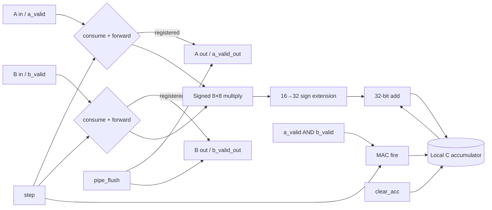
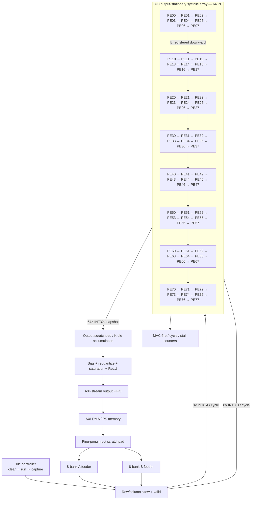

# PE ve 8×8 Systolic Array — Tasarım Kararı ve Repo İncelemesi

İnceleme tarihi: 2026-09-02  
Hedef: PYNQ-Z2 / XC7Z020, 100 MHz başlangıç hedefi  
Mimari karar: signed INT8 × signed INT8, signed INT32 accumulator, output-stationary, 8×8 / 64 PE

## Sonuç

Projede kullanılacak doğru başlangıç noktası, her PE'nin bir C elemanını yerel accumulator'da
tuttuğu output-stationary bir ağdır. A sağa, B aşağı akar; yalnız iki operand valid olduğunda MAC
çalışır. Array RTL'i AXI, DMA ve CNN katman kontrolünden ayrılmıştır. Bu ayrım PE/mesh doğrulamasını
basit tutar ve daha sonra BRAM feeder, requantization ve AXI wrapper eklenmesini kolaylaştırır.

Vault'taki kodlardan doğrudan modül kopyalanmadı. Bazı repolarda açık lisans yok; ayrıca arayüz ve
sayısal kontratlar hedef projeyle uyuşmuyor. Yeni RTL temiz-kaynak yazıldı, referanslar yalnız karar
ve risk girdisi olarak kullanıldı.

## Vault repo taraması

| Repo / incelenen commit | Gerçek kapsam | Alınan fikir | Neden RTL taşınmadı |
| --- | --- | --- | --- |
| `jkhlim125/Systolic-Array-Accelerator` / `d43b4ce36a08` | Verilog 4×4 output-stationary PE, loader, FSM, collector ve trace | Ayrı A/B valid, yerel psum, generate mesh, diagonal wavefront, MAC activity trace | `enable` forwarding'i durdurmuyor; K=array boyutuna bağlı; 24-bit accumulator; entegrasyon backpressure'sız. Pyslang: 0 hata, 23 uyarı |
| `ridash2005/...CNNs` / `efba48bc6137` | Parametrik rectangular mesh, 3-stage PE, serial I/O, testbench/UVM/ASIC akışı | Rectangular parametreleme, çarpım pipeline'ı, self-checking/random test ve partial-shape fikri | Operand valid yok; zero-padding'e güveniyor. Serial wrapper geniş data bus'ını CDC protokolü olmadan geçiriyor. Pyslang: 0 hata, 18 uyarı |
| `diwu1990/uSystolic-Sim` / `e86ae3963b4a` | Weight-stationary simülatör ve 8/16-bit, 4/8/16/32 boyutlu SV synthesis örnekleri | Giriş/ağırlık/çıkış kontrol yollarını ayırma; gerçek bandwidth, utilization, energy modelleme | Projenin output-stationary MVP'sinden farklı; unary/temporal hesap odaklı. `array_8.sv` genvar'ları yeniden tanımlıyor. Pyslang: 0 hata, 19 uyarı |
| `jiaaom/HPDLA` / `6ca5df3a2ef4` | Chisel PE/tile generator, UInt/SInt/FP backend fikri | Parametrik generator yaklaşımı ve weight-stationary seçeneği | Generated `Tile.v` içinde `reset` ve `io_weightEnable` kullanılmıyor; kaynak ile generated RTL uyumsuz. MAC yolu latched weight yerine doğrudan input weight kullanıyor; valid/clear yok. Pyslang: 0 hata, 6 uyarı |
| `Mattjesc/Efficient-FPGA-CNN-Accelerator` / `92069e1e7d5e` | Direct convolution, pool, ReLU, quantizer; systolic değil | Line/window buffer'ın array'den ayrı tutulması gerektiğine dair karşı-örnek | 9 MAC kombinasyonel döngüde 16-bit değişkende toplanıyor; signed arithmetic shift uyarısı var; raporlanan DSP=0. Pyslang: 0 hata, 27 uyarı |
| `Charan-Yakasiri/...MNIST...` / `bfa4dcb3262e` | Sabit LeNet RTL ve AXI-stream benzeri giriş wrapper'ı; systolic değil | Handshake ve numerical-contract testlerinin zorunluluğunu gösteren karşı-örnek | Derleme 12 hata/1117 uyarı; FC weight dizisi 480 eleman iken 719'a kadar erişiliyor, bir weight bankası atanmamış, valid semantiği gerçek handshake'ten kopuk |
| `ic-lab-duth/FusedGCN4HLS` / `f1e5fd74e2c6` | HLS C++, PE-local weight memory, K×M spatial unroll ve tiling | `active_row/active_col`, local weight reuse ve K/M tiling | GCN/float/HLS akışı; RTL modülü değil ve hedef CNN/GEMM kontratına doğrudan bağlanamaz |
| `horizon-research/systolic-array-dataflow-optimizer` / `c57dda765622` | Python dataflow, buffer, DRAM transfer, utilization ve cycle modeli | Array boyutunu yalnız PE sayısıyla değil buffer/bandwidth/utilization ile seçme | RTL değil; modern RTL üretim kaynağı olarak değil, erken mimari model olarak kullanılmalı |

## Kendi tasarımımıza giren parçalar

1. **jkhlim'den:** output-stationary veri akışı, ayrı A/B valid zincirleri ve diagonal wavefront
   gözlenebilirliği.
2. **ridash'tan:** `ROWS`, `COLS`, `K` ayrımı, self-checking golden matrix testi ve ileride
   multiplier pipeline ekleme yolu.
3. **uSystolic'ten:** kontrol ile verinin beraber ilerlemesi, 8×8'lik fiziksel konfigürasyonun
   erken denenmesi ve MAC utilization sayacı.
4. **FusedGCN4HLS'den:** partial tile ve local reuse yaklaşımı.
5. **dataflow optimizer'dan:** BRAM kapasitesi, dış bellek bant genişliği ve PE utilization'ın aynı
   tasarım denklemine konması.
6. **Mattjesc ve Charan'dan:** dar accumulator, belirsiz signed/Q formatı, sentetik valid üretimi ve
   yalnız waveform'a dayalı doğrulamanın kabul edilmemesi.

## PE sayısal ve kontrol kontratı

| Özellik | Karar |
| --- | --- |
| Aktivasyon / ağırlık | Two's-complement signed INT8 |
| Çarpım | signed 16 bit, tam hassasiyet |
| Accumulator | signed 32 bit |
| Dataflow | Output-stationary |
| Hareket | A bir hücre/çevrim sağa, B bir hücre/çevrim aşağı |
| MAC koşulu | `step && a_valid && b_valid && !clear_acc && !pipe_flush` |
| Stall | `step=0`: forwarding register'ları ve accumulator birlikte hold |
| Yeni dot product | `clear_acc=1`: yalnız accumulator temizlenir |
| Pipeline iptali | `pipe_flush=1`: A/B ve valid forwarding temizlenir |
| Reset | Tek clock-domain, synchronous active-low `rst_n` |
| Overflow | PE içinde 32-bit wrap; saturation/requantization array sonrasında |
| DSP hedefi | PE başına tam bir DSP48E1; 8×8 için 64 DSP |

INT32, tek 8×8 tile için fazlasıyla güvenlidir: en büyük tek INT8 ürün 16384, sekiz terimli pozitif
toplam 131072'dir. Daha uzun K boyutlarında tile sonuçları birleştirilirken accumulator bound'u
katman bazında ayrıca kanıtlanmalıdır.

## PE blok diyagramı



## 8×8 / 64 PE blok diyagramı



Not: Diyagramdaki satır okları A akışını, satırlar arasındaki oklar B'nin kayıtlı aşağı akışını
temsil eder. Her fiziksel PE kendi `(r,c)` C elemanını tutar.

## Zamanlama

Skew kuralı:

- `A[r,k]` sol kenardan `t=r+k` anında çıkar.
- `B[k,c]` üst kenardan `t=c+k` anında çıkar.
- İki operand `PE[r,c]` içinde `t=k+r+c` anında buluşur.
- Son MAC çevrimi `t=K+R+C-3`; toplam run penceresi `K+R+C-2` çevrimdir.

Tam 8×8, K=8 tile için run penceresi 22 çevrimdir. Referans wrapper'da ayrıca bir clear ve bir
capture çevrimi vardır; `start` kabulünden `c_valid`e 24 clock period sürer. Tek izole tile'ın run
utilization'ı `512 / (64×22) = %36,36` olur. Uzun K, arka arkaya tile ve ping-pong feeder ile fill/
drain maliyeti amorti edilmelidir.

100 MHz'te teorik tepe:

- 64 MAC/çevrim = 6,4 GMAC/s.
- Çarpma ve toplama iki ayrı operasyon sayılırsa 12,8 GOPS.
- Array kenar giriş ihtiyacı her aktif çevrimde 8 byte A + 8 byte B = 16 byte/çevrim, yani
  1,6 GB/s iç feeder bant genişliği.

Bu değerler teorik tavanlardır; AXI/DDR throughput'u değildir.

## İyi tasarım için gerekenler

### P0 — PE/mesh sign-off öncesi zorunlu

- Katman bazlı INT8 zero-point/scale, bias formatı, rounding ve saturation belgesi.
- PE unit test: `-128×-128`, `-128×127`, bubble, stall, clear, flush, reset ve overflow.
- 2×2 ve 8×8 bit-exact matrix testleri; random signed veri ve partial tile.
- Her PE için `K` adet, toplam `active_rows×active_cols×K` adet MAC-fire kontrolü.
- SVA: invalid iken accumulator hold; stall iken tüm state hold; clear önceliği; start-busy kuralı.
- Vivado OOC synthesis: 64 DSP48E1, latch=0, critical warning=0, WNS≥0 @100 MHz.
- Post-synthesis ve post-route timing; yalnız behavioral simulation yeterli değil.

### P1 — 8×8 motorun sistemleşmesi

- A ve B için en az sekizer okunabilir bankaya sahip ping-pong BRAM scratchpad.
- AXI DMA ile scratchpad arasında geniş burst; array içinde kesintisiz 16 byte/çevrim feeder.
- K>8 için output scratchpad accumulation veya PE `acc_seed/load_seed` yolu.
- Output FIFO ve `c_valid/c_ready`; array bittikten sonra güvenli backpressure.
- Bias → requantization → round → saturation → ReLU zinciri, golden model ile aynı bit kuralları.
- Partial row/column/K maskeleri ve padding'in valid üzerinden yapılması; sahte sıfırı valid saymama.
- Tile descriptor: base address, M/N/K, strides, quantization parametreleri ve last-tile maskeleri.
- Performance counter: active cycles, MAC count, feeder stall, output stall, tile count.

### P2 — optimizasyon ve fiziksel kapanış

- Uzun multiplier yolunda isteğe bağlı product pipeline; valid/clear kontrolü aynı gecikmeyle taşınmalı.
- Floorplan/Pblock ancak routed timing bunu gerektirirse; önce hiyerarşiyi koruyan synthesis raporu.
- Clock gating yerine CE/`step`; FPGA global clock ağını combinational logic ile kapatmama.
- Gerçek CNN katmanlarıyla bandwidth ve utilization modeli; 8×8 boyut kararını ölçümle doğrulama.
- Double buffering ve tile overlap; DMA, feeder, compute ve drain sürelerinin timeline analizi.

## Üretilen RTL yapısı

```text
systolic_array_8x8
└── systolic_tile_engine
    ├── tile capture + runtime shape registers
    ├── skewed edge feeder
    ├── clear/run/capture FSM
    └── systolic_array_os (8×8)
        └── 64 × pe_os
            ├── A/B forwarding registers
            ├── A/B valid forwarding registers
            ├── signed 8×8 multiplier
            └── signed 32-bit local accumulator
```

## Doğrulama sonucu ve dürüst sınır

- Yeni RTL + iki testbench, pyslang 11.0 ile parse ve elaborate edildi: **0 hata, 0 uyarı**.
- Bağımsız cycle model dört konfigürasyonda geçti: 8×8×8, 3×5×7, 1×1×1 ve 8×2×5.
- 8×8×8 modelinde 22 run çevrimi ve tam 512 MAC gözlendi.
- Bu makinede Icarus/Verilator/Vivado kurulu olmadığı için HDL behavioral simulation ve gerçek
  XC7Z020 synthesis çalıştırılamadı. `check_synth.tcl` özellikle bu kalan sign-off işini otomatik
  hale getirir ve DSP sayısı 64 değilse başarısız olur.

## Önerilen uygulama sırası

1. Mevcut PE yerine önce `pe_os.sv`yi bağımsız simüle et ve Vivado'da 1 DSP/PE'yi kanıtla.
2. `systolic_array_os.sv`yi 2×2 parametreyle wavefront + stall testi altında doğrula.
3. Sabit `systolic_array_8x8` top ile OOC synthesis çalıştır; 64 DSP ve 100 MHz kabul kapısı olsun.
4. Geniş demo tile portlarını banked BRAM feeder/collector ile değiştir.
5. K-tile accumulation ve requantizer ekle; Python integer golden modelle bit-exact bağla.
6. En son AXI DMA wrapper ve register map ekle; random backpressure testinden sonra board'a çık.
